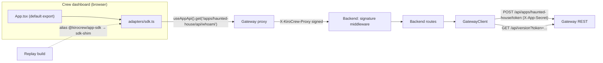

# Design Document

## Overview

Spec 1 gives Haunted House a working Crew app with no rooms yet: a manifest Crew 0.12.1 accepts, a Python backend that trusts only the gateway, one gateway client, a status page that can run live or from a recorded log, a local install script, and the tests, CI and Kiro hooks that guard them. The end-to-end proof is one status line on the page: "Backend reachable · Gateway 0.12.1". It needs the page, the signed proxy request, the app token exchange and one authenticated gateway call to all work.

Facts marked *verified* come from the day-one spikes or the 0.12.1 source (`.kiro/steering/tech.md`). Facts marked *ASSUMPTION* get a check in the task list.

## Architecture



- The dashboard imports `/apps/haunted-house/ui/<ui.entry>` and renders its default export (*verified* in the shipped demo app and AppHost). `ui.entry` resolves under the app's `ui/` folder, not the app root as the docs say (*verified*: `dist/index.mjs` was served at `/apps/hh-spike/ui/dist/index.mjs`).
- Crew starts the backend as `<gateway python> -s app/backend/main.py` with cwd at the app root, and passes `PORT`, `KIROCREW_PROXY_SECRET`, `KIROCREW_GATEWAY_ORIGIN` and `KIROCREW_APP_NAME` (*verified*).
- Pure logic lives in `core/` (no network, filesystem or clock). Only `adapters/` and `server.py` touch the outside world.

## Components and Interfaces

### Repository files (Requirements 1, 2)

```
LICENSE  README.md  .gitignore  pyproject.toml  requirements-dev.txt
.github/workflows/ci.yml
.kiro/hooks/{kiro-tracked,test-core-on-save,tests-after-task,secret-guard}.json
app/app.json  app/assets/icon.png
app/backend/main.py  app/backend/haunted_house/{core,adapters}/  app/backend/haunted_house/server.py
app/backend/tests/{unit,property}/
app/ui/{package.json,package-lock.json,vite.config.ts,vite.replay.config.ts,vitest.config.ts}
app/ui/src/{App.tsx,core/,adapters/}  app/ui/replay/  app/ui/dist/index.mjs (committed)
scripts/{check-kiro-tracked.sh,secret_scan.py,check-bundle-imports.mjs,install-local.sh,test-all.sh}
fixtures/replay/demo.jsonl
```

- `.gitignore`: `kiro-docs/`, `node_modules/`, `__pycache__/`, `.venv/`, `.pytest_cache/`, `.hypothesis/`, `app/ui/dist-replay/`, `*.app_secret`, `.app_secret`. It never names `.kiro`.
- `pyproject.toml` (pytest and tool config) sits at the repo root, not in `app/`, so Crew never tries `pip install .` on the app.
- The GitHub repo is named `haunted-house`. The local working-folder name never appears in committed files.

`scripts/check-kiro-tracked.sh` builds the list `.kiro`, `.kiro/`, `.kiro/.probe` and every file under `.kiro/`, then pipes it to `git check-ignore --no-index -v --stdin`. `--no-index` reports ignore rules even for tracked files. Each hit prints `<source>:<line>:<pattern>  <path>` and the script exits 1. No hits means exit 0.

### Manifest (Requirement 3)

```json
{
  "name": "haunted-house", "version": "0.1.0", "displayName": "Haunted House",
  "description": "A spatial home for AI agents: rooms are spec phases, ghosts are agents, doors are your approvals.",
  "author": "Haunted House contributors", "license": "MIT", "minKiroCrewVersion": "0.12.1",
  "iconPath": "assets/icon.png",
  "backend": { "entryPoint": "backend/main.py", "type": "python", "port": "auto", "healthCheck": "/health" },
  "ui": { "entry": "dist/index.mjs", "pages": [{ "route": "/apps/haunted-house", "label": "Haunted House", "icon": "Ghost" }] },
  "permissions": { "api": ["/api/version", "/apps/haunted-house/api/*"] }
}
```

- `/api/version` is the smallest authenticated read in 0.12.1 (*verified*: not on the public path list, returns only `{"version"}`). It proves the token path end to end.
- `/apps/haunted-house/api/*` is listed because the dashboard's `useAppApi()` refuses any path not in `permissions.api` (*verified* in the 0.12.1 dashboard code).
- No `requirements.txt` in `app/`. The backend uses aiohttp from Crew's own interpreter (aiohttp 3.14.5, Python 3.12.16, *verified*), so enabling the app needs no pip download. The fallback, if a later Crew drops aiohttp, is an `app/requirements.txt`, which Crew provisions with pip (*verified* in source).
- `tests/unit/test_manifest.py` checks Requirement 3 and Crew's documented rules: kebab-case name, semver, required non-empty strings, relative contained paths, every page has `route` and `label`, no `autoApprove` anywhere. It also checks that the manifest's `permissions.api` equals the client's route prefixes plus the own-backend prefix (see `ROUTES` below).

### Backend core (Requirement 5, 6)

`haunted_house/core/proxy_signature.py`

```python
WINDOW_SECONDS = 60
class Verdict(Enum): ACCEPT, MISSING, MALFORMED, STALE, MISMATCH, NO_SECRET

def sign(secret: str, ts: int, method: str, target: str, body: bytes) -> str: ...
    # returns "<ts>:<hex hmac>"; hmac = HMAC-SHA256(secret, f"{ts}:{method}:{target}:{sha256(body).hex}")
def verify(header: str | None, *, method: str, target: str, body: bytes,
           secret: str | None, now: float) -> Verdict: ...
```

- Order: `NO_SECRET` if the secret is empty; `MISSING` if no header; `MALFORMED` unless the header is `^\d{1,12}:[0-9a-f]{64}$`; `STALE` if `abs(now - ts) > 60`; `MISMATCH` unless `hmac.compare_digest` matches. Never raises.
- `target` is the raw path plus raw query exactly as received (`request.raw_path`), matching what the gateway signs (*verified*).
- Only the v1 header is checked. Crew also sends a replay-proof v2 signature with a nonce. Checking it needs a nonce cache; deferred (see Decisions).

`core/scope.py`: `path_allowed(prefixes, path) -> bool`, using the dashboard's matching rules (*verified*): exact match, `p/` children, `p/*` meaning `p` and children, trailing `*` as a raw prefix. Paths with `..`, `\`, or a scheme or host are never allowed.

`core/urls.py`: `with_token(path_and_query, token) -> str`. Drops any existing `token` parameter, appends `token=<percent-encoded>`, keeps the other parameters in order.

`core/redact.py`: `redact(text, secrets) -> str`. Replaces every occurrence of each secret, and of its percent-encoded form, with `[redacted]`.

### Backend server (Requirement 5)

`haunted_house/server.py` builds an aiohttp `web.Application`:

- Middleware: paths under `/api/` get `verify(...)` with `now=time.time()`. Anything other than `ACCEPT` returns `401 {"error":"bad_proxy_signature"}` before routing. The reason is logged at debug level without the header value. `/health` and unknown non-`/api/` paths skip the check (unknown paths return 404).
- Routes: `GET /health` returns `{"status":"ok"}`. `GET /api/whoami` returns `{"backend":"ok","gateway":{"version":...}}` or `{"backend":"ok","gateway":{"error":"timeout"|"unreachable"|"denied"|"config"}}`.
- Body limit 1 MiB (aiohttp default). Binds `127.0.0.1:$PORT` only. `main.py` adds its own folder to `sys.path`, checks that aiohttp imports (exits 1 with a clear log line if not), and calls `server.main()`.

### Gateway client (Requirement 6)

`haunted_house/adapters/gateway_client.py`

```python
ROUTES = {"version": ("GET", "/api/version")}   # every gateway path the app calls, in one place

class GatewayError(Exception):   # kind: "timeout" | "unreachable" | "denied" | "http" | "config"
    kind: str; status: int | None; code: str | None

class GatewayClient:
    def __init__(self, settings: Settings, session: aiohttp.ClientSession, allowed: list[str]): ...
    async def call(self, route: str, body: dict | None = None, timeout: float = 30) -> dict: ...
```

- `Settings` comes from env. The origin must be `http://127.0.0.1:<port>`, `http://localhost:<port>` or `http://[::1]:<port>`. Anything else is a `config` error, so the secret is never sent off the machine.
- Token: obtained on first need with `POST /api/apps/haunted-house/token` and header `X-App-Secret`, cached in memory only. On a 401 or 403 from the target call: drop the token, get a new one, retry once. A second failure returns `GatewayError("denied")`.
- Before any request, `path_allowed(allowed, path)` must be true (`allowed` is read from the installed `app.json`). Otherwise it raises `GatewayError("config")` with no network call. A wrong path then fails in tests, not as a 403 in front of a judge.
- Every log line, exception message and returned error passes through `redact(..., [secret, token])`. URLs are logged as path only, never with the query.

### UI (Requirements 4, 7)

- `src/adapters/sdk.ts` is the only file that imports `@kirocrew/app-sdk`. It re-exports `useAppApi` and `useAppEvents`, and adds `useBackendStatus()`, which calls `/apps/haunted-house/api/whoami` through `useAppApi()`. `src/adapters/app-sdk.d.ts` declares types for the hooks we use (no published types exist).
- `src/App.tsx` default-exports `HauntedHouseApp`, a status panel with two rows: Backend and Gateway. Each row shows its state as text plus an icon, never color alone (steering). Spec 1 uses no `@kirocrew/app-sdk/ui` components, so the replay stand-in doesn't need them.
- `vite.config.ts`: library build of `src/App.tsx` to `dist/index.mjs`, with `react`, `react-dom`, `react/jsx-runtime`, `lucide-react` and `/^@kirocrew\/app-sdk/` external. `package.json` has no `@kirocrew/app-sdk` entry (the scaffold's peer entry breaks `npm install`, *verified*). Dev React types pin to 18.3, matching the host's React 18.3.1 (*verified*).
- `vite.replay.config.ts`: app build rooted at `replay/`, alias `@kirocrew/app-sdk` → `src/adapters/sdk-shim/index.ts`, React bundled, output `dist-replay/` (not committed; spec 7 publishes it).
- `src/adapters/sdk-shim/index.ts` loads `./fixture.jsonl` (copied from `fixtures/replay/demo.jsonl`), schedules each frame by its recorded time, and calls the subscribers of that frame's `type` with `frame.data`. `useAppApi().get('/apps/haunted-house/api/whoami')` returns `{"backend":"replay","gateway":{"version":"replay"}}`. *ASSUMPTION*: the live `useAppEvents` callback receives `frame.data`. Spec 1 subscribes to no events; spec 2 confirms this with a live capture.
- `scripts/check-bundle-imports.mjs` parses `dist/index.mjs` with `es-module-lexer` (static and dynamic imports) and fails on any bare specifier that isn't a host module.

### Install script (Requirement 8)

`scripts/install-local.sh` (bash, `set -euo pipefail`):
1. Checks `kirocrew --version` ≥ 0.12.1 (`sort -V`), `node`, `npm` and `git`, and that `GET http://127.0.0.1:${KIROCREW_PORT:-5476}/api/health` answers. Each failure prints what's missing and how to fix it, then exits 1.
2. Runs `npm ci && npm run build` in `app/ui`.
3. If `kirocrew app info haunted-house` exits 0, runs `kirocrew app update --source "$APP_DIR" haunted-house`. Otherwise runs `kirocrew app install "$APP_DIR"` (exit codes *verified*).
4. Prints the dashboard steps: Apps → Library → Haunted House → Enable, accept the trust prompt, and approve new permissions after later updates.

It never calls `kirocrew config`, `/enable`, `/api/chat/mode` or anything that touches trust. A test fails if any of those strings appear in the script.

### Secret scan (Requirement 10)

`scripts/secret_scan.py` (stdlib only, Python 3.12+). One pattern table serves CI, the Kiro hook and the tests:

- Patterns: private key headers, AWS access key IDs, GitHub tokens (`gh[pousr]_`, `github_pat_`), Slack tokens (`xox[abprs]-`), JWT-shaped strings, Crew secret env names with values (`KIROCREW_PROXY_SECRET=`, `X-App-Secret:` followed by a value), and generic `api_key|secret|token|password` assignments with 16+ character literals.
- Fixture rule: files under `fixtures/` or `spikes/fixtures/` also fail on absolute home paths (`/Users/<name>/`, `/home/<name>/`, `C:\Users\<name>\`).
- `.app_secret` files fail by name.
- Output: `<file>:<line>: <pattern name>`. It never prints the matched text.
- Modes: default scans `git ls-files`. `--hook` reads a Kiro PreToolUse event from stdin, scans every string inside `tool_input`, and exits 2 with a message on stderr if anything matches.

A Python scanner beats gitleaks here: gitleaks isn't installed locally, its GitHub Action needs a license for organizations, and the hook and CI need the same rules.

### Kiro hooks (Requirement 11)

| File | Trigger | Matcher | Command |
|---|---|---|---|
| `kiro-tracked.json` | `PostFileSave` | `(^|/)\.gitignore$` | `scripts/check-kiro-tracked.sh` |
| `test-core-on-save.json` | `PostFileSave` | `(^|/)app/ui/src/core/.+\.tsx?$` | `npm --prefix app/ui run test:core` |
| `test-core-on-save.json` | `PostFileSave` | `(^|/)app/backend/haunted_house/core/.+\.py$` | `scripts/test-py.sh -q -m core app/backend/tests` |
| `tests-after-task.json` | `PostTaskExec` (*verified*, timeout 300 s) | none | `scripts/test-all.sh` |
| `secret-guard.json` | `PreToolUse` | `write` | `python3 scripts/secret_scan.py --hook` |

Kiro file-save triggers fire only on agent edits, not manual saves (hooks__types.md). CI runs the same checks for everything else. Writing files under `.kiro/hooks/` always prompts for approval (permissions.md), so expect prompts when the hooks are created.

### CI (Requirement 9)

`.github/workflows/ci.yml` runs on push and pull request, with three jobs:
- `python`: Python 3.12, `pip install -r requirements-dev.txt` (pytest, hypothesis, `aiohttp>=3.14,<3.15` to match Crew), then `pytest`.
- `ui`: Node 22, `npm ci`, `npm test`, `npm run build`, `node scripts/check-bundle-imports.mjs`, `git diff --exit-code app/ui/dist` (stale bundle, names the file), `npm run build:replay`.
- `repo`: `scripts/check-kiro-tracked.sh`, `python3 scripts/secret_scan.py`, `shellcheck scripts/*.sh`.

Local commands: `scripts/test-all.sh` runs `scripts/test-py.sh` (venv made with `uv venv --python 3.12`) and `npm --prefix app/ui test`.

## Data Models

- **Signed request:** `(method: str, target: str, body: bytes, header: "<ts>:<64 hex>")`.
- **Verdict:** `ACCEPT | MISSING | MALFORMED | STALE | MISMATCH | NO_SECRET`. Only `ACCEPT` reaches a handler.
- **GatewayError:** `kind`, optional `status` and `code`, and a message that is redacted at construction.
- **Replay frame (JSONL line):** `{"t": <unix seconds float>, "frame": {"type": <string>, "data": <any JSON>}}`. Same shape as the spike fixtures.

## Correctness Properties

*A property is a characteristic or behavior that should hold true across all valid executions of a system: a formal statement about what the system should do. Properties bridge human-readable specifications and machine-verifiable correctness guarantees.*

The five project-wide safety properties belong to later specs: the ghost-state reducer (spec 2), idempotent mansion creation (spec 3), and path confinement, approval matching and phase order (spec 4). The properties below guard spec 1's own trust boundary.

### Property 1: Signatures are accepted only inside the time window

*For any* non-empty secret, method, target, body and timestamp `ts`, and any verifier time `now`, `verify(sign(secret, ts, method, target, body), ...)` returns `ACCEPT` if and only if `abs(now - ts) <= 60`, and returns `STALE` otherwise.

**Validates: Requirements 5.2, 5.3**

### Property 2: Any change to a signed request is rejected

*For any* signed request and any single change to its method, target, body, timestamp or signature digits, or a different secret, `verify` does not return `ACCEPT`.

**Validates: Requirements 5.3, 5.5**

### Property 3: Malformed input is rejected without errors

*For any* header string (including empty, unicode, missing colon, non-numeric or huge timestamps, wrong-length or non-hex digests) and any secret, `verify` returns without raising. It returns `NO_SECRET` whenever the secret is empty, and never returns `ACCEPT` for a header that doesn't match `^\d{1,12}:[0-9a-f]{64}$`.

**Validates: Requirements 5.3, 5.4**

### Property 4: Unsigned API requests never reach a handler

*For any* path under `/api/`, method, body, and set of headers without a valid signature, the route handler is never called, and the backend responds 401, or 400 when the HTTP layer rejects the request line before routing (aiohttp's C parser does this for unknown methods). *For any* headers, `GET /health` responds 200.

**Validates: Requirements 5.1, 5.3, 5.4**

### Property 5: The token is placed in the query exactly once

*For any* path, any existing query string (including an existing `token` parameter) and any token, `with_token` keeps the path unchanged, keeps every other parameter in order, and contains exactly one `token` parameter, whose decoded value equals the token.

**Validates: Requirements 6.2**

### Property 6: The client never reveals the secret or token

*For any* secret and token of 8 or more characters, and any simulated gateway behavior (any status code, response bodies that echo the request URL and headers, timeouts, connection errors), no log record, exception message or returned value of the client contains the secret or the token, in raw or percent-encoded form.

**Validates: Requirements 6.4, 6.5**

### Property 7: At most one token refresh and one retry per call

*For any* sequence of gateway responses, one `call()` sends at most two requests to the target path and at most two token exchanges. It refreshes only after a 401 or 403, and a timeout from either request becomes `GatewayError("timeout")`.

**Validates: Requirements 6.1, 6.3, 6.5**

### Property 8: The client never calls outside the manifest scope

*For any* list of prefixes and any path, the client sends a request only if `path_allowed(prefixes, path)` is true. Otherwise it raises `GatewayError("config")` and makes no network call. `path_allowed` agrees with a reference model of the dashboard's matching rules.

**Validates: Requirements 3.3**

### Property 9: The secret scan finds credentials without printing them

*For any* generated credential matching a scanned pattern, placed on any line of arbitrary surrounding text, the scan reports that file and line number, and its output contains no substring of the credential longer than 4 characters.

**Validates: Requirements 10.1, 10.2, 11.4**

### Property 10: Home paths in fixtures are flagged

*For any* fixture text containing an absolute home-directory path, the scan reports the fixture. *For any* fixture text whose only home references use `~/`, the scan reports no home-path finding.

**Validates: Requirements 10.3**

### Property 11: Replay delivers each frame once, in order, to the right subscribers

*For any* list of frames with non-decreasing timestamps and any set of subscribed event types, the replay stand-in calls each subscriber exactly once per frame of its type, in file order, with that frame's `data`, and never for a frame of another type.

**Validates: Requirements 7.2, 7.3**

## Error Handling

| Situation | Behavior |
|---|---|
| `KIROCREW_PROXY_SECRET` missing | Backend starts; every `/api/` request returns 401 (`NO_SECRET`); one warning at startup |
| Gateway origin missing or not loopback | `whoami` reports `gateway.error = "config"`; the secret is never sent |
| Token exchange or call returns 401/403 twice | `gateway.error = "denied"`; UI says the app may need re-enabling or a permission approval |
| Gateway slow | 30 s timeout → `gateway.error = "timeout"` |
| aiohttp missing from Crew's interpreter | `main.py` exits 1 with a log line naming the fallback (`app/requirements.txt`) |
| Backend unreachable from the page | Backend row shows "Not reachable" with the HTTP status, if any |
| Bundle imports a non-host module | `check-bundle-imports.mjs` fails, naming the specifier |
| Install prerequisites missing | Script names the missing tool or version and exits 1 before changing anything |

## Testing Strategy

- **Property tests:** Hypothesis (Python, Properties 1 to 10) and fast-check (TypeScript, Property 11), at least 100 examples each. Property 4 drives the aiohttp test client with 50 examples. Each test carries a comment `Feature: crew-app-foundation, Property N: <title>`. Core property tests carry the pytest marker `core` so the save hook can select them.
- **Unit and example tests:** manifest rules; `check-kiro-tracked.sh` in temporary git repos (`.kiro/` ignored, `.kiro/specs/x.md` ignored by `*.md`, negation rule, clean repo); bundle import checker on sample modules; install script with a fake `kirocrew` on `PATH` (fresh install, update, too-old version, gateway down, forbidden strings); hook JSON files parse and name the expected triggers.
- **DOM tests:** Vitest with jsdom renders the live `App` with a mocked adapter (reachable, unreachable, gateway error). It also renders the replay entry with the stand-in and a fixture, checks it renders the same root component, and checks that every `fetch` goes to `./fixture.jsonl`.
- **Live check (manual, recorded in tech.md):** install on Crew 0.12.1, enable, open the page, see "Backend reachable · Gateway 0.12.1". This confirms the open assumptions: `useAppApi` accepts the own-backend prefix, and the hook trigger name.

## Decisions and open questions

1. **aiohttp from Crew's interpreter, not pip-provisioned:** no network or pip step at enable time. Risk: a future Crew drops aiohttp. Fallback documented above.
2. **Own secret scanner over gitleaks:** one rule set for the hook, CI and tests.
3. **v1 proxy signature only:** meets Requirement 5. The v2 replay-proof check needs a nonce cache and Crew's exact v2 format; revisit if time allows.
4. **`/api/version` as the authenticated probe:** least data of any authenticated route. Later specs add `/api/chat` and `/api/chat/*` and `sessionApproval`. Spec 7 freezes the final list before judges install.
5. **ASSUMPTIONS to confirm in the live check:** `useAppApi` accepts `/apps/haunted-house/api/*` (fallback: same-origin `fetch` inside the adapter); the `PostTaskExec` trigger name; `useAppEvents` delivers `frame.data` (spec 2).
