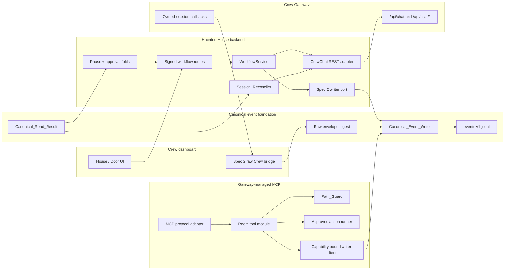
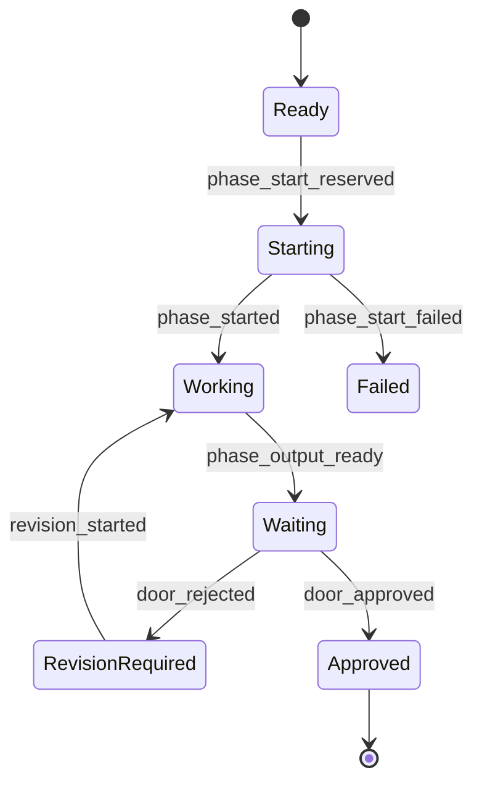
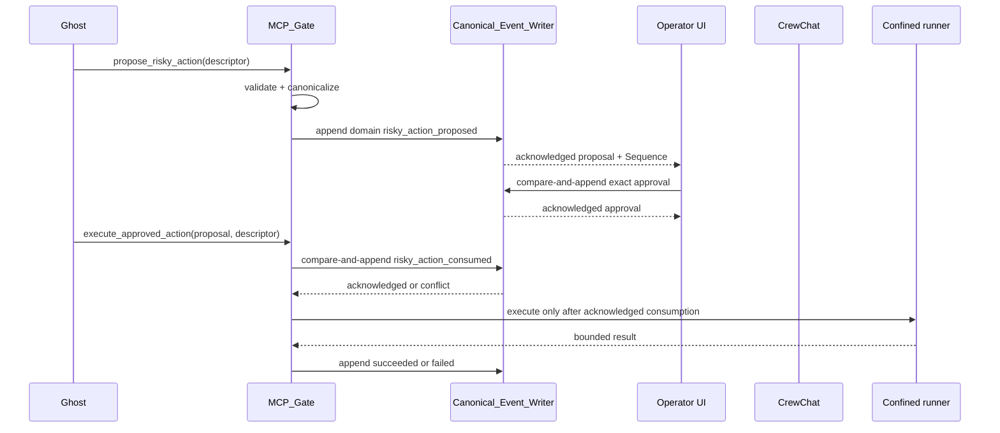

# Design Document

## Overview

Doors and Guardrails adds Haunted House's authority model on top of the canonical event foundation. It makes backend domain logic authoritative for phase order, Door decisions, exact risky-action approval, and room path policy. Every accepted workflow, Door, approval, action, denial, and outcome becomes a `domain_event_recorded` App_Event through the `Canonical_Event_Writer` from `seance-log-and-ghost-state`.

This feature owns no event envelope or event persistence implementation. It does not assign Event_ID, Record_ID, Sequence, persistence time, `prev_hash`, or `hash`; open an Event_Log; normalize a Crew envelope; or define replay order. Its Phase_State_Machine and Approval_Ledger filter acknowledged canonical events for `payload.domain == "doors_and_guardrails"`, validate the domain payload, and fold those records in canonical Sequence order. Projection_Version is the highest Sequence observed.

Runtime ghosts use app-owned Crew chat sessions, not `/api/spawn`. The browser forwards owned-session Crew callbacks to Spec 2's raw ingest route. This feature consumes the resulting canonical tool and approval events and uses bounded session history for exact `(slot, mid)` reconciliation. It never runs a second WebSocket normalizer. A future backend WebSocket optimization belongs to Spec 2 and must replace browser delivery.

A risky action executes only after an exact approval has been atomically consumed. Atomicity comes from Spec 2 `compare_and_append`: Spec 4 folds the current canonical projection, proposes one consumption candidate, and appends it only if the expected highest Sequence remains current. The MCP process never opens the log directly.

MVP includes requirements, design, tasks, and implementation phases; exact Door and risky approvals; app-owned sessions; guarded room tools; waiting UI; and domain replay from the canonical Event_Log. The Séance Room review-and-return loop remains stretch scope.

## Cross-spec ownership

| Concern | Owner | This feature's relationship |
|---|---|---|
| App_Event envelope, IDs, Sequence, hash fields, serialization | Spec 2 | Builds candidates only and consumes acknowledged records. |
| One Event_Log, writer lock, append, compare-and-append, read, integrity | Spec 2 | Uses `Canonical_Event_Writer`; defines no store or log path. |
| Crew raw-envelope normalization and reconnect catch-up | Spec 2 | Consumes canonical Crew events; requests bounded reconciliation through Spec 2. |
| Ghost state and canonical replay order | Spec 2 | Joins Ghost_Snapshot into workflow UI; does not reduce Crew frames. |
| Phase, Door, approval, action, and guardrail payloads and folds | Spec 4 | Owns domain validation, transition rules, matching, and authorization. |
| Room roles, task claims, artifact validation, terminal outcome | Spec 5 | Consumes this feature's authority interfaces after Spec 4 is complete. |
| Spatial house and interruption presentation | House UI spec | Consumes projections and exact command callbacks. |

Dependency order is `crew-app-foundation` → Spec 2 → Spec 4 → Spec 5. Spec 2 must provide the writer and canonical read result before any Spec 4 mutation can be accepted. Spec 5 must not start until Spec 4 provides workflow, approval, CrewChat, and MCP authority interfaces.

## Research findings and constraints

- Only `permissions.api` is currently enforced by Crew. Manifest declarations remain minimal, while MCP_Gate, Path_Guard, and approval folds remain primary authority.
- Crew custom agents need explicit skill and steering resources. Profiles use exact MCP selectors, V3 deny rules, no `autoApprove`, and empty legacy `allowedTools`.
- Hooks and Crew's approval floor are secondary controls. MCP_Gate and Path_Guard repeat checks even when a hook did not run or Crew already approved a tool.
- S6 verifies app-owned session setup order and exact permission fields. `mid` identifies a permission message; `approval_id` may repeat and is used only when answering Crew.
- S6 also verifies that the browser/app can observe owned-session events. Under the reconciled contract, the browser forwards those raw envelopes to Spec 2 and this feature reacts only after canonical acknowledgment.
- S9 must establish portable app-MCP launch and trusted session identity. A failure blocks mutation tools.
- S10 must establish command confinement. A failure disables command and git actions but leaves guarded delete available.

## Architecture



### Trust seams

1. **Browser to backend:** Foundation proxy verification runs before workflow or Spec 2 ingest handlers. Browser values remain untrusted and receive shape, length, enum, Mansion, digest, and Projection_Version validation.
2. **Backend to Crew:** The implemented GatewayClient centralizes app-token acquisition, loopback restriction, route allowlisting, timeout, and redaction. CrewChat adds typed dynamic chat routes.
3. **Crew event delivery:** The browser packages subscribed type plus callback data and sends it to Spec 2. Spec 2 validates scope, normalizes, persists, and returns canonical events. Spec 4 sees no raw frame.
4. **Ghost to MCP:** Trusted launch context binds one session, Ghost, Mansion, and Room. Tool names and arguments are untrusted. The model cannot choose authority fields.
5. **MCP to canonical writer:** A capability-bound backend operation exposes candidate append/compare-and-append, not a filesystem path or file handle. Spec 2 remains the only writer.
6. **MCP/backend to project files:** Guarded filesystem operations use canonical containment, descriptor-relative traversal, no-follow checks, and hard-link rejection.
7. **Approved process to host:** Structured command and git actions run only when S10's confinement adapter is available.

## Domain event payloads

Every Spec 4 record is an App_Event_Candidate with `event_type = "domain_event_recorded"`, `source.origin = "house"`, and:

```python
@dataclass(frozen=True)
class GuardrailDomainPayload:
    domain: Literal["doors_and_guardrails"]
    kind: GuardrailEventKind
    entity_id: str
    data: Mapping[str, JSONValue]
```

`GuardrailEventKind` includes phase reservation/start/failure/output readiness, Door proposal/supersession/approval/rejection, risky proposal/approval/rejection/consumption/denial/success/failure, Crew approval reconciliation, path denial, spec-write preparation/completion/recovery, and explicit stretch return decisions. Payload builders accept typed values and emit content-free bounded data. Spec 2 validates the outer canonical envelope and performs final deep redaction.

The domain does not define a second `SeanceEvent` dataclass. A domain record's acknowledged App_Event supplies Event_ID and Sequence. Domain entity identifiers and command identifiers remain payload data used by the Spec 4 fold.

## Workflow model

The initial projection has `requirements=ready`, later phases `not_started`, and every Door `sealed`.



Door edges are fixed:

```text
requirements -> design -> tasks -> implementation
```

Approving a Door makes only its immediate successor `ready`. A separate Phase_Start_Command is required to start it. `room-ghosts` validates the Phase_Output before this feature accepts `phase_output_ready`; transport `crew_turn_ended` never does so.

A phase start uses a reservation record before external Crew setup. The workflow service:

1. reads the current Canonical_Read_Result;
2. validates the command and builds `phase_start_reserved`;
3. compare-and-appends against Projection_Version;
4. creates and binds the Crew slot;
5. appends `phase_started`, or appends `phase_start_failed` with a safe code;
6. sends the turn only after binding succeeds.

The state machine is pure. It filters Spec 4 domain records from selected canonical App_Events and consumes them in Sequence order. Invalid domain transitions produce a diagnostic and preserve the preceding valid domain projection. Integrity and ordering remain Spec 2 concerns.

## Approval and action model

### Exact Door decisions

A Door_Proposal binds proposal ID, phase, exact Spec_Document path, Artifact_Revision, and creation Sequence. A decision request also carries expected Projection_Version. The service compares every field and uses compare-and-append. Concurrent decisions race on the same expected Sequence; exactly one can append.

### Exact risky actions



Approval is necessary but insufficient. Trusted session identity, descriptor digest, Room_Policy, Project_Path, action kind, arguments, working directory, path intents, and confinement availability must all match. A failed execution remains consumed.

### Crew Session_Approval reconciliation

Spec 2 canonical events preserve Crew permission facts keyed by `mid`. Session_Reconciler reads those events and, when needed, asks the bounded CrewChat history operation for the original message. Recovered raw history facts are submitted to Spec 2's ingest/normalizer path, not interpreted by Spec 4.

An app decision is appended canonically before CrewChat answers the permission. An external Crew resolution becomes a Spec 4 domain decision only when `(slot, mid, tool_name, Action_Digest)` identifies one pending proposal. The first compare-and-append wins. An unmatched external outcome records `approval_resolution_ignored` and grants no authority.

## Components and Interfaces

### Canonical writer port

Spec 4 depends on, but does not implement:

```python
class CanonicalEventWriter(Protocol):
    async def append_candidates(
        self, mansion_id: str, candidates: Sequence[AppEventCandidate]
    ) -> AppendResult: ...

    async def compare_and_append(
        self,
        mansion_id: str,
        expected_sequence: int,
        candidates: Sequence[AppEventCandidate],
    ) -> AppendResult: ...

    async def read_after(
        self, mansion_id: str, after_sequence: int, limit: int
    ) -> CanonicalReadResult: ...
```

Backend services receive this interface. The MCP adapter receives a capability-bound client for the same backend operations after S9 proves identity. No Spec 4 class wraps a direct file writer.

### Pure workflow module

`app/backend/haunted_house/core/workflow.py`:

```python
class Phase(StrEnum):
    REQUIREMENTS = "requirements"
    DESIGN = "design"
    TASKS = "tasks"
    IMPLEMENTATION = "implementation"

class PhaseStatus(StrEnum):
    NOT_STARTED = "not_started"
    READY = "ready"
    STARTING = "starting"
    WORKING = "working"
    WAITING = "waiting"
    REVISION_REQUIRED = "revision_required"
    APPROVED = "approved"
    FAILED = "failed"
    DONE = "done"

class DoorStatus(StrEnum):
    SEALED = "sealed"
    WAITING = "waiting"
    OPEN = "open"
    REJECTED = "rejected"

def fold_workflow(events: Iterable[AppEvent]) -> WorkflowProjection: ...
def decide_transition(projection: WorkflowProjection, command: WorkflowCommand) -> TransitionResult: ...
def build_workflow_candidate(decision: DomainDecision) -> AppEventCandidate: ...
```

The module verifies `event_type`, domain, payload kind, and required payload fields but trusts Spec 2's acknowledged Event_ID and Sequence. Records from other domains are ignored. Projection_Version advances to the highest canonical Sequence observed, including records from other domains, so compare-and-append detects every intervening write.

### Pure approvals module

`app/backend/haunted_house/core/approvals.py`:

```python
def canonical_action(descriptor: ActionDescriptor) -> bytes: ...
def action_digest(descriptor: ActionDescriptor) -> str: ...
def fold_approval_ledger(events: Iterable[AppEvent]) -> ApprovalLedger: ...
def decide_consumption(ledger: ApprovalLedger, request: ExecutionRequest) -> ConsumeDecision: ...
def correlate_permission(message: PendingPermission, ledger: ApprovalLedger) -> Correlation: ...
```

Canonical action JSON uses UTF-8, NFC strings, sorted object keys, no floats, and no insignificant whitespace. The descriptor includes Mansion ID, session slot, Room, action kind, argument vector, guarded working directory, and every path intent. Shell strings and caller-supplied environments are rejected.

`decide_consumption` returns one domain candidate and expected Projection_Version only when the proposal is approved, unconsumed, and exactly matched. The caller must receive writer acknowledgment before dispatch.

### Path policy

`app/backend/haunted_house/core/path_policy.py` remains pure:

```python
class Access(StrEnum):
    LIST = "list"
    READ = "read"
    WRITE = "write"
    DELETE = "delete"
    COMMAND_READ = "command_read"
    COMMAND_WRITE = "command_write"
    GIT_WRITE = "git_write"

@dataclass(frozen=True)
class RoomPolicy:
    room: str
    allow: tuple[PathRule, ...]
    deny: tuple[PathRule, ...]

def parse_relative_path(raw: str) -> tuple[str, ...] | PathError: ...
def policy_allows(policy: RoomPolicy, access: Access, parts: tuple[str, ...]) -> bool: ...
def evaluate_path(evidence: PathEvidence, policy: RoomPolicy, access: Access) -> PathDecision: ...
```

Deny rules override allow rules. The backend supplies active spec identity. Every room denies `.haunted-house/**`, credential-shaped paths, symlinks, and paths outside the Mansion. Direct tools deny `.git/**`; only structured git action can request GIT_WRITE. Tinkers cannot write `.kiro/specs/**`; Spec 5 narrows Tinker policy further with a task claim.

### Guarded filesystem and action runner

`adapters/guarded_filesystem.py` parses paths, traverses relative to trusted directory descriptors, rejects symbolic and multiply linked files, verifies canonical containment, performs same-directory atomic replacement, and rechecks metadata. A spec write uses prepare/replace/complete domain records through the writer. Recovery compares the guarded artifact digest and appends recovered or uncertain evidence through the same writer.

`adapters/command_runner.py` supports:

- `delete_path`: one guarded file or empty directory;
- `run_command`: an allowlisted executable, exact argv, trusted environment, guarded cwd and path intents, timeout, and bounded output;
- `git_write`: only `add` and `commit` with exact pathspecs and message.

Push, force, reset, clean, branch deletion, hooks bypass, config changes, shell parsing, caller environment, and recursive delete are unsupported. If S10 cannot prove confinement, command and git return `confinement_unavailable` without starting a process.

### CrewChat and Session_Reconciler

`adapters/crew_chat.py` owns REST calls only:

```python
class CrewChat:
    async def create_bound_session(self, request: SessionRequest) -> SessionBinding: ...
    async def send_turn(self, binding: SessionBinding, text: str) -> TurnResult: ...
    async def get_session(self, slot: str) -> CrewSessionSnapshot: ...
    async def resolve_permission(self, permission: PendingPermission, decision: str) -> ResolveResult: ...
```

`create_bound_session` calls create slot, set project, set normal mode, then send turn. Dynamic values are validated and percent-encoded. App tokens remain in GatewayClient memory. There is no `CrewEventStream` in this feature.

`services/session_reconciler.py` consumes Spec 2 canonical approval events and bounded session snapshots. It requests Spec 2 reconciliation for raw history facts, then folds newly acknowledged canonical events. It owns proposal correlation and first-wins decisions, not source normalization.

### Workflow service

`services/workflow_service.py` coordinates pure decisions and adapters:

- `start_phase` reserves through compare-and-append, binds Crew, then appends start/failure;
- `submit_phase_output` accepts only a Spec 5 validated Artifact_Revision;
- `decide_door` compare-and-appends the first exact decision;
- `decide_risky_action` compare-and-appends the first exact decision and then answers Crew when matched;
- `consume_and_execute` compare-and-appends consumption before dispatch, then appends outcome;
- `projection` folds selected canonical events and propagates Spec 2 integrity status.

### MCP server

`app/mcp/server.py` is the stdio protocol adapter. `app/mcp/room_tools.py` is the tool module. Protocol parsing is separate from authorization. S9 must prove app-relative launch and trusted identity. Without it, mutation tools are absent.

| Tool | Archivist | Draughtsman | Foreman | Tinker |
|---|:---:|:---:|:---:|:---:|
| `list_room_files` | yes | yes | yes | yes |
| `read_room_file` | yes | yes | yes | yes |
| `write_spec_document` | requirements | design | tasks | no |
| `submit_phase_output` | yes | yes | yes | implementation result |
| `write_room_file` | no | no | no | yes |
| `propose_risky_action` | no | no | no | yes |
| `execute_approved_action` | no | no | no | yes |

Exact profile selectors and the server both enforce the catalog. Model-visible data never contains Session_Capability.

### Manifest

The final manifest adds gateway-managed agent, skill, and MCP resources; exact `/api/chat`, `/api/chat/*`, `/api/version`, and own-backend paths; `sessionApproval: true`; and only consumed advisory event names. It omits spawn/global-approval paths and every `autoApprove` field.

### Signed workflow routes

| Method and path | Purpose |
|---|---|
| `GET /api/mansions/{mansion}/workflow` | Fold current canonical records into workflow and approval projections. |
| `POST /api/mansions/{mansion}/phases/{phase}/start` | Explicit phase start with command ID and expected Projection_Version. |
| `POST /api/mansions/{mansion}/doors/{proposal}/approve` | Exact Artifact_Revision approval. |
| `POST /api/mansions/{mansion}/doors/{proposal}/reject` | Exact Artifact_Revision rejection. |
| `POST /api/mansions/{mansion}/approvals/{proposal}/approve` | Exact Action_Digest approval. |
| `POST /api/mansions/{mansion}/approvals/{proposal}/reject` | Exact Action_Digest rejection. |

Spec 2 owns event reads and integrity diagnostics; this feature adds no `/audit/verify` route. Mutation responses include acknowledged Event_ID, Sequence, Projection_Version, and updated projection. Stale versions return 409, invalid input 400, missing Mansion 404, unavailable canonical integrity 423, and Crew failures safe 502/504 responses.

### UI

The UI consumes backend WorkflowProjection and Spec 2 Ghost_Snapshot. It never appends domain events, normalizes Crew frames, or reduces approval state from raw callbacks. Decision callbacks carry exact proposal, digest/revision, and Projection_Version.

House Map and panels display text plus icons, complete proposal data, separate Approve/Reject controls, disabled approval for incomplete display, keyboard navigation, and focus restoration. `useNotify` is limited to waiting, blocked, and failed transitions and merges by Ghost for 10 seconds. `useNavBadge` counts unresolved operator actions.

Replay feeds the same UI projection from Spec 2 canonical records and the Spec 4 domain fold. It performs no Gateway or Backend request.

## Data Models

### Workflow projection

```python
@dataclass(frozen=True)
class WorkflowProjection:
    version: int                    # highest canonical Sequence folded
    phases: Mapping[Phase, PhaseView]
    risky_proposals: Mapping[str, RiskyProposal]
    pending_permissions: Mapping[tuple[str, str], PendingPermission]
    waiting_count: int
    integrity: Literal["valid", "corrupt", "uncertain"]
```

### Artifact and Door

```python
@dataclass(frozen=True)
class ArtifactRevision:
    revision: int
    sha256: str
    size_bytes: int

@dataclass(frozen=True)
class DoorProposal:
    proposal_id: str
    phase: Phase
    document_path: str
    artifact_revision: ArtifactRevision
    status: Literal["pending", "approved", "rejected", "superseded"]
    created_sequence: int
    decision_event_id: str | None
```

### Action and approval

```python
@dataclass(frozen=True)
class ActionDescriptor:
    schema_version: Literal[1]
    mansion_id: str
    session_slot: str
    room: str
    kind: Literal["delete_path", "run_command", "git_write"]
    working_directory: str
    arguments: Mapping[str, JSONValue]
    path_intents: tuple[PathIntent, ...]

@dataclass(frozen=True)
class ApprovalLedger:
    projection_version: int
    proposals: Mapping[str, RiskyProposal]
    decisions_by_command: Mapping[str, DecisionRef]
```

### Crew permission

```python
@dataclass(frozen=True)
class PendingPermission:
    slot: str
    mid: str
    approval_id: str
    tool_name: str
    tool_input: Mapping[str, JSONValue]
    action_digest: str | None
```

The lookup key is `(slot, mid)`. `approval_id` is response data, not identity.

## Correctness Properties

*A property is a universal behavior over generated domain inputs. Event serialization, hash integrity, Sequence assignment, Crew normalization, base Ghost reduction, and canonical live/replay ordering are tested only in Spec 2.*

### Property 1: Phase order and explicit advancement always hold

For any valid canonical domain history, a Phase can enter an active or terminal state only when every predecessor Door is open; approving one Door makes only the immediate successor ready and never working without a later Phase_Start_Command.

**Validates: Requirements 1.1, 1.3, 1.4, 1.5, 1.6, 1.7, 1.8, 12.1**

### Property 2: Workflow folding is deterministic over canonical Sequence

For any selected canonical App_Event sequence, repeated Spec 4 folds produce equal projections, Projection_Version equals the highest Sequence observed, records from other domains do not alter domain state, and an invalid Spec 4 transition preserves the preceding valid domain projection.

**Validates: Requirements 1.2, 1.9, 10.2**

### Property 3: A Door decision applies only to the current artifact revision

For any pending Door_Proposal and decision, the Door changes only when proposal ID, phase, path, revision, digest, and Projection_Version equal current state; changing the artifact creates supersession rather than approving old bytes.

**Validates: Requirements 2.1, 2.2, 2.3, 2.4, 2.5, 6.6, 8.3, 8.5**

### Property 4: The first exact Door decision wins

For any pending Door_Proposal and competing exact decisions using one expected Projection_Version, at most one compare-and-append succeeds and the folded outcome equals that acknowledged decision.

**Validates: Requirements 2.6**

### Property 5: Action canonicalization is stable and complete

For any valid Action_Descriptor, key order does not change canonical bytes or Action_Digest, changing any execution-relevant field changes the digest except for a cryptographic collision, and parse/canonicalize round trips preserve bytes.

**Validates: Requirements 3.1, 3.4**

### Property 6: A risky action never runs without one exact approval

For any execution request, authorization succeeds only when an acknowledged proposal with matching ID, digest, Mansion, Room, session, kind, arguments, working directory, and path intents is approved and unconsumed, and every Path_Guard decision allows it.

**Validates: Requirements 3.2, 3.3, 3.4, 3.7, 3.9, 6.8**

### Property 7: A risky approval is consumed at most once

For any approved proposal and any interleaving of execution claims and outcomes, exactly the first exact claim against the current Projection_Version can append `risky_action_consumed`; later claims fail, including after execution failure.

**Validates: Requirements 3.5, 3.6, 3.8**

### Property 8: Crew permission correlation requires message identity and exact action

For any pending permissions and risky proposals, an app or external decision resolves a proposal only when slot, `mid`, tool name, proposal ID, and Action_Digest identify one pending proposal; matching `approval_id` alone grants no authority.

**Validates: Requirements 4.1, 4.2, 4.5, 4.6**

### Property 9: Ghost access remains inside Effective_Room_Policy

For any Room_Policy, access kind, path evidence, and approval state, final authorization is true only when the path is canonically inside the Mansion, an allow rule grants access, no deny or Protected_Path rule matches, and any required risky approval is exact.

**Validates: Requirements 3.9, 5.3, 5.7, 5.9, 6.3, 6.4, 6.5, 6.8, 11.5, 11.6**

### Property 10: Traversal-shaped paths are rejected before access

For any path that is absolute or contains forbidden empty, dot, parent, backslash, NUL, control, or encoded traversal components, parsing returns PathError and no normalized Project_Path.

**Validates: Requirements 5.2**

### Property 11: Implementation concurrency never exceeds three

For any assignment queue and session lifecycle, the scheduler contains at most three implementation sessions in starting or working states.

**Validates: Requirements 7.9**

### Property 12: Invalid or stale workflow commands append no domain record

For any workflow mutation, invalid shape, unknown Mansion/Phase, malformed identity/digest, excessive length, illegal transition, or stale Projection_Version produces no App_Event_Candidate accepted by the writer; a valid command produces at most one acknowledged domain record per command ID.

**Validates: Requirements 8.2, 8.3, 8.4, 8.5, 8.6**

### Property 13: Non-decision UI activity cannot approve a proposal

For any UI projection and sequence of navigation, views, timers, `chat_done`, Ghost results, refreshes, or unknown UI events without an acknowledged approval domain record, every pending proposal remains unapproved.

**Validates: Requirements 9.9**

### Property 14: Waiting notifications obey the interruption window

For any time-ordered waiting, blocked, and failed transitions, the coalescer emits at most one toast per Ghost in each 10-second window, while Needs You equals current unresolved operator actions.

**Validates: Requirements 9.5, 9.6**

### Property 15: Spec 4 live and replay projections agree

For any valid selected canonical history, incremental Spec 4 folding and a fresh fold over the same Sequence-ordered domain records produce equal Phase, Door, Waiting_State, proposal, approval, consumption, and outcome projections.

**Validates: Requirements 10.4, 10.5, 10.6**

### Property 16: Domain payload builders exclude sensitive or content-bearing fields

For any generated document body, token, secret, capability, credential-shaped value, encoded secret, and tool data, Spec 4 Domain_Event_Payload builders, DTOs, tool responses, and error values contain none of those values or document bodies and preserve only bounded typed summaries for Spec 2 final redaction.

**Validates: Requirements 10.3, 10.7, 11.8**

### Property 17: Stretch review cannot bypass an explicit return decision

For any workflow history and feature flag, review state is absent when disabled; when enabled, review cannot start before implementation output readiness, and failed review creates a pending return proposal without starting another Phase.

**Validates: Requirements 12.4, 12.5, 12.6**

## Error Handling

| Condition | Behavior | Canonical evidence |
|---|---|---|
| Predecessor Door sealed | Return 409; start no session. | Optional `phase_start_denied` domain record only when policy chooses to audit denials. |
| Stale Projection_Version | Return 409; append nothing. | Existing canonical history remains unchanged. |
| Stale proposal or digest | Return 409; preserve pending proposal. | Optional safe denial domain record through a fresh explicit command, never the stale mutation itself. |
| Competing decision | First acknowledged compare-and-append wins. | One decision domain record. |
| Unmatched Crew resolution | Grant no authority. | `approval_resolution_ignored`. |
| Browser event delivery disconnects | Mark uncertain; block decisions until Spec 2 catch-up. | Spec 2 owns transport diagnostics; Spec 4 propagates integrity. |
| Crew setup fails | Keep phase retryable only by explicit command. | `phase_start_failed` safe code. |
| `chat_done` arrives | Make no workflow or terminal transition. | Spec 2 `crew_turn_ended`; Spec 5 later settles output. |
| Invalid path or protected path | Deny before target access. | `path_denied` domain payload. |
| Writer unavailable or canonical integrity invalid | Refuse mutation and expose blocked state. | No alternate log or unlocked fallback. |
| Spec write crash | Recover by guarded digest inspection before another Door proposal. | Prepared then recovered/uncertain domain records. |
| Action fails after consumption | Do not restore approval. | Consumed then failed records. |
| Session identity unavailable | Expose no mutation tools. | Safe blocked domain record when writer is available. |
| Command confinement unavailable | Start no process. | `confinement_unavailable`. |
| Replay integrity diagnostic | Fold only Spec 2-authoritative records/prefix and show diagnostic. | No Spec 4 chain verification or repair. |

## Testing Strategy

### Property tests

- Hypothesis tests Properties 1–12, 15–17 in pure Python modules and modeled writer interfaces.
- fast-check tests Properties 13–14 in TypeScript UI core.
- Each property has one primary test with at least 100 examples and `Feature: doors-and-guardrails, Property N: <title>`.
- Spec 4 does not duplicate Spec 2 property tests for canonical serialization, Event_ID/Record_ID, Sequence/hash integrity, Crew normalization, Ghost_State, or base live/replay ordering.

### Integration tests

- Use a fake Canonical_Event_Writer to assert candidate payloads and acknowledgment order; use the real Spec 2 writer for cross-spec compare-and-append races and restart replay.
- Filesystem tests cover symlink/hard-link refusal, descriptor-relative races, atomic writes, recovery, and no target access on denial.
- Fake Gateway tests cover app-owned session setup order, interactive mode, history reads, exact approval bodies, and first-answer conflicts. Raw fixture frames pass through Spec 2 ingest once.
- MCP subprocess tests cover protocol framing, exact tools, absent/forged identity, path denial, exact approvals, and capability-bound writer access without a log file handle.
- UI tests cover proposal detail, text-plus-icon states, keyboard behavior, disabled unsafe approval, Needs You, notification coalescing, and no inferred approval.
- Replay tests load only a Spec 2 canonical fixture and compare the Spec 4 fold and TypeScript DTO projection. No test creates `seance.jsonl`, `seance_store.py`, a Spec 4 event parser, or a Spec 4 Crew normalizer.

### Requirements traceability

| Requirements | Design elements | Verification |
|---|---|---|
| 1 | Workflow core and service | Properties 1–2 |
| 2 | DoorProposal and compare-and-append | Properties 3–4 |
| 3 | Approvals core and runner | Properties 5–7 |
| 4 | Session_Reconciler and CrewChat | Property 8; fake Gateway |
| 5 | Path policy and guarded filesystem | Properties 9–10; race tests |
| 6 | MCP Gate and trusted identity | Properties 3, 6, 9; MCP tests |
| 7 | CrewChat plus Spec 2 event flow | Property 11; cross-spec integration |
| 8 | Signed workflow routes | Property 12; endpoint tests |
| 9 | House/decision UI | Properties 13–14; DOM tests |
| 10 | Domain payloads and folds over canonical records | Properties 15–16; replay parity |
| 11 | Profiles and fail-closed composition | Properties 6, 9, 16; static/bypass tests |
| 12 | MVP dependency and stretch return | Properties 1, 17 |

## Design Decisions and required spikes

1. **Spec 2 is the only event and storage owner.** Spec 4 uses its canonical envelope, writer, Sequence, integrity result, and replay order.
2. **Approval state is a fold, not a store.** Approval_Record and Action_Record are domain payloads inside canonical App_Events.
3. **Atomic consumption uses compare-and-append.** The shared writer lock prevents double consumption without exposing storage internals.
4. **Crew normalization stays in Spec 2.** Session_Reconciler owns domain correlation only. There is no Spec 4 CrewEventStream.
5. **All symlinks and multiply linked files are rejected.** The smaller invariant is easier to audit.
6. **Actions use structured argv and trusted environment.** Arbitrary shell strings are unsupported.
7. **S9, MCP identity:** Must prove trusted app-relative launch and session binding. Failure blocks mutation tools.
8. **S10, process confinement:** Must prove host confinement. Failure disables command and git actions.
9. **No native Kiro phase engine is assumed.** Haunted House writes compatible files and owns its phase projection.
10. **No `/api/spawn` fallback exists.** Runtime ghosts use app-owned chat sessions only.
