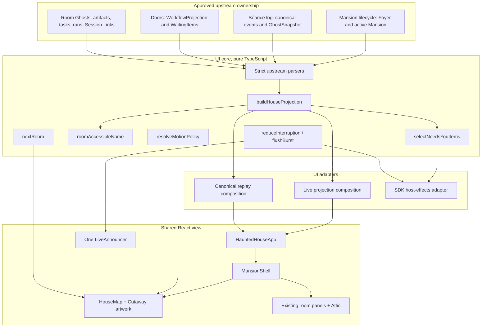

# Design Document

## Overview

House UI and Accessibility is the presentation and interaction layer that turns the approved Haunted House subsystems into one spatial product. The existing Foyer remains the entry experience until an Operator opens a Mansion. The open Mansion then renders one cutaway house whose rooms, doors, ghosts, artifacts, waiting items, and replay state come from the approved upstream projections. The UI never owns a second workflow state, infers an approval, or treats transport completion as artifact success.

The visual design uses original inline SVG and plain CSS. Semantic HTML remains independent of the drawing: the house is a navigation landmark containing an ordered list, and each room list item contains keyboard-operable room, ghost, and door controls. Large layouts position those controls as a cutaway house. Narrow layouts reflow the same list into a single column without changing DOM or reading order.

MVP rooms are Foyer, Study, Drafting Room, Workshop, and Attic. A build-time flag may show the Séance Room as a focusable locked room with plain explanatory copy. Enabling the review interface and adding opt-in sound remain stretch work. The MVP loads no audio.

Facts marked **verified** below come from checked-in code, approved specs, local Crew documentation, or workspace steering. Facts marked **assumption** require an executable spike before dependent implementation.

### Research findings

- `kiro-docs/crew__apps__sdk.md` documents dashboard hooks `useAppApi`, `useAppEvents`, `useTheme`, `useNavigate`, `useNotify`, and `useNavBadge`. It states that `useTheme` is reactive and identifies `mode`, `accent`, and `colorTheme`; that `useNotify` requests a toast; and that `useNavBadge` updates the sidebar badge. The document does not define the TypeScript field types for `Theme`, the notification option object, toast replacement semantics, badge cleanup semantics, or behavior in an app replay (**verified documentation gap**).
- `kiro-docs/crew__apps__sdk.md` says dashboard app hooks are supplied through the runtime import map. The foundation code enforces one import seam in `app/ui/src/adapters/sdk.ts`, and `app/ui/src/adapters/sdk-boundary.test.ts` rejects any other production SDK importer (**verified**). This feature extends that seam instead of importing the SDK from components.
- `kiro-docs/crew__apps.md` documents dashboard UI pages, host runtime loading, disabled-by-default third-party apps, and the fact that only `permissions.api` is currently enforced. `kiro-docs/crew__apps__manifest.md` documents `ui.entry`, app page fields, relative path validation, and the advisory status of event and storage declarations (**verified**). This visual feature needs no new Gateway API path.
- `kiro-docs/crew__apps__manifest.md` permits a host Lucide icon for the app page. The foundation Vite config marks `lucide-react` and all SDK imports external, and the bundle checker accepts only host modules and local chunks (**verified**). Functional state icons may use Lucide; the house, room, object, door, and ghost artwork remains original SVG.
- `.kiro/steering/theme-and-accessibility.md` sets the product rules used here: cozy-spooky tone, original SVG, Crew theme values, WCAG 2.2 AA contrast, state text plus icon or pose, two-second minimum animation cycles, no fast flashing/parallax/shake, Still House, complete keyboard behavior, one polite live region, waiting/blocked/failed interruptions, 10-second notification merging, and a needs-only badge (**verified project requirement**).
- `.kiro/steering/product.md` establishes the spatial-first product, MVP room list, six Ghost states, locked/stretch Séance Room, secondary chat links, and Attic replay (**verified project requirement**).
- `.kiro/specs/mansion-lifecycle/design.md` defines the Foyer and Mansion Shell seam. `.kiro/specs/seance-log-and-ghost-state/design.md` defines canonical Ghost snapshots and replay folding. `.kiro/specs/doors-and-guardrails/design.md` defines authoritative workflow, Door and waiting projections and sketches a House Map. `.kiro/specs/room-ghosts/design.md` defines joined room projections and artifact-first panels. Their UI tasks are roadmap placeholders; this specification owns the final shared visual shell and must compose their implemented contracts rather than create parallel reducers (**verified roadmap constraint**).
- Current `app/ui/src/App.tsx` is the foundation status panel. It already uses state text with hidden decorative icons, one polite live region, Crew-style CSS-variable fallbacks, and a two-second reduced-motion-aware loading animation. `App.states.test.tsx` enforces one live region and non-color state text. `replay.test.tsx` enforces the same root component and no replay transport beyond `./fixture.jsonl` (**verified starting point**).
- The current replay build aliases only exact `@kirocrew/app-sdk` to `src/adapters/sdk-shim/index.ts`. Any new host hook must therefore have a replay stand-in with the same local interface before the live app imports the hook through `sdk.ts` (**verified**).
- WCAG 2.2 sections 1.4.3 and 1.4.11 set the 4.5:1 normal-text and 3:1 non-text contrast thresholds used by steering. Section 1.4.10 motivates the 320 CSS-pixel reflow target, and sections 2.4.7, 2.4.11, and 2.4.13 inform visible, unobscured, sufficiently discernible focus indicators. Source: `https://www.w3.org/TR/WCAG22/`.

### Required SDK contract spike

**HUI-S1: Theme, toast, and badge hook contract.** Before integrating host hooks, an executable development-only probe must run against the supported local Crew version and record a scrubbed fixture that proves:

1. the exact `useTheme()` return shape and updates in light and dark modes;
2. the actual host CSS variable names and representative light/dark computed values available inside an app page;
3. the exact `useNotify()` call and option shape, whether a stable ID replaces an existing toast, and how cleanup behaves after unmount;
4. the exact `useNavBadge()` call shape, update behavior, zero/clear behavior, and unmount behavior;
5. that the replay SDK stand-in can expose matching no-network hook interfaces; and
6. that none of these hooks adds a Gateway permission or transport call from application code.

The fixture stores field names, primitive type categories, update counts, and synthetic labels only. It stores no token, secret, absolute home path, unrelated dashboard state, or raw theme stylesheet.

If toast replacement is available, the live adapter may show the first eligible event immediately and replace the same toast with the merged burst summary. If replacement is unavailable, the adapter waits until the 10-second burst closes and sends one summary. If theme values or badge clearing cannot be verified, dependent host integration remains blocked and the house uses no guessed signature. The visual fallback palette and in-page Needs You control remain testable, but they do not substitute for a required host contract.

## Architecture



### Ownership and seams

| Concern | Owning module | Rule |
|---|---|---|
| Mansion selection and return | `mansion-lifecycle` Foyer | Reuse the approved state and controls; do not clone the Foyer reducer. |
| Canonical Ghost state | `seance-log-and-ghost-state` | Consume `GhostSnapshot`; do not fold Crew frames in this feature. |
| Phase, Door, proposal, and waiting state | `doors-and-guardrails` | Consume authoritative projection and existing decision commands; opening a panel creates no decision. |
| Artifact, task, run, and Session Link data | `room-ghosts` | Reuse artifact-first room panels and secondary links. |
| Final spatial presentation | This feature's `HouseMap` module | Own room registry, art, labels, keyboard map, focus restoration, motion, responsive CSS, and panel composition. |
| Interruption decisions | This feature's `InterruptionPolicy` module | Pure function produces host-toast/live-announcement effects; adapters execute effects. |
| Host SDK effects | Existing `adapters/sdk.ts` seam plus `host-effects.ts` | Only the SDK seam imports `@kirocrew/app-sdk`; replay supplies inert host effects. |
| Replay source | Approved canonical replay adapter | Render the same shell and panels; no Gateway/backend fallback. |

The external interface of the House Map is intentionally small:

```typescript
interface HouseMapProps {
  projection: HouseProjection
  openSurface: (target: HouseSurfaceTarget, opener: HTMLElement) => void
  motion: EffectiveMotion
}
```

The module hides SVG geometry, responsive positioning, arrow adjacency, accessible labels, hotspot structure, and focus behavior. Deleting it would spread those rules across every room, so it forms a deep module rather than a collection of shallow visual wrappers.

### Rendering flow

1. `HauntedHouseApp` retains the foundation backend reachability gate.
2. Before Mansion entry, the existing Foyer renders.
3. After Mansion entry, the live or replay adapter validates upstream DTOs and calls `buildHouseProjection`.
4. Invalid or integrity-uncertain data produces an unavailable, read-only room projection with bounded text. It never fabricates a Door or Ghost state.
5. `MansionShell` renders the toolbar, Needs You shortcut, Still House toggle, House Map, active panel portal, and exactly one live announcer.
6. The House Map reads one static room registry. CSS places the same ordered list in a cutaway at wide widths and in one column at narrow widths.
7. User intent opens a room, ghost, or door surface. Existing room and decision modules execute actions. The House Map never calls approval endpoints.
8. Canonical state changes update visual state in place. Eligible transitions pass through the pure Interruption Policy before a host toast or live announcement occurs.

## Components and Interfaces

### Static room registry

`app/ui/src/core/house-registry.ts` defines the complete presentation registry and geometry. It contains no React or runtime state.

```typescript
type RoomId = 'foyer' | 'study' | 'drafting-room' | 'workshop' | 'attic' | 'seance-room'
type RoomPhase = 'navigation' | 'requirements' | 'design' | 'tasks-and-implementation' | 'replay' | 'review'

type ArrowDirection = 'ArrowUp' | 'ArrowDown' | 'ArrowLeft' | 'ArrowRight'

interface RoomDefinition {
  id: RoomId
  name: string
  phase: RoomPhase
  order: number
  scope: 'mvp' | 'stretch'
  neighbors: Partial<Record<ArrowDirection, RoomId>>
}

const HOUSE_ROOMS: readonly RoomDefinition[]
function nextRoom(room: RoomId, direction: ArrowDirection, visible: ReadonlySet<RoomId>): RoomId
```

The fixed MVP navigation map is spatial rather than list-based:

| Room | Up | Down | Left | Right |
|---|---|---|---|---|
| Foyer | Drafting Room | — | Study | Workshop |
| Study | Attic | — | — | Foyer |
| Drafting Room | Attic | Foyer | Study | Workshop |
| Workshop | Attic | — | Foyer | Séance Room when visible |
| Attic | — | Drafting Room | Study | Workshop |
| Séance Room | Attic | — | Workshop | — |

When the preferred neighbor is hidden, `nextRoom` follows the same direction through the static map once more; if no visible target exists, it returns the origin. Responsive reflow does not change this map, so a layout media query cannot silently change keyboard behavior.

### House projection

`app/ui/src/core/house-projection.ts` consumes already parsed upstream values. It does not import adapters or know DTO field spelling.

```typescript
type PresentationDoorState = DoorState | 'not_applicable'
type PresentationGhostState = GhostState | 'not_applicable'
type ProjectionIntegrity = 'valid' | 'uncertain' | 'corrupt' | 'incompatible'

interface RoomPresentation {
  roomId: RoomId
  phase: RoomPhase
  door: PresentationDoorState
  ghost: PresentationGhostState
  integrity: ProjectionIntegrity
  mutatingActionsEnabled: boolean
  diagnostic: string | null
  waitingItems: readonly WaitingItemView[]
  recoveryAction: RecoveryActionView | null
}

interface HouseProjection {
  mansionName: string
  rooms: readonly RoomPresentation[]
  needsYou: readonly NeedsYouItem[]
  replay: ReplayView
}

function buildHouseProjection(input: UpstreamHouseInput, options: HouseOptions): HouseProjection
function selectNeedsYouItems(rooms: readonly RoomPresentation[]): readonly NeedsYouItem[]
function roomAccessibleName(room: RoomPresentation): string
```

`buildHouseProjection` is an anti-corruption module over four upstream specs. It copies Door and Ghost enums exactly, inserts `not_applicable` only for registry entries that have no upstream entity, and disables mutation when any required integrity value is not `valid`. The module never changes an upstream `sealed`, `waiting`, `open`, `rejected`, `idle`, `working`, `blocked`, `failed`, or `done` value.

`selectNeedsYouItems` creates stable actionable identities:

- one item per unresolved Door, tool, or risky-action proposal identifier;
- one item per failed current run when an explicit recovery decision is available;
- no item for ordinary progress, open tools, completed work, or a blocked run without an Operator action;
- duplicates collapse by `(kind, authoritativeId)`;
- output follows Room_Order, then the upstream action order.

The accessible room label uses fixed copy:

```text
<Room name>. Phase: <phase>. Door: <door state or not applicable>. Ghost: <ghost state or not applicable>.
```

The visible state labels use the same formatter, which prevents accessible and visual terminology from drifting.

### Interruption Policy

`app/ui/src/core/interruption-policy.ts` is a pure state machine. It receives an injected observation time; it reads no clock and runs no timer.

```typescript
type InterruptState = 'waiting' | 'blocked' | 'failed'

interface InterruptionEvent {
  eventId: string
  ghostId: string
  ghostName: string
  roomId: RoomId
  state: InterruptState
  observedAtMs: number
}

interface InterruptionBurst {
  openedAtMs: number
  lastAcceptedAtMs: number
  events: readonly InterruptionEvent[]
}

interface InterruptionPolicyState {
  seenEventIds: ReadonlySet<string>
  burst: InterruptionBurst | null
}

type InterruptionEffect =
  | { kind: 'none' }
  | { kind: 'summary'; text: string; eventIds: readonly string[] }

function reduceInterruption(
  state: InterruptionPolicyState,
  event: CanonicalGhostTransition,
): { state: InterruptionPolicyState; effects: readonly InterruptionEffect[] }

function flushInterruption(
  state: InterruptionPolicyState,
  nowMs: number,
): { state: InterruptionPolicyState; effects: readonly InterruptionEffect[] }
```

Rules:

1. Only transitions whose destination is waiting, blocked, or failed enter a burst.
2. A previously seen canonical event ID is ignored for the mounted session.
3. A burst starts at the first eligible event and accepts distinct eligible events observed no more than 10,000 ms after its latest accepted event.
4. The adapter resets a single 10-second timer after each accepted event. `flushInterruption` emits once when `nowMs - lastAcceptedAtMs >= 10_000`.
5. If a later event arrives after a burst is eligible to flush, `reduceInterruption` emits the old summary and starts a new burst.
6. Summary construction groups events by Ghost in Room_Order, reports the latest state per Ghost, and includes the number of distinct canonical events. Copy is capped at 240 Unicode code points; overflow becomes `“N ghosts need attention. Open Needs you for details.”`
7. One summary effect feeds both the host-toast adapter and the one live announcer. The host adapter cannot create additional wording or eligibility.

This trailing-window interpretation ensures that a burst has one summary and that the summary is emitted within 10 seconds of the last accepted event. If HUI-S1 proves replaceable host toasts, the adapter may also display an immediate first toast and replace that same toast ID; this does not create a second visible toast.

### Motion Policy

`app/ui/src/core/motion-policy.ts` has a small pure interface:

```typescript
interface MotionInputs {
  stillHouse: boolean
  prefersReducedMotion: boolean
}

type EffectiveMotion = 'none' | 'low-frequency'

function resolveMotionPolicy(inputs: MotionInputs): EffectiveMotion
```

Any true suppression input returns `none`; only two false values return `low-frequency`. Components set `data-motion` on the Mansion Shell. CSS animation exists only under `[data-motion="low-frequency"]` and a `prefers-reduced-motion: no-preference` media query. Every optional loop lasts at least two seconds. No keyframe changes viewport position, scroll position, perspective, or pointer-relative transform. Focus, panel opening, state recognition, and decision controls require no animation.

The Still House toggle controls the current mounted app session. Browser preference remains authoritative even when the toggle is off. Persistence across browser sessions is deliberately absent from MVP because it would add a storage contract not requested by the product.

### SDK and host-effects adapters

The existing `app/ui/src/adapters/sdk.ts` remains the sole SDK importer. After HUI-S1 it may re-export normalized wrappers, not raw undocumented values:

```typescript
interface HostThemeSnapshot {
  mode: 'light' | 'dark'
  accent: string | null
  colorTheme: string | null
}

interface HostEffects {
  theme: HostThemeSnapshot
  notify(summary: HostSummary): void
  setNavBadge(count: number): void
  clearNavBadge(): void
}
```

`app/ui/src/adapters/host-effects.ts` turns pure effects into hook calls. It sets the badge from `projection.needsYou.length`, clears the badge on unmount, and forwards each summary to `useNotify` using only HUI-S1-proven options. Components never call the host hooks directly.

`app/ui/src/adapters/app-sdk.d.ts` is updated from the scrubbed spike contract. `sdk-boundary.test.ts` continues proving that only `sdk.ts` imports the host package. `src/adapters/sdk-shim/index.ts` provides reactive fixture theme state, records notifications and badge values only in tests, and performs no live transport. Production replay uses no-op toast/badge effects and renders the in-page Needs You count.

No new manifest API permission follows from these hooks. If implementation needs a new API path, the design must return for review rather than silently expand `permissions.api`.

### React shell and visual modules

```text
app/ui/src/
├── App.tsx
├── core/
│   ├── house-registry.ts
│   ├── house-projection.ts
│   ├── interruption-policy.ts
│   └── motion-policy.ts
├── adapters/
│   ├── sdk.ts
│   ├── app-sdk.d.ts
│   ├── host-effects.ts
│   └── sdk-shim/index.ts
├── components/
│   ├── MansionShell.tsx
│   ├── HouseToolbar.tsx
│   ├── HouseMap.tsx
│   ├── RoomHotspots.tsx
│   ├── RoomPanelHost.tsx
│   ├── LiveAnnouncer.tsx
│   └── house-styles.ts
└── rooms/
    ├── foyer/                 # approved mansion-lifecycle module
    ├── study/                 # approved room-ghost module
    ├── drafting-room/         # approved room-ghost module
    ├── workshop/              # approved room-ghost module
    ├── attic/AtticPanel.tsx
    └── seance-room/LockedSeancePanel.tsx
```

`App.tsx` remains the default export for live and replay bundles. It preserves backend loading, failure, and Retry behavior. It delegates Foyer and Mansion rendering after reachability is established.

`MansionShell` owns one open-surface state and an opener-element reference. A single `RoomPanelHost` renders the active Room, Ghost, or Door panel as a labelled modal dialog when the dashboard viewport can support an overlay, or as a labelled adjacent region on narrow screens. The focus contract is identical: opening moves focus to the panel heading or first decision control; Escape closes only the topmost surface; closing restores focus to the connected opener if present, otherwise to the corresponding Room_Control.

`HouseMap` renders:

```html
<nav aria-label="Mansion rooms">
  <ol>
    <li><!-- room button, optional ghost button, optional door button --></li>
    ...
  </ol>
</nav>
```

Every interactive depiction is a native `button`. Locked, uncertain, or replay-only items use `aria-disabled="true"` rather than the `disabled` attribute when the control still opens explanatory details. Mutation buttons that have no informative action use `disabled` and adjacent visible reason copy. Decorative SVG uses `aria-hidden="true" focusable="false"`; accessible names come from HTML labels, not SVG `<title>` values.

The Room_Control handles Arrow keys and Enter. Ghost and Door controls remain in ordinary Tab order but do not join the room-arrow group. The toolbar appears before the map and contains the active Mansion name, Needs You shortcut, Still House toggle, and compact system-status disclosure. The existing status details remain available without preceding the spatial map in an open Mansion.

The Needs You shortcut computes no state itself. When active, it opens the first target Room from `projection.needsYou`, then focuses that Room's first actionable control. When zero, it remains visible with `aria-disabled="true"` and changes no panel or focus state.

### Room integration

The feature reuses room modules as they become available:

- **Foyer:** existing list/create/open flow before Mansion entry; active-Mansion panel inside the house provides current Mansion identity and Return to Foyer.
- **Study:** requirements artifact, Archivist state, requirements Door, allowed write scope, existing approval/revision controls, and secondary Session Link.
- **Drafting Room:** design artifact, Draughtsman state, design Door, allowed write scope, existing approval/revision controls, and secondary Session Link.
- **Workshop:** task board, Foreman/Tinker states, task/implementation Door state, claims and queue, existing controls, and secondary Session Links.
- **Attic:** canonical Event Log replay status, valid-prefix diagnostics, and current replay-derived room/Ghost history. Search, filtering, export, and rich timeline controls remain stretch.
- **Séance Room:** focusable locked explanatory panel in the default build, or the upstream bounded review projection when the stretch flag is enabled.

Room panels receive authoritative action callbacks from upstream adapters. They do not receive generic `approve(id)` or raw path functions. Each decision interface retains its exact proposal identifier, revision/digest, projection version, and first-wins behavior from `doors-and-guardrails`.

### Original art and CSS

`components/house-art.tsx` contains repository-authored SVG primitives for the house frame, floors, roof, stairs, doors, furnishings, and Ghost silhouettes. The functional controls are HTML overlays; all art is decorative. No SVG `<image>`, remote URL, data-URI raster, script, animation element, external `<use>`, trademarked name, or copied path enters the source.

`components/house-styles.ts` exports one CSS string inserted by `MansionShell`, preserving the foundation's single ESM delivery. Vite must not emit a required standalone stylesheet. CSS declares semantic house variables that first reference the HUI-S1-verified Crew variables and then a fallback:

```css
--hh-surface: var(--verified-crew-surface, #fff8e8);
--hh-text: var(--verified-crew-text, #241b17);
--hh-focus: var(--verified-crew-focus, #005fcc);
```

Exact variable names replace the placeholders only after HUI-S1. Light and dark fallback palettes are data in `house-palette.ts`, allowing automated contrast calculation. State colors are accents only; shape, icon/pose, border style, and text carry meaning.

At 900 CSS pixels and above, CSS Grid positions rooms over the cutaway. Below 900 pixels, the same list uses a compact grid. At 640 pixels and below, it becomes one column. At a 320-pixel container width, controls use `min-width: 0`, long values use `overflow-wrap: anywhere`, and the page has no horizontal overflow. The panel width is bounded by `min(42rem, 100%)`.

### Live region, toast, and badge integration

`LiveAnnouncer` is mounted once in `MansionShell` and receives only the latest `summary` effect. No Room or upstream panel may add `aria-live`, `role="status"`, `role="alert"`, `role="log"`, `output`, or another implicit live-region role. Existing foundation status announcements move into this one shared region when Mansion Shell is active; before Mansion entry, the foundation status view remains the only live region.

A shell-level DOM invariant test counts explicit and implicit live regions for every fixture. Host toasts and live announcements share the exact pure summary. The badge updates immediately from authoritative Needs You items and does not wait for interruption bursts.

### Replay composition

Live and replay modes create the same `UpstreamHouseInput` after their respective adapters validate data. Replay uses the canonical Event Log parser/selector/reducer from `seance-log-and-ghost-state`, the workflow replay fold reconciled by the approved specs, and fixture-backed mansion data. It never opens a WebSocket or calls the own backend.

Replay host effects are inert: no host toast or sidebar exists, but the in-page Needs You count and live announcer still use the shared policy as fixture time advances. Every mutating action and Session Link is marked read-only. The Attic displays parser/integrity diagnostics and the exact valid prefix instead of hiding corruption.

### Requirements traceability

| Requirement | Design elements |
|---|---|
| 1 | App rendering flow, static room registry, House Map, room integration, artifact-first panel order |
| 2 | House Projection module, strict integrity handling, state formatters, upstream action callbacks |
| 3 | House registry navigation map, native controls, Mansion Shell panel stack, opener focus restoration, Needs You selector |
| 4 | Navigation-list markup, accessible label formatter, decorative-art rules, one Live Announcer, panel semantics |
| 5 | HUI-S1, House Palette, original inline SVG, plain inline CSS, contrast matrix |
| 6 | Stable DOM order, responsive CSS breakpoints, fixed navigation map, wrapping rules |
| 7 | Motion Policy, Still House state, media-query adapter, motion-gated CSS |
| 8 | Interruption Policy, Host Effects adapter, Live Announcer, Needs You selector, sidebar badge effect |
| 9 | Live/replay composition adapters, same root/shell/components, read-only replay, Attic diagnostics |
| 10 | Pure core interfaces, DOM/a11y harness, contrast and CSS contract tests, replay transport guards, HUI-S1 |
| 11 | Build-time scope flags, locked Séance panel, no MVP audio path, stretch interfaces isolated from MVP |

## Data Models

### Upstream house input

```typescript
interface UpstreamHouseInput {
  mansion: MansionView
  workflow: WorkflowProjection
  ghosts: ReadonlyMap<string, GhostSnapshot>
  rooms: ReadonlyMap<string, JoinedRoomProjection>
  replay: ReplayProjection
}

interface HouseOptions {
  seanceRoom: 'hidden' | 'locked' | 'enabled'
  mode: 'live' | 'replay'
}
```

The adapters validate DTOs before constructing this value. `HouseOptions` is application configuration, not an Operator-controlled authority value. `seanceRoom: 'enabled'` affects presentation only after the upstream review contract is enabled.

### House projection

```typescript
interface HouseProjection {
  mansionName: string
  mode: 'live' | 'replay'
  rooms: readonly RoomPresentation[]
  needsYou: readonly NeedsYouItem[]
  replay: {
    integrity: 'valid' | 'corrupt' | 'incompatible'
    validRecordCount: number
    diagnostic: string | null
  }
}

interface NeedsYouItem {
  id: string
  kind: 'door-decision' | 'tool-decision' | 'risky-decision' | 'failed-run-recovery'
  roomId: RoomId
  ghostId: string | null
  label: string
  actionAvailable: true
}
```

`rooms` follows visible Room_Order exactly. `needsYou` contains no duplicate `(kind, id)` and follows room/action order. `label` is bounded display copy, not raw model or tool input.

### Surface and focus state

```typescript
type HouseSurfaceTarget =
  | { kind: 'room'; roomId: RoomId }
  | { kind: 'ghost'; roomId: RoomId; ghostId: string }
  | { kind: 'door'; roomId: RoomId; proposalId: string | null }

interface OpenSurface {
  target: HouseSurfaceTarget
  openerKey: string
}
```

The DOM element reference remains in a React ref rather than serializable state. `openerKey` provides a stable fallback after rerender. Opening a surface never appears in workflow or approval data.

### Interruption state

```typescript
interface InterruptionPolicyState {
  seenEventIds: ReadonlySet<string>
  burst: {
    openedAtMs: number
    lastAcceptedAtMs: number
    events: readonly InterruptionEvent[]
  } | null
}

interface HostSummary {
  text: string
  eventIds: readonly string[]
}
```

The set lives only for the mounted UI session and is not persisted. Canonical upstream IDs make reconnect duplicates harmless. A summary contains no tool input, artifact body, path, secret, or model output.

### Theme and palette

```typescript
type ThemeMode = 'light' | 'dark'

interface HousePalette {
  canvas: string
  surface: string
  surfaceRaised: string
  text: string
  textMuted: string
  border: string
  focus: string
  accent: string
  danger: string
}

interface ContrastPair {
  foreground: keyof HousePalette
  background: keyof HousePalette
  minimum: 3 | 4.5
}
```

Fallback palettes and all functional contrast pairs are fixed test data. Crew values are mapped to semantic tokens only through HUI-S1-proven variables and retain text/shape redundancy if a host accent changes.

### Motion state

```typescript
interface MotionState {
  stillHouse: boolean
  prefersReducedMotion: boolean
  effective: 'none' | 'low-frequency'
}
```

`effective` is derived, never independently mutated. Sound state is absent from the MVP model.
## Correctness Properties

*A property is a characteristic or behavior that should hold true across all valid executions of a system-essentially, a formal statement about what the system should do. Properties serve as the bridge between human-readable specifications and machine-verifiable correctness guarantees.*

The prework classified host hooks, React focus, CSS rendering, and accessibility-rule execution as example or integration concerns. Property-based testing applies to the pure House Projection, label, navigation, Needs You, Motion Policy, and Interruption Policy modules. Reflection consolidated criteria that share one generated state model and did not repeat universal properties already owned by the upstream event, workflow, or room specifications.

### Property 1: House projection preserves authority and fails closed

For all valid upstream house inputs and all room registry entries, `buildHouseProjection` preserves each upstream Door_State and Ghost_State exactly, uses `not_applicable` only for a registry entity without that upstream concept, keeps rooms in configured Room_Order, and enables mutation only when every required upstream integrity value is `valid`; for all uncertain, corrupt, incompatible, or malformed affected inputs, the corresponding room has mutation disabled and a bounded non-empty diagnostic.

**Validates: Requirements 2.1, 2.2, 2.3, 2.4, 2.8**

### Property 2: Every room label states the complete nonvisual model

For all RoomPresentation values, `roomAccessibleName` returns bounded text that contains the Room name, Phase, exact Door_State or `not applicable`, and exact Ghost_State or `not applicable` once each, and contains no `undefined`, empty state field, icon name, color name, or raw diagnostic.

**Validates: Requirements 4.2**

### Property 3: Arrow navigation is valid, bounded, and layout-independent

For all visible non-empty Room sets containing the focused Room, all Arrow directions, and all responsive layout modes, `nextRoom` returns either the focused Room or one visible Room reachable in the requested direction through the fixed navigation map; a missing directional target returns the focused Room, and changing layout mode alone never changes the result.

**Validates: Requirements 3.2, 3.3, 6.4**

### Property 4: Needs You selection is exact, unique, and ordered

For all finite RoomPresentation collections, `selectNeedsYouItems` returns exactly one item for each distinct current unresolved Operator action or actionable failed-run recovery, returns no item for ambient state or a blocked Ghost without an Operator action, orders items by Room_Order and upstream action order, reports a count equal to the returned collection length, removes an item when the authoritative action resolves, and chooses the first returned room as the Needs_You_Shortcut target.

**Validates: Requirements 3.7, 3.8, 8.7, 8.8, 8.9, 8.10**

### Property 5: Either motion preference suppresses optional motion

For all Still_House and Reduced_Motion_Preference boolean combinations, `resolveMotionPolicy` returns `none` when either input is true and returns `low-frequency` only when both inputs are false; no other EffectiveMotion value is possible.

**Validates: Requirements 7.2, 7.3, 7.5**

### Property 6: Interruption filtering, deduplication, and burst summaries follow the reference policy

For all finite time-ordered sequences of canonical Ghost transitions, routine events, duplicate event identifiers, and flush times, reducing and flushing the sequence emits summaries only for distinct transitions to `waiting`, `blocked`, or `failed`; partitions accepted events into trailing 10-second Interruption_Bursts; emits at most one summary for each burst no later than 10 seconds after the burst's last accepted event; preserves Room_Order while reporting the latest state per affected Ghost; includes each emitted event identifier exactly once; and limits every summary to 240 Unicode code points.

**Validates: Requirements 8.1, 8.2, 8.3, 8.4, 8.5, 8.6**

## Error Handling

| Condition | House_UI behavior | Authority and interruption behavior |
|---|---|---|
| Backend is loading or unreachable | Preserve the foundation status view and Retry action; do not mount a fabricated Mansion | No host toast or badge from missing house state |
| Foyer list/create/open fails | Reuse the approved inline Foyer error and prior successful list | No workflow inference and no interruption unless an authoritative Ghost transition exists |
| Upstream DTO is malformed or version-incompatible | Mark only the affected room `incompatible`, show bounded text, disable mutation, request the owning adapter's normal refresh | Do not coerce unknown Door/Ghost states or notify from malformed data |
| Workflow or room integrity is uncertain | Keep valid-prefix content visible; mark affected controls unavailable | Exclude unavailable non-actions from Needs You; preserve authoritative pending items already known |
| Canonical replay is corrupt | Attic shows the last valid prefix and exact safe diagnostic | Create no later room state and make no live fallback request |
| Room disappears while its panel is open | Close the stale panel and focus the corresponding visible Room_Control, or the House Map heading if the room is hidden | Execute no action from stale panel data |
| Opener DOM node is replaced during rerender | Resolve `openerKey` to the current control; fall back to the corresponding Room_Control | Focus recovery never triggers a click or decision |
| Operator presses an unsupported key | Leave focus and panel state unchanged | Append no event and call no adapter |
| Reduced-motion media listener is unavailable | Default `prefersReducedMotion` to true until a reliable value exists | Keep all behavior usable with `data-motion="none"` |
| Interruption timer fires after unmount | Cleanup cancels the timer and discards the pending UI-only burst | Clear the host badge through the verified HUI-S1 operation; send no toast/live update |
| `useNotify` throws or rejects through a verified wrapper | Keep in-page state, Needs You control, and live announcement working; record only a bounded local diagnostic in development | Never retry in a loop and never broaden eligible events |
| Sidebar badge hook cannot update | Preserve the in-page Needs You count and avoid repeated host calls | House authority and decisions remain unchanged |
| Theme value is missing | Use the matching tested fallback House Palette token | State meaning remains in text/shape/icon, not the missing color |
| Theme value cannot meet a known functional contrast pair | Use the tested fallback for that semantic pair rather than the unsafe host accent | Keep state and focus visible; do not alter host theme settings |
| Replay mutation or Session Link is activated | Keep the control read-only and show bounded explanatory copy | Make no fetch, WebSocket, navigation-to-chat, or decision call |
| Locked Séance Room is opened | Show the stretch explanation and close control | Present no review mutation and change no workflow state |
| HUI-S1 contradicts an SDK declaration | Stop dependent integration and update the adapter declaration, wrapper, shim, and contract tests first | Do not guess call signatures or add permissions |
| HUI-S2 cannot prove 320-pixel and 200-percent rendering | Return the implementation to design before claiming Requirements 6.3 or 6.5 complete | Static CSS checks may guide repair but cannot be reported as rendered-layout evidence |

All diagnostics use fixed bounded copy. Theme objects, raw host notifications, canonical payloads, tool input, artifact content, paths, tokens, secrets, and exception bodies do not enter toast, live-region, badge, or accessible-label text.

## Testing Strategy

The feature uses TypeScript, React 18, Vitest, Testing Library, fast-check, and plain CSS under the existing Vite library build. `axe-core` may be added as a development-only dependency and invoked from Vitest; no runtime package is added. Tests preserve the existing single SDK import seam and replay transport traps.

### Property-based tests

Use fast-check in `app/ui/src/core/*.property.test.ts`. Each primary property runs at least 200 generated cases and has one test with the exact comment:

```text
Feature: house-ui-and-accessibility, Property N: <property title>
```

Each numbered property has exactly one primary property-based test:

| Property | Planned test | Generated focus |
|---|---|---|
| 1 | `house-projection.property.test.ts` | Every Door/Ghost enum, missing entities, integrity states, malformed bounded inputs, stretch visibility options |
| 2 | `room-label.property.test.ts` | Room names, phases, every presentation state, Unicode and bounded labels |
| 3 | `house-navigation.property.test.ts` | Origins, four directions, visible-room subsets, hidden/locked Séance Room, layout modes |
| 4 | `needs-you.property.test.ts` | Duplicate proposal IDs, pending/resolved actions, failed recoveries, blocked non-actions, arbitrary room order inputs |
| 5 | `motion-policy.property.test.ts` | Complete boolean truth table plus repeat-call determinism |
| 6 | `interruption-policy.property.test.ts` | Eligible/ineligible transitions, duplicate IDs, 9,999/10,000/10,001 ms gaps, multiple Ghosts, Unicode, overflow summaries, flush order |

The tests use independent table/reference models. They read no SDK, DOM, network, filesystem, or clock. The Interruption Policy test injects every time value. Property 6 is one state-machine property rather than separate tests that could disagree about burst state.

### Unit and example tests

- `house-projection.test.ts`: exact room registry, hidden/locked/enabled Séance settings, stable diagnostics, state cue tables, and no mutation inference.
- `interruption-policy.test.ts`: readable one-event, duplicate, same-Ghost escalation, multi-Ghost merge, exact boundary, long-copy, and unmount-flush examples.
- `motion-policy.test.ts`: the four input combinations and media-listener fallback.
- `house-palette.test.ts`: WCAG relative-luminance calculation for every normal-text pair at 4.5:1 and every boundary/focus pair at 3:1 in both fallback palettes.
- `house-art.test.tsx`: every decorative SVG hidden from assistive technology; no `<image>`, external `<use>`, script, raster data URI, external URL, SVG animation element, audio element, or prohibited product name.
- SDK boundary tests: only `adapters/sdk.ts` imports `@kirocrew/app-sdk`; app-sdk declarations and wrappers match the scrubbed HUI-S1 contract fixture; host-effect failures do not crash the shell; unmount clears timers and the badge.
- CSS contract tests: plain CSS only, required wide/compact/linear breakpoints, wrapping rules, focus-visible rules, motion gate, minimum two-second cycles, no parallax/pointer tracking/shake/perspective/rapid-flash definitions, and no required separate stylesheet.

### DOM, keyboard, and accessibility tests

Vitest and Testing Library render a matrix covering:

- no Mansion, open Mansion, backend failure, and retry;
- Foyer, Study, Drafting Room, Workshop, Attic, locked Séance Room, and enabled stretch fixture;
- every Door_State and every Ghost_State;
- valid, uncertain, corrupt, incompatible, waiting, resolved, and replay-read-only projections;
- light fallback, dark fallback, HUI-S1 host-theme fixture, Still House, and reduced motion.

Assertions cover:

- the Mansion navigation landmark, one ordered list, Room_Order, room/ghost/door native controls, complete accessible names, hidden decorative SVG, and artifact-first panel order;
- exactly one explicit or implicit live region in every mounted application state;
- text plus icon/pose/shape for every state and visible reasons for disabled controls;
- complete Tab order; ArrowUp/Down/Left/Right; Enter; Escape for nested and room surfaces; opener replacement; and Needs You zero/first-target behavior;
- focus placement on panel open and exact restoration on close;
- zero approval/start/action adapter calls from room, Ghost, Door-detail, Attic, or Session Link viewing;
- one shared summary reaching toast and live region, no ambient announcement, immediate badge updates, duplicate suppression, and cleanup;
- zero applicable `axe-core` violations for each major matrix fixture. Color contrast remains in the explicit palette tests because jsdom cannot compute it reliably.

Use real timers only where the host wrapper must be exercised. Pure burst tests use injected time or fake timers and leave no timer pending.

### HUI-S2 rendered reflow spike

Vitest/jsdom does not calculate layout, `scrollWidth`, zoom, or focus occlusion reliably. A required implementation spike named **HUI-S2** must determine the smallest repository-compatible headless browser harness available in the current Node/CI environment without changing the shipped runtime. The accepted harness must automate:

1. an open Mansion at 320 CSS pixels with `scrollWidth <= clientWidth`;
2. 200-percent text enlargement with every state label and decision control visible and reachable;
3. wide, compact, and linear layout transitions with unchanged DOM Room_Order;
4. focus indicators not clipped by the Mansion Shell or panel container; and
5. light/dark fallback screenshots or computed style captures that contain no external asset request.

If an existing browser executable is unavailable, the spike records that result and implementation returns to design to choose an approved development-only runner. Static CSS assertions are retained but do not replace HUI-S2 acceptance evidence.

### Live/replay and upstream integration tests

- Extend the foundation replay DOM harness. Render the same `HauntedHouseApp`, `MansionShell`, House Map, controls, and panels from a canonical scrubbed fixture. Throw on WebSocket, XMLHttpRequest, EventSource, and every fetch other than `./fixture.jsonl`.
- Feed equivalent acknowledged records through live and replay composition and compare Room_Order, Door/Ghost text, Needs You count, accessible labels, Attic valid-prefix output, and root component identity.
- Hold live persistence acknowledgments to prove unacknowledged data never changes the house.
- Exercise existing Foyer open/return, workflow decision, tool approval, room artifact, Workshop, and Attic adapters through their public interfaces. Assert the house does not add another reducer, endpoint, or approval function.
- Re-run foundation status, SDK boundary, bundle import, replay, typecheck, committed-bundle, and stale-bundle checks unchanged.

### Spike acceptance and test gates

- **HUI-S1** passes only when the installed Crew hook signatures, theme updates, CSS variables, notification merge behavior, badge clearing, and replay stand-ins are captured in a scrubbed fixture and enforced by adapter contract tests.
- **HUI-S2** passes only when automated rendered checks establish 320-pixel reflow and 200-percent text behavior.
- A failed spike blocks only dependent implementation. It does not authorize guessed SDK types, hidden overflow, an extra live region, or a silent removal of a requirement.
- The final check runs `npm --prefix app/ui test -- --run`, `npm --prefix app/ui run typecheck`, the live and replay builds, bundle import checks, the repository Python suite, secret/home-path scans, and the stale committed-bundle check.

## Design Decisions and Rationale

1. **One semantic list, many visual layouts.** Absolute-positioning a separate accessible tree would risk drift. The same ordered list is both the cutaway interaction surface and the nonvisual House Map.
2. **State enters through one anti-corruption module.** `buildHouseProjection` is the only place upstream concepts become presentation concepts. It cannot approve, start, retry, or rewrite state.
3. **Room, Ghost, and Door are separate controls.** This satisfies complete Tab access without nesting interactive elements. Arrow keys apply only to Room controls.
4. **Locked remains focusable when it explains itself.** A locked Séance room uses `aria-disabled` and opens non-mutating copy. A disabled mutation with no explanatory action uses native `disabled` plus visible reason text.
5. **The Needs You badge counts actions, not alarming colors or states.** Pending decision IDs and explicit failed-run recovery actions are countable. A blocked Ghost without an available action can interrupt once but does not inflate the badge.
6. **One pure interruption summary drives both channels.** Toast and live copy cannot diverge. A trailing 10-second window merges bursts and canonical IDs suppress reconnect duplicates.
7. **Motion is absent under either suppression signal.** The browser preference overrides the in-app toggle. MVP does not persist the toggle because persistence adds an unrelated storage contract.
8. **House art is decorative; controls are HTML.** This keeps SVG originality and spatial style independent from accessible naming and keyboard behavior.
9. **Fallbacks are semantic palette data.** Each functional pair is testable. Unsafe or absent host accent values cannot erase text, borders, or focus.
10. **Sound is absent from MVP code.** Off-by-default stretch audio requires an explicit future implementation and asset provenance; no dormant audio path ships now.
11. **Final UI ownership moves here.** Earlier specs define upstream behavior and provisional UI tasks. This feature composes those public interfaces and must not copy their state machines or create duplicate approval controls.
12. **SDK gaps are spikes, not declarations.** Local docs name hooks but omit operational details required for safe merging and cleanup. HUI-S1 converts those details into a tested adapter contract before use.
