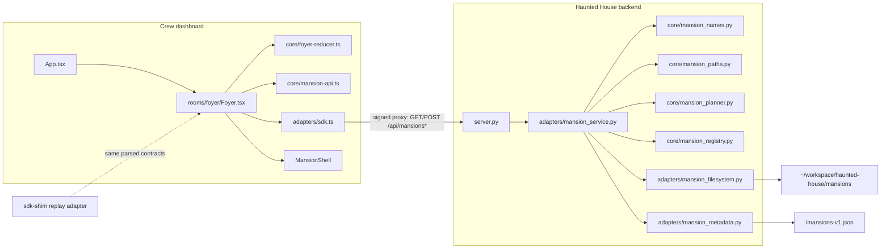

# Design Document

## Overview

The mansion lifecycle feature turns the foundation status page into the Foyer. The Foyer lists app-registered projects, creates a project only after server-side safety checks, lets the operator select one project, and revalidates the project before opening a minimal Mansion Shell. The backend owns all path construction and filesystem decisions. The browser sends only a validated name candidate.

The design keeps decision logic pure and moves filesystem, clock, app-data, and Crew access into adapters. A versioned metadata registry remembers mansions without putting Haunted House bookkeeping inside user projects. New projects contain only the directories Kiro needs to begin a feature spec. Existing projects are inspected but never changed.

### Scope decisions

| Decision | MVP | Stretch |
|---|---|---|
| Root | `~/workspace/haunted-house/mansions` | Operator-configurable approved roots |
| Project spec name | Equal to mansion name | Multiple specs per mansion |
| Registered set | Explicitly created or adopted through the create action | Automatic discovery and import |
| Actions | List, create, select, open, retry, return | Rename, archive, recent ordering |
| Destructive actions | No deletion endpoint or control | Deletion remains a separate future spec |

### Research findings and constraints

- `specs.md` defines a Kiro feature spec as `.kiro/specs/<name>/` containing `requirements.md`, `design.md`, and `tasks.md` as phases progress. `specs__feature-specs__requirements-first.md` confirms that `requirements.md` is created before design and tasks. The mansion initializer therefore creates the spec directory but no placeholder documents.
- `crew__interfaces__cli-reference.md` documents a per-run `--cwd`. The verified S3 result in `.kiro/steering/tech.md` narrows accepted Crew working directories to `~/workspace`, `~/workspaces`, `~/workplace`, and `~/workplaces`; the default mansion root is under the first accepted root.
- `crew__apps__sdk.md` documents `useAppApi()`, `useTheme()`, app backend reverse-proxy routes, and an app-scoped data-directory helper. The foundation spike found that the documented Python client is not published, so this feature does not import that client.
- `crew__apps.md` and `crew__apps__manifest.md` state that only `permissions.api` is enforced today and that `permissions.storage` is advisory. The manifest will declare `storage: true` because the backend uses app-scoped metadata, but backend path checks remain the security boundary.
- `crew__apps.md` states that install copies omit source-only directories and external symlink targets. Mansion data therefore cannot live in application source or UI build output.
- `crew__apps__sdk.md` documents host-injected authentication for `useAppApi()`. All new Foyer calls continue through `/apps/haunted-house/api/*`, already covered by the manifest's API scope and protected by the foundation proxy-signature middleware.
- `specs__correctness.md` recommends property tests for universal invariants. The path policy, creation planner, registry codec, and Foyer reducer have generated input spaces suitable for Hypothesis and fast-check.

### Assumption requiring a spike

Crew documents an app-scoped data directory but does not document how a standalone backend without `kirocrew-client` obtains that path. The installed app currently has a `data/` directory and the foundation verified that Crew starts the backend with the app root as the current working directory. Task 1.1 must verify that `<app-root>/data` survives backend restart and local app update. If the check fails, implementation must stop and revise this design around a verified Crew-owned persistent location; the task must not invent a user-home path.

## Architecture



### Layer responsibilities

- `core/` contains immutable data models, name validation, path-policy decisions over explicit path facts, project classification/planning, registry parsing/printing, and Foyer state reduction. Core code performs no filesystem, network, Crew SDK, or clock access.
- `adapters/` collects real path facts, performs checked directory operations, persists metadata, calls the app API, and supplies live or replay responses.
- `server.py` verifies the existing proxy signature before parsing API input, maps domain outcomes to HTTP, and does not expose absolute paths or exception text.
- React room components render state and send user intent. React components never construct a filesystem path or infer project compatibility.

## Components and Interfaces

### Backend domain models

`haunted_house/core/mansion_names.py`

```python
MANSION_NAME_PATTERN = re.compile(r"^[a-z0-9]+(?:-[a-z0-9]+)*$")
MAX_MANSION_NAME_LENGTH = 40

def is_valid_mansion_name(value: object) -> bool: ...
```

The validator performs no coercion or normalization. Validation precedes path construction and registry lookup.

`haunted_house/core/mansion_paths.py`

```python
@dataclass(frozen=True)
class PathFact:
    lexical: PurePath
    canonical: PurePath
    kind: Literal["missing", "directory", "file", "symlink", "other"]

@dataclass(frozen=True)
class PathDecision:
    accepted: bool
    code: Literal["ok", "unsafe_mansion_root", "symlink_escape", "mansion_conflict"]

def is_component_within(parent: PurePath, child: PurePath) -> bool: ...
def evaluate_root(approved_roots: tuple[PathFact, ...], root_chain: tuple[PathFact, ...]) -> PathDecision: ...
def evaluate_mansion_path(root: PathFact, target_chain: tuple[PathFact, ...]) -> PathDecision: ...
```

Containment compares path components, not string prefixes. Equality does not satisfy strict descendant checks. Path facts make canonicalization and symlink handling testable without allowing core code to inspect the host filesystem.

`haunted_house/core/mansion_planner.py`

```python
class ProjectStatus(StrEnum):
    READY = "ready"
    MISSING = "missing"
    CONFLICT = "conflict"

class CreateOutcome(StrEnum):
    CREATED = "created"
    EXISTING_COMPATIBLE = "existing_compatible"

@dataclass(frozen=True)
class ProjectSnapshot:
    target: EntryFact
    kiro: EntryFact
    specs: EntryFact
    project_spec: EntryFact
    extra_entries: tuple[EntryFact, ...]

@dataclass(frozen=True)
class CreatePlan:
    action: Literal["create_tree", "register_existing", "return_existing", "reject"]
    error_code: str | None

def classify_project(snapshot: ProjectSnapshot) -> ProjectStatus: ...
def plan_create(snapshot: ProjectSnapshot, registered: bool) -> CreatePlan: ...
def apply_model_create(state: ModelState, name: str) -> ModelResult: ...
```

`classify_project` accepts extra entries only after all required entries are real contained directories. `plan_create` is the single source for create/adopt/conflict behavior. The model transition supports exhaustive property tests for idempotence, pre-existing-tree preservation, and registry uniqueness.

`haunted_house/core/mansion_registry.py`

```python
REGISTRY_SCHEMA_VERSION = 1

@dataclass(frozen=True, order=True)
class MansionRecord:
    name: str
    project_spec: str
    relative_path: str
    origin: Literal["created", "existing"]

@dataclass(frozen=True)
class MansionRegistry:
    schema_version: Literal[1]
    mansions: tuple[MansionRecord, ...]

def parse_registry(text: str) -> MansionRegistry: ...
def print_registry(registry: MansionRegistry) -> str: ...
def upsert_record(registry: MansionRegistry, record: MansionRecord) -> MansionRegistry: ...
```

Parsing is strict: one supported version, exact field names, valid names, `project_spec == name`, `relative_path == name`, valid origin, and unique names. Printing sorts records by name, uses UTF-8 JSON with two-space indentation and a final newline, and produces the canonical representation. No absolute path enters this model.

`haunted_house/core/mansion_requests.py`

```python
@dataclass(frozen=True)
class MansionRequest:
    name: str

class InvalidRequest(ValueError): ...

def parse_mansion_request(value: object) -> MansionRequest: ...
```

The request parser accepts exactly a mapping with one key named `name` and a string value. The parser validates shape only; `MansionService` applies `is_valid_mansion_name` next. The function is total over JSON-compatible values and has no side effects.

### Filesystem adapter

`haunted_house/adapters/mansion_filesystem.py`

```python
@dataclass(frozen=True)
class ResolvedMansion:
    name: str
    project_spec: str
    root: Path
    target: Path
    display_path: str

class MansionFilesystem(Protocol):
    def ensure_safe_root(self) -> PathFact: ...
    def resolve(self, name: str) -> ResolvedMansion: ...
    def snapshot(self, mansion: ResolvedMansion) -> ProjectSnapshot: ...
    def create_minimal_tree(self, mansion: ResolvedMansion) -> None: ...
```

The live adapter follows this order:

1. Expand the configured root and reject relative or lexical `..` values.
2. Require one existing Approved_Root as a real directory. Walk each root component with `lstat`; reject symbolic links and non-directories. Create only missing root-container directories.
3. Append a previously validated Mansion_Name. Use component-aware containment before any mutation.
4. Inspect the target and each required descendant with `lstat`, `realpath`, and component-aware containment. A symlink is never treated as a required directory, even when the symlink points inward.
5. For a missing target, acquire the service mutation lock, repeat every check, create the target with `exist_ok=False`, and create descendants relative to directory descriptors opened with no-follow semantics where the platform provides them.
6. If a required `mkdir` collides, stop before writing through the colliding entry. Rollback may remove only empty directories created by the current attempt whose device and inode still match recorded creation results. Rollback never removes a pre-existing entry or an entry with unknown contents. A failed rollback returns `filesystem_error` and leaves metadata unchanged.
7. Re-snapshot the completed tree before allowing a metadata write.

The MVP exposes no delete operation. Transaction rollback is private cleanup limited to newly created, identity-matched empty directories.

The live default is `Path.home() / "workspace" / "haunted-house" / "mansions"`. Tests inject a root and approved-root set. The API never accepts either value.

### Metadata adapter

`haunted_house/adapters/mansion_metadata.py`

```python
class MetadataUnavailable(RuntimeError): ...

class MansionMetadataStore(Protocol):
    def load(self) -> MansionRegistry: ...
    def save(self, registry: MansionRegistry) -> None: ...
```

The live store uses `<verified-app-data>/mansions-v1.json` and an application-level `asyncio.Lock` owned by `MansionService`. A missing file loads as an empty registry. A malformed or unsupported file raises `MetadataUnavailable`; the store does not replace, rename, repair, or truncate that file.

A save writes the canonical representation to an exclusive temporary file in the same directory, flushes and fsyncs the file, atomically replaces `mansions-v1.json`, and fsyncs the directory where supported. Temporary files contain app metadata only. Metadata is written after a created or adopted project passes a final compatibility snapshot.

### Mansion service

`haunted_house/adapters/mansion_service.py`

```python
@dataclass(frozen=True)
class MansionDescriptor:
    name: str
    project_spec: str
    display_path: str
    status: ProjectStatus

@dataclass(frozen=True)
class CreateResult:
    outcome: CreateOutcome
    mansion: MansionDescriptor

class MansionService:
    async def list_mansions(self) -> tuple[MansionDescriptor, ...]: ...
    async def create_mansion(self, name: object) -> CreateResult: ...
    async def open_mansion(self, name: object) -> MansionDescriptor: ...
```

Every method loads the registry through the strict codec. `list_mansions` revalidates each registered project and sorts descriptors by name. `create_mansion` locks the whole check/create/register sequence, then checks the name, root, target snapshot, plan, final snapshot, and registry in that order. `open_mansion` requires a registered name and revalidates the filesystem immediately before returning. No service result contains a `Path`.

A compatible unregistered project is adopted only through `create_mansion`. Listing does not scan arbitrary folders beneath the root.

### HTTP API

The existing proxy-signature middleware remains first in `server.py`. Route handlers accept at most the existing 1 MiB application limit, require `application/json` for POST, require an exact `{ "name": string }` object, and call an injected `MansionService`.

```text
GET  /api/mansions
  200 {"schemaVersion":1,"mansions":[MansionDescriptor...]}

POST /api/mansions
  body {"name":"kebab-name"}
  201 {"outcome":"created","mansion":MansionDescriptor}
  200 {"outcome":"existing_compatible","mansion":MansionDescriptor}

POST /api/mansions/open
  body {"name":"kebab-name"}
  200 {"mansion":MansionDescriptor}

Error
  {"error":{"code":"stable_code","message":"short safe copy"}}
```

Error responses use 400 for malformed requests, 404 for an unregistered name, 409 for missing/conflicting registered projects and target collisions, 422 for invalid names, and 500 for unsafe runtime configuration, metadata failure, or unexpected filesystem failure. A 401 remains exclusively the foundation signature response. Handlers log exception type and stable code without returning raw paths or exception strings.

`build_app` accepts an optional service for unit tests. `build_live_app` constructs the verified app-data path, filesystem adapter, metadata store, and service during application startup.

### UI core and adapter

`app/ui/src/core/mansion-api.ts` defines TypeScript types and strict parsers for the three success responses and stable error bodies. Unknown fields in success objects are ignored for forward compatibility; missing, wrongly typed, duplicate, invalid-name, absolute-path, and unknown-status values fail parsing. Display paths must begin with `~/` and contain the descriptor name as the final component.

`app/ui/src/core/foyer-reducer.ts` owns:

```typescript
type LoadState = { kind: 'loading' } | { kind: 'ready'; mansions: MansionDescriptor[] } | { kind: 'error'; message: string }
type MutationState = { kind: 'idle' } | { kind: 'creating' | 'opening'; name: string } | { kind: 'error'; operation: 'create' | 'open'; name: string; message: string }
type ViewState = { kind: 'foyer' } | { kind: 'mansion'; mansion: MansionDescriptor }

interface FoyerState {
  load: LoadState
  mutation: MutationState
  selectedName: string | null
  view: ViewState
}
```

Reducer events cover load started/succeeded/failed, selection, create started/succeeded/failed, open started/succeeded/failed, and return. Success upserts and sorts one descriptor. Failure leaves the last successful list untouched. Start events are ignored while the same mutation is pending.

`app/ui/src/adapters/sdk.ts` remains the only live SDK import. It adds `useMansionApi()` with `list`, `create`, and `open` methods calling:

```typescript
const MANSIONS_PATH = '/apps/haunted-house/api/mansions'
const OPEN_MANSION_PATH = '/apps/haunted-house/api/mansions/open'
```

The adapter maps SDK errors and parsed backend errors to short UI messages. It never passes raw response bodies to components. The existing `useBackendStatus()` still gates the Foyer so a backend outage has one retry path.

### Foyer components

- `App.tsx` renders the existing backend check while loading or unreachable, then mounts the Foyer when the backend is reachable.
- `rooms/foyer/Foyer.tsx` composes the heading, create form, list state, mutation feedback, and Mansion Shell transition.
- `CreateMansionForm.tsx` uses a labelled input with `maxLength=40`, pattern guidance, and server error text. Client validation improves feedback but never replaces server validation.
- `MansionList.tsx` uses a labelled native radio group styled as spatial mansion cards. Native radio behavior supplies Arrow-key selection; Enter invokes the same open function as the visible Open button.
- `MansionShell.tsx` names the opened mansion and Project_Spec and provides a Return to Foyer button. Escape invokes the same return function.

The Foyer uses Crew theme CSS variables and `useTheme()` from the SDK boundary, retains explicit text and icons for status, uses visible focus rings, and honors both `prefers-reduced-motion` and the existing Still House preference seam. Routine load progress stays inline. One polite live region announces only successful create/open outcomes; errors remain beside the initiating control.

### Replay adapter

The SDK shim implements the same `get` and `post` calls against an in-memory fixture registry. List, create, and open responses pass through the same TypeScript parsers and reducer as live responses. The shim records attempted URLs in tests, performs no `fetch` except the existing local fixture load, and performs no filesystem operation.

### Traceability

| Requirement | Design elements |
|---|---|
| 1 | Foyer reducer, Mansion list, Mansion Shell, open endpoint |
| 2 | Mansion name validator, strict request parser, service ordering |
| 3 | Path facts, root policy, filesystem adapter, server-derived paths |
| 4 | Creation planner, service mutation lock, checked mkdir, rollback guard |
| 5 | Project snapshot/classifier, exact directory initializer |
| 6 | Registry codec, app-data metadata store, atomic save |
| 7 | Typed service results, HTTP routes, UI response parsers |
| 8 | Reducer states, accessible components, theme and motion handling |
| 9 | SDK shim, shared parsers/reducer/components |
| 10 | Route table and Foyer action set |

## Data Models

### Registry JSON

```json
{
  "schemaVersion": 1,
  "mansions": [
    {
      "name": "weather-station",
      "projectSpec": "weather-station",
      "relativePath": "weather-station",
      "origin": "created"
    }
  ]
}
```

Records are unique and sorted by `name`. `relativePath` is exactly the validated name in the MVP. The registry stores no timestamp, selected item, absolute path, project content, or UI state.

### Mansion descriptor JSON

```json
{
  "name": "weather-station",
  "projectSpec": "weather-station",
  "displayPath": "~/workspace/haunted-house/mansions/weather-station",
  "status": "ready"
}
```

`status` is `ready`, `missing`, or `conflict`. The display path is presentation-only and never returns to the backend as an authority value.

### Project tree

```text
~/workspace/haunted-house/mansions/
└── weather-station/
    └── .kiro/
        └── specs/
            └── weather-station/
```

The initializer creates directories only. The requirements ghost creates `requirements.md` in a later feature.

### Error model

```typescript
interface MansionApiError {
  error: {
    code:
      | 'invalid_request'
      | 'invalid_mansion_name'
      | 'unsafe_mansion_root'
      | 'symlink_escape'
      | 'mansion_conflict'
      | 'mansion_missing'
      | 'mansion_not_registered'
      | 'metadata_unavailable'
      | 'filesystem_error'
    message: string
  }
}
```

The message is fixed copy selected by code. Neither field contains an absolute path, request body, or exception text.

## Correctness Properties

*A property is a characteristic or behavior that should hold true across all valid executions of a system: essentially, a formal statement about what the system should do. Properties serve as the bridge between human-readable specifications and machine-verifiable correctness guarantees.*

### Property 1: Mansion name validation matches the exact language

For all input values, `is_valid_mansion_name` returns true if and only if the value is a string of at most 40 characters that matches `^[a-z0-9]+(-[a-z0-9]+)*$`; the validator returns false rather than trimming, case-folding, normalizing, or substituting any other value.

**Validates: Requirements 2.1, 2.5**

### Property 2: Invalid names cause no state transition

For all filesystem and Metadata_Registry model states and all Mansion_Name values rejected by `is_valid_mansion_name`, create and open attempts return `invalid_mansion_name` and leave the complete model state unchanged.

**Validates: Requirements 2.2, 2.3, 2.4**

### Property 3: Every accepted path remains confined

For all Approved_Root, Mansion_Root, Mansion_Path, and path-component fact combinations, the Path_Policy accepts a Mansion_Path only when the root chain contains real non-symlink directories under an Approved_Root, the Mansion_Path is a strict component descendant of that root, and every resolved required descendant remains inside the root; every rejected combination leaves the model state unchanged.

**Validates: Requirements 3.2, 3.3, 3.4, 3.5**

### Property 4: Existing project classification preserves every entry

For all pre-existing target trees, create planning classifies the tree as compatible exactly when all required Minimal_Project_Tree entries are real contained directories; the compatible branch changes at most the app-owned registry, the conflict branch changes no state, and both branches preserve every pre-existing project entry and opaque content byte-for-byte, including additional entries.

**Validates: Requirements 4.3, 4.5, 4.6, 5.4, 5.5, 5.6**

### Property 5: Creation is exact, idempotent, and confluent

For all valid Mansion_Name values, safe absent targets, valid initial registries, and non-empty sequences of same-name create operations in any order, the first successful operation adds exactly the Mansion directory and three required descendant directories, adds no file, sets Project_Spec equal to Mansion_Name, produces at most one `created` outcome, and converges on one project tree and one Mansion_Record that remain unchanged by every later operation.

**Validates: Requirements 4.1, 4.2, 4.7, 5.1, 5.2, 5.3, 6.3**

### Property 6: Registry serialization is canonical and round-trippable

For all valid Metadata_Registry values, `parse_registry(print_registry(registry))` equals the canonical registry with unique name-sorted records, every stored relative path equals the corresponding Mansion_Name and is not absolute, and printing the parsed result produces exactly the same deterministic JSON bytes.

**Validates: Requirements 6.2, 6.3, 6.7, 6.8**

### Property 7: Descriptor projection is complete and sorted

For all valid Metadata_Registry values and all project-status assignments, descriptor projection returns exactly one Mansion_Descriptor per Mansion_Record, preserves each name and Project_Spec, assigns the matching `ready`, `missing`, or `conflict` status, exposes only a home-relative display path, and orders the result by Mansion_Name.

**Validates: Requirements 7.1, 7.7**

### Property 8: Request parsing accepts only the exact body shape

For all JSON-compatible values, `parse_mansion_request` returns a MansionRequest if and only if the value is an object containing exactly one key named `name` with a string value; every other value returns `invalid_request` without invoking Mansion_Service or changing model state.

**Validates: Requirements 7.5**

### Property 9: Foyer transitions preserve one coherent selection and list

For all valid Foyer states and event sequences, the Foyer reducer keeps selection null or equal to exactly one listed Mansion_Name, permits at most one pending create or open mutation, preserves the last successful list on mutation failure, and upserts a successful create descriptor through the same sorted transition in live and replay modes.

**Validates: Requirements 1.4, 8.2, 8.3, 8.5, 9.3**

### Property 10: Replay operations are deterministic and isolated

For all valid fixture registries and list, create, and open operation sequences, two Replay_Adapter instances started from the same fixture produce equivalent response and Foyer-state sequences, make no Gateway request, perform no filesystem operation, and preserve the fixture input.

**Validates: Requirements 9.2**

## Error Handling

| Condition | Stable behavior | HTTP/UI behavior | Mutation rule |
|---|---|---|---|
| Name is empty, too long, non-kebab, Unicode, uppercase, or traversal text | `invalid_mansion_name` | 422; field error | No path resolution, filesystem access, or metadata write |
| POST body is malformed JSON or has the wrong shape | `invalid_request` | 400; form-level error | No service call |
| Default/configured root is outside Approved_Root values, relative, or symlinked | `unsafe_mansion_root` | 500; “Mansion storage is not configured safely.” | No mansion or registry write |
| Target or required descendant is a symlink escape | `symlink_escape` | 409; card/form conflict text | No write through the symlink; no registry write |
| Target is a file or incompatible directory | `mansion_conflict` | 409; explain that existing content was left unchanged | Preserve target and registry |
| Registered project no longer exists | `mansion_missing` | Listed as `missing`; open returns 409 | Preserve registry for operator visibility |
| Valid open name is not registered | `mansion_not_registered` | 404; refresh/list guidance | No mutation |
| Registry is absent | Empty registry | 200 empty state | No project mutation; no registry file until first successful create/adopt |
| Registry is malformed or version is unsupported | `metadata_unavailable` | 500; retry is allowed | Preserve original registry bytes; block create/open |
| Metadata atomic save fails before replacement | `metadata_unavailable` | 500; preserve current list in UI | Old registry remains authoritative; project may exist and can be adopted by retry |
| Directory creation collides after final check | `mansion_conflict` or `filesystem_error` | 409 for classified collision, 500 for unclassified I/O | Never replace or write through collision; rollback only owned, identity-matched empty directories |
| Unexpected filesystem exception | `filesystem_error` | 500 with fixed copy | No metadata write; no path or exception text in response |
| Backend is unreachable | Existing foundation state | Foyer is gated by status panel and Retry | No request is assumed successful |
| List request fails | Request error | Inline list error and Retry | Keep no fabricated list |
| Create/open request fails | Stable mapped copy | Error beside initiating control | Preserve last successful list and selection |
| Unsupported mutation | Router refusal | 404 or 405 | No service call |

Errors are ordinary Foyer content, not toasts. Logs may include stable codes and exception class names, but no absolute project path, request body, registry contents, secret, or token.

## Testing Strategy

### Property-based tests

Use Hypothesis for Python core models and fast-check for TypeScript core/replay state. Every property test runs at least 100 generated examples. Each correctness property has one test carrying the exact comment:

```text
Feature: mansion-lifecycle, Property N: <property title>
```

- **Python core:** Properties 1–8 cover exact validation, invalid-name no-op behavior, path-fact containment, project classification/preservation, exact idempotent model creation, registry round trip, descriptor projection, and strict request parsing.
- **TypeScript core:** Property 9 covers `foyer-reducer.ts`; Property 10 covers a pure replay operation model used by the SDK shim.
- Generators include empty and Unicode strings, 39/40/41-character boundaries, prefix-sibling paths, root equality, `..`, symlink facts, files at every required directory position, arbitrary opaque extra project entries, duplicate registry inputs, unsupported schema versions, arbitrary JSON bodies, stale selections, repeated events, and operation permutations.
- Property tests exercise pure code only. Real filesystem, aiohttp, React rendering, and Crew behavior use focused integration or example tests.

### Unit and integration tests

- **Filesystem adapter:** Temporary directories cover creation, compatible adoption with extra files, file/symlink collisions at each required path, root-container setup, root symlinks, escaping symlinks, sibling-prefix paths, collision injected between snapshot and mkdir, guarded rollback, and a complete before/after byte snapshot proving existing project preservation.
- **Metadata adapter:** Missing file, fresh save, deterministic bytes, atomic replacement, interrupted write, malformed JSON preservation, unsupported schema preservation, permission errors, and a newly constructed store loading the same records.
- **Service:** Spy adapters assert validation-before-resolution, recheck-under-lock, metadata-after-final-snapshot, one record under concurrent asyncio calls, sorted list projection, registered-only open, and revalidation between list and open.
- **HTTP:** aiohttp tests cover all methods, success statuses, exact request-body validation, error-code mapping, safe response bodies, unsupported routes/methods, and unsigned requests that never reach a service spy.
- **UI core/API parser:** Unit tests cover every stable success and error shape, forward-compatible extra response fields, malformed values, bounded messages, sorted upsert, stale selection, and retry transitions.
- **DOM/accessibility:** Vitest and Testing Library cover backend gating, loading, empty, ready, missing, conflict and error states; create/select/open/return; disabled duplicate actions; Arrow, Enter, Escape, and focus restoration; one polite live region; textual state labels; Crew theme variables; reduced motion; and the absence of delete, rename, archive, and import controls.
- **Replay:** The replay DOM test renders the same Foyer and Mansion Shell, runs deterministic list/create/open responses, and asserts no Gateway URL or filesystem surface is called.
- **Manifest/build:** Update the manifest test for `permissions.storage: true`; run typecheck, Vitest, Python tests, live and replay builds, bundle import checks, and stale committed-bundle checks.

### Spike and acceptance checks

Task 1.1 creates an automated persistence probe for the documented app-data assumption. The check obtains the backend's resolved app-data location without exposing a home path, writes a synthetic registry, reconstructs or restarts the backend service, and confirms equivalent metadata. Where the local Crew test harness supports app update, the probe also confirms update preservation. The implementation phase must record the result in `.kiro/steering/tech.md` only after the result is verified; if the path contract fails, design and tasks return for revision before mansion code proceeds.

The final automated acceptance test uses temporary roots and a fresh service instance to create, list, select through reducer state, open, reconstruct the service, list again, and open again. This test does not launch a development server or mutate the real default root.

## Design Decisions and Rationale

1. **The browser sends names, never paths.** This removes path authority from the least trusted layer and makes containment a backend invariant.
2. **Compatible projects are adopted only through explicit Create.** Listing scans metadata rather than arbitrary user folders, keeping discovery predictable and avoiding unrequested filesystem traversal.
3. **Missing registered projects remain visible.** Silent registry deletion would hide a problem and violate append-only expectations for later séance records.
4. **No placeholder spec documents.** Kiro creates requirements, design, and tasks in sequence (`specs.md`); empty placeholders could be mistaken for approved phase output.
5. **The registry stores no absolute path or timestamp.** The root is server configuration, the relative path is the validated name, and no clock is needed for MVP behavior.
6. **Project creation and registry save are ordered, not distributed transaction participants.** The project tree completes and revalidates before metadata is saved. If metadata save fails, retry safely adopts the now-compatible project without changing project contents.
7. **A single process lock serializes mutations.** Crew runs one backend process for the app. Filesystem no-follow checks and exclusive mkdir remain necessary because non-app processes can race.
8. **`permissions.storage: true` is declared but not trusted as enforcement.** `crew__apps.md` and `crew__apps__manifest.md` call storage advisory, so path policy and server-only path derivation enforce safety.
9. **Deletion stays outside this feature.** No backend method, service method, reducer event, or Foyer control can request project removal.
