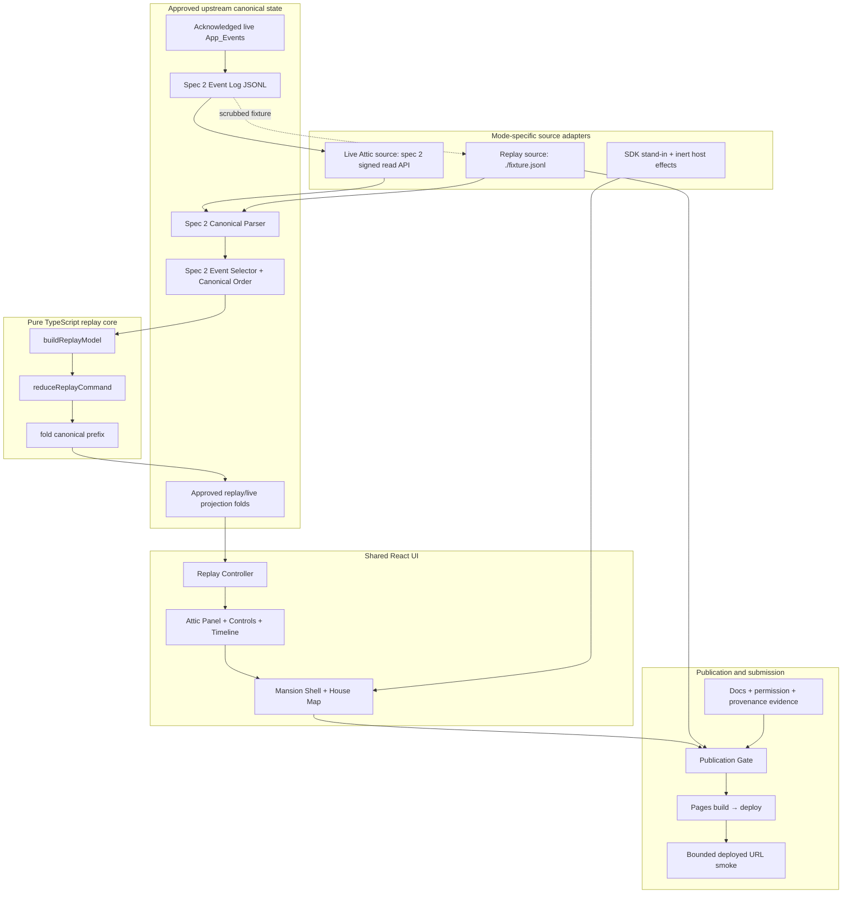

# Design Document

## Overview

`replay-and-submission` turns the canonical séance record into the final judge-facing path. The Attic loads only the versioned append-only Event Log owned by `seance-log-and-ghost-state`. It uses that spec's parser, variant selector, Canonical Order, and fold contracts. Playback adds presentation state around those functions: a cursor identifies a canonical prefix, controls change the cursor and schedule, and every displayed state is recomputed from the prefix. The final cursor therefore has the same projection as a fresh full replay and the live fold over the same acknowledged records.

The static build renders the same `HauntedHouseApp`, Mansion shell, House map, room panels, and Attic as the live Crew page. Vite aliases the existing SDK boundary to a replay adapter. The adapter loads one relative `./fixture.jsonl` asset and supplies inert host effects. It cannot open a WebSocket, call the Haunted House backend, navigate to a Crew session, or execute a mutation. A separate GitHub Pages workflow builds and audits this static artifact, deploys only after the audit passes, and performs a bounded post-deployment smoke check. The existing CI remains the required push and pull-request safety net.

Submission readiness is treated as an executable repository contract. Static validators check the documented install command, Crew version, trust instructions, links, asset provenance, final permission snapshot, demo duration, dated milestones, fixture safety, and generated static artifact. The documentation remains hand-readable, while machine-readable freeze and provenance records prevent the release copy from drifting.

MVP includes canonical replay, playback controls, the Attic panel, static replay, publication checks, GitHub Pages, live install instructions, the permission freeze, documentation, screenshots checklist, and release schedule. Search, filters, exports, bookmarks, enabled review UI, sound, and decorative polish remain stretch work. Stretch begins only after every MVP gate and the complete rehearsal pass.

### Existing foundation and upstream ownership

This design consumes rather than replaces the preceding specs:

- `crew-app-foundation` owns the signed backend, loopback-only Gateway client, SDK import seam, Vite library and replay builds, committed live bundle, install script, secret scan, and three-job CI.
- `seance-log-and-ghost-state` owns `App_Event`, Event Log JSONL, canonical parsing, variant selection, Canonical Order, Ghost snapshots, live folding, and replay folding. This feature adds no event schema, parser, selector, log, or Ghost reducer.
- `mansion-lifecycle` owns Mansion selection, the Foyer, server-derived project paths, and the active Mansion identity.
- `doors-and-guardrails` owns phases, Doors, waiting items, exact approvals, and replayable authority evidence.
- `room-ghosts` owns artifact/task/run projections and the validated terminal gate.
- `house-ui-and-accessibility` owns the shared Mansion shell, House map, room registry, focus behavior, interruption policy, theme, motion policy, and final visual composition. This feature owns only the Attic's replay interaction and release/publication layer.

The current draft designs expose one known cross-spec conflict: spec 2 proposes `.haunted-house/seance/events.v1.jsonl`, while spec 4 initially proposes a separate hash-chained `.haunted-house/seance.jsonl`. `room-ghosts` already requires reconciliation onto one spec 2 canonical source. RS-S0 below is a hard composition gate. Replay work cannot proceed by creating a third representation.

### Research findings

Exact local Kiro and Crew documentation used by this design:

- `kiro-docs/specs.md` defines the three spec artifacts and parallel task waves. `kiro-docs/specs__feature-specs__requirements-first.md` defines the requirements, design, and tasks sequence. `kiro-docs/specs__correctness.md` defines property-based testing and requirement traceability.
- `kiro-docs/crew__apps.md` describes gateway-managed app resources, disabled-by-default third-party apps, the manual trust boundary, the enforced `permissions.api` allowlist, and installation copy exclusions.
- `kiro-docs/crew__apps__manifest.md` defines `minKiroCrewVersion`, UI and backend path validation, app resource fields, app-store image metadata, permission declarations, and gateway lifecycle fields.
- `kiro-docs/crew__apps__sdk.md` defines `useAppApi`, `useAppEvents`, `useTheme`, `useNotify`, `useNavBadge`, host-supplied SDK loading, reverse-proxy access, and Gateway API categories. The checked-in foundation and `.kiro/steering/tech.md` remain authoritative where installed Crew 0.12.1/0.12.2 differs, including the `X-KiroCrew-Proxy` header and absence of a published `kirocrew-client` package.
- `kiro-docs/crew__apps__publishing.md` requires a committed UI bundle, minimal permissions, a tested README, valid agents and skills, and repository-hosted screenshots. The document also explains that install omits `node_modules`, `.git`, `__pycache__`, `.venv`, and outside symlink targets.
- `kiro-docs/crew__installation.md` records Crew's supported runtime floor and dashboard setup context. `kiro-docs/crew__interfaces__cli-reference.md` records the current CLI command families; installed-version `--help` remains the command authority.
- `.kiro/steering/theme-and-accessibility.md` supplies the Attic keyboard, reduced-motion, single-live-region, original-art, contrast, and interruption constraints. `.kiro/steering/product.md` makes replay an MVP Attic function and the séance log the only replay source.

GitHub recommends a custom Actions workflow when the site needs a build step. The current official guidance uses `actions/configure-pages`, `actions/upload-pages-artifact`, and `actions/deploy-pages`; the deploy job needs `pages: write`, `id-token: write`, a `github-pages` environment, and an explicit dependency on the build job. Sources: [Using custom workflows with GitHub Pages](https://docs.github.com/pages/getting-started-with-github-pages/using-custom-workflows-with-github-pages) and [Configuring a publishing source for your GitHub Pages site](https://docs.github.com/pages/getting-started-with-github-pages/configuring-a-publishing-source-for-your-github-pages-site). The replay workflow follows that separation and gives build and smoke jobs read-only permissions. Content was rephrased for compliance with licensing restrictions.

### Spike-gated assumptions

Every unverified external or cross-spec fact becomes an executable Spike. Each Spike writes a scrubbed machine-readable result under `spikes/` and no secret or absolute home path.

| Spike | Question | Pass condition | Failure behavior |
|---|---|---|---|
| **RS-S0: canonical replay composition** | Do the implemented specs 2, 4, 5, and 6 expose one spec 2 Event Log, one parser/selector, one live fold, and one replay fold with compatible projection fields? | A characterization harness loads a synthetic log through real upstream public seams, proves one canonical source and equal full live/replay projections, and finds no second authoritative log or reducer | Block Attic integration as `contract_unavailable`; return the owning specs to design; add no adapter that invents state |
| **RS-S1: public repository metadata** | What are the final public HTTPS repository URL, default branch, clone folder, and Pages URL? | A read-only probe verifies public visibility, MIT license detection, default branch, reachable repository URL, and GitHub Pages Actions source, then writes bounded URL/slug metadata | Keep placeholder-free final README links blocked; publish no readiness claim and invent no repository URL |
| **RS-S2: final permission inventory** | Does the completed MVP code call only the proposed API paths and subscribe only to the proposed event set? | Static route/event/resource inventory plus existing manifest tests agree with the exact baseline, including storage and session approval; prohibited paths are absent | Return to the owning feature design before freeze; do not silently broaden the manifest |
| **RS-S3: deterministic media capture** | Can the HUI-S2 browser harness capture repeatable light, dark, replay, and approval screenshots at required dimensions? | The existing browser harness renders fixtures without external requests, records viewport/theme metadata, and writes only original screenshots | Keep incomplete screenshots marked in the asset checklist; select a reviewed development-only runner before claiming media readiness |

RS-S0 gates replay code. RS-S1 gates final URLs and clone copy, but not local replay implementation. RS-S2 gates the Judge-Facing Version. RS-S3 gates screenshot checklist closure, but not functional replay.

## Architecture



### Trust and authority boundaries

1. **Canonical boundary:** only records acknowledged and parsed by spec 2 enter replay. Replay never accepts a saved snapshot, raw Crew frame, room-local state cache, or model-authored summary as authority.
2. **Projection boundary:** each Cursor maps to a canonical selected prefix. Upstream pure folds derive every visible phase, Door, Ghost, waiting, artifact, and task value. The playback reducer cannot approve, start, retry, or mutate work.
3. **Static transport boundary:** the replay build aliases the sole SDK importer to the stand-in. The stand-in can load `./fixture.jsonl` and bundled relative assets only. All mutation, Crew navigation, host notification, and badge effects are inert and visibly read-only.
4. **Publication boundary:** fixture and built output pass secret, home-path, transport, remote-asset, local-reference, canonicality, and provenance checks before upload. A failed check yields no Pages artifact.
5. **Live install boundary:** the script builds and installs or updates the app but does not enable, trust, approve, or edit security settings. The owner performs the Trust Step in Crew.
6. **Permission boundary:** the inventory is derived from final route/event/resource constants and compared with the manifest before a deterministic freeze record is accepted. Replay consumes none of those permissions.

### Replay data flow

1. The live Attic source pages only the spec 2 Event Log read endpoint for the selected Mansion. The static source loads only `./fixture.jsonl`.
2. The source passes text or records to the exact Canonical Parser established by RS-S0. The parser returns valid supported records plus safe line diagnostics.
3. The spec 2 Event Selector collapses exact Record_ID duplicates, chooses deterministic variants, and produces Canonical Order. File order is retained only as audit context.
4. `buildReplayModel` creates safe Timeline entries and deterministic Presentation Time offsets. The model starts paused at Cursor zero.
5. `reduceReplayCommand` handles user commands and timer steps. It never folds incremental mutable state; after each Cursor change, the projection adapter folds `selected.slice(0, cursor)` through the approved upstream replay functions.
6. At the final Cursor, the projection equals a fresh full replay. The parity test compares that result with the upstream Live Fold for the same selected records.
7. The Attic displays current state, a safe event summary, Timeline, and parser/ordering diagnostics. Raw payloads and document bodies never render.

### Deterministic presentation timing

Presentation timing affects only delays. Canonical Order and Cursor determine state.

For selected event `i`:

- event zero has `presentationOffsetMs = 0`;
- for each later event, use `occurred_at_ms[i] - occurred_at_ms[i-1]` when both values are finite safe integers and the difference is positive;
- otherwise use `1,000 ms`;
- clamp each positive interval to `250..4,000 ms`;
- add the interval to the previous offset.

The next timer delay is the adjacent Presentation Time difference divided by Playback Speed. Changing speed cancels the pending timer and schedules the complete next interval at the new speed. Pausing cancels the timer. Timer callbacks carry a generation number; callbacks from a cancelled generation are ignored. Seeking while playing preserves `playing` unless the target is final. Seeking from `complete` to an earlier Cursor produces `paused`. Restart always produces paused Cursor zero. The initial state never auto-plays.

These rules use only recorded values and constants, so repeated model construction produces identical Timeline offsets. Exact wall-clock delivery is not a correctness claim.

## Components and Interfaces

### Canonical replay composition port

RS-S0 finalizes names against implemented upstream modules. The intended narrow interface is:

```typescript
interface CanonicalReplayPort {
  parse(text: string): {
    records: readonly AppEvent[]
    diagnostics: readonly ReplayDiagnostic[]
  }
  select(records: readonly AppEvent[]): {
    records: readonly AppEvent[]
    diagnostics: readonly ReplayDiagnostic[]
  }
  fold(records: readonly AppEvent[]): ReplayProjection
  foldLive(records: readonly AppEvent[]): LiveProjection
}
```

The concrete port delegates to spec 2 parsing/selection and the reconciled specs 4–6 projection fold. `foldLive` exists for tests and live composition; production static replay calls only `fold`. No method accepts raw Crew frames, snapshots, session history, filesystem paths, or network clients.

If upstream TypeScript and Python responsibilities prevent one in-process port, RS-S0 produces scrubbed cross-language vectors and a generated projection DTO fixture from the canonical Event Log. Static replay still folds through the approved TypeScript public functions; it does not load a saved final snapshot.

### Pure replay model

`app/ui/src/core/replay-timeline.ts` replaces the foundation raw-frame player after spec 2's canonical parser is present.

```typescript
export const REPLAY_SPEEDS = [0.5, 1, 2] as const
export type ReplaySpeed = (typeof REPLAY_SPEEDS)[number]
export type PlaybackStatus = 'paused' | 'playing' | 'complete'

export interface TimelineEntry {
  recordId: string
  eventId: string
  eventType: string
  actorLabel: string
  summary: string
  presentationOffsetMs: number
}

export interface ReplayModel {
  records: readonly AppEvent[]
  timeline: readonly TimelineEntry[]
  diagnostics: readonly ReplayDiagnostic[]
}

export interface ReplayState {
  status: PlaybackStatus
  cursor: number
  speed: ReplaySpeed
  generation: number
  projection: ReplayProjection
  commandError: ReplayCommandError | null
}

export type ReplayCommand =
  | { kind: 'play' | 'pause' | 'resume' | 'restart' }
  | { kind: 'set_speed'; speed: number }
  | { kind: 'seek'; cursor: number }
  | { kind: 'step'; generation: number }

export function buildReplayModel(result: CanonicalSelection): ReplayModel
export function initialReplayState(model: ReplayModel, fold: ReplayFold): ReplayState
export function reduceReplayCommand(
  model: ReplayModel,
  state: ReplayState,
  command: ReplayCommand,
  fold: ReplayFold,
): ReplayState
export function nextDelayMs(model: ReplayModel, state: ReplayState): number | null
```

The module is pure and immutable. It imports no React, SDK, DOM, timer, network, filesystem, or clock API. `safeTimelineEntry` uses an allowlist per Event Type and fixed bounded copy. It may show event type, room/ghost display name, state/outcome enum, sequence position, and safe reason category. It never includes arbitrary payload strings, tool input/output, prompt text, document content, path, token, or exception body.

The old foundation `replay-player.ts` is removed or reduced to a compatibility adapter after canonical replay replaces raw `{t, frame}` playback. No production replay path may normalize raw Crew frames.

### Replay Controller adapter

`app/ui/src/adapters/replay-controller.ts` or a hook in `adapters/seance-replay.ts` owns browser effects:

```typescript
interface ReplayScheduler {
  schedule(delayMs: number, generation: number, step: () => void): () => void
}

interface ReplayController {
  model: ReplayModel
  state: ReplayState
  command(command: ReplayCommand): void
}
```

The React hook stores ReplayState, calls the pure reducer, and maintains at most one timeout. Every state or speed change cancels the prior timeout. Unmount cancels the timeout. A stale generation callback becomes a no-op through the pure reducer. The adapter does not announce routine steps, send host notifications, update the Needs You badge, or persist playback preferences.

### Live and static Event Log sources

`app/ui/src/adapters/attic-log-source.ts` defines a small source result:

```typescript
interface AtticLogResult {
  status: 'loading' | 'ready' | 'error'
  text: string | null
  safeMessage: string | null
}
```

- **Live implementation:** delegates to the implemented spec 2 paged Event Log API through the existing `adapters/sdk.ts` boundary. It requests the selected Mansion's canonical records only. It never queries Crew chat history for replay.
- **Static implementation:** lives behind the SDK/replay alias and fetches `./fixture.jsonl` once. It performs no retry to another URL. A load error returns fixed bounded copy and an empty source.

The current foundation `useBackendStatus()` may retain its in-memory `WHOAMI_PATH` call because the stand-in answers without transport. Build and DOM guards prove that no browser request follows. A route string in shared source is not a live call.

### Attic UI

The final composition extends `app/ui/src/rooms/attic/AtticPanel.tsx` from `house-ui-and-accessibility` rather than creating another room shell.

```text
AtticPanel.tsx
├── ReplaySummary.tsx       current projection, cursor/total, status
├── ReplayControls.tsx      play/pause/resume/restart/speed/seek/previous/next
├── ReplayTimeline.tsx      ordered list with current-entry cue
└── ReplayDiagnostics.tsx   parser/order/load diagnostics
```

- Controls are native buttons, a labelled select or radio group for speed, and an `input type="range"` plus previous/next buttons for exact event navigation.
- The range minimum is zero and maximum is selected-record count. Its accessible value text is `Event n of N` or `Start of replay`.
- The Timeline is an ordered list. The current item uses `aria-current="step"`, visible text, border/shape, and icon; color is supplementary.
- Playback status is visible text. Routine cursor changes do not use `aria-live`, `role="status"`, sound, toast, or host notification. The one shell live region remains owned by `house-ui-and-accessibility`.
- The panel accepts no generic mutation or navigation callback. Live session links, if composed by the room shell, stay secondary. Replay mode disables them with visible read-only copy.
- Still House and browser reduced motion suppress only decorative transition CSS. Cursor and projection updates remain immediate and functional.

### Replay SDK stand-in and build

The existing `app/ui/src/adapters/sdk-shim/index.ts` remains the replacement for exact `@kirocrew/app-sdk`. It is extended with the HUI-S1-proven theme/host-effect interfaces and the Attic fixture source. In production replay:

- `useAppApi` answers only local deterministic stand-in operations and rejects mutations;
- `useAppEvents` does not open a WebSocket and, after canonical replay migration, cannot emit raw Crew frames as replay authority;
- `useTheme` uses deterministic fixture theme state;
- notification, badge, session-navigation, approval, and chat-launch functions are inert or return a read-only result;
- only the fixture source may call `fetch`, and only with `./fixture.jsonl`.

`vite.replay.config.ts` retains root `app/ui/replay`, `base: './'`, bundled React/Lucide, exact SDK alias, no public directory, and output `app/ui/dist-replay/`. A build plugin copies the canonical `fixtures/replay/demo.jsonl` as `fixture.jsonl` and adds `.nojekyll`. Static output is not committed; GitHub Pages builds it from locked source. The live `app/ui/dist/index.mjs` remains committed as required by Crew.

### Replay fixture and publication checks

`fixtures/replay/demo.jsonl` is generated only from synthetic domain data or a scrubbed demo Mansion. It covers the minimum narrative: two ghosts, one tool call, one approval request/decision, one Door decision, one completion, and one blocked or failed result. A deterministic fixture builder uses the canonical serializer and fixed synthetic identifiers/times. A check compares committed bytes to a fresh generation so hand edits cannot make the fixture noncanonical.

`app/ui/scripts-tests/check-replay-build.test.ts` and repository scripts enforce the static boundary:

- parse every fixture line with the upstream Canonical Parser;
- verify deterministic generation and expected final projection;
- run the existing secret scanner over source fixture and built copy;
- reject absolute macOS, Linux, Windows, and escaped Home Paths;
- reject localhost Gateway origins, external scripts/styles/images/fonts/media, service workers, WebSocket/EventSource/XMLHttpRequest construction, and production SDK imports in the built replay artifact;
- permit only relative local asset references from `index.html` and generated modules;
- resolve every referenced static file inside `dist-replay`;
- verify `fixture.jsonl` equals the approved committed fixture;
- verify no build output is a symlink or hard link.

Static source checks supplement rather than replace the DOM transport traps. Minified-code substring scans alone do not prove isolation.

### Local and deployed smoke harnesses

`scripts/smoke-replay-site.mjs` supports two bounded modes:

1. **Local artifact:** start an ephemeral loopback HTTP server rooted at `app/ui/dist-replay`, request `index.html`, parse local script/style/asset references, request every reference and `fixture.jsonl`, reject traversal or external URLs, then close the server in `finally`.
2. **Deployed URL:** accept only an HTTPS URL produced by the Pages deployment output, retry bounded GET requests for the page and relative fixture with exponential delays capped by a total timeout, verify expected content markers, then exit.

The process is one-shot, creates no file, logs no query or token, and never contacts Crew. DOM tests remain the proof that the fetched JavaScript renders the shared root; the smoke harness proves packaging and hosting.

### GitHub Pages workflow

`.github/workflows/pages.yml` is separate from Normal CI:

- triggers on pushes to the verified default branch and `workflow_dispatch`;
- uses a deployment concurrency group with `cancel-in-progress: false`;
- the **build** job has `contents: read`, checks out without persisted credentials, installs the pinned Node version used by CI, runs `npm ci`, replay-focused tests, type checking, `build:replay`, fixture/build/publication checks, and local smoke, then uses `actions/configure-pages` and `actions/upload-pages-artifact` for `app/ui/dist-replay`;
- the **deploy** job depends on build, has only `pages: write` and `id-token: write` beyond read defaults, uses the `github-pages` environment, and runs `actions/deploy-pages`;
- the **smoke** job depends on deploy, receives the deployment URL as an output, has read-only permissions, and runs the bounded deployed URL smoke.

Action major versions follow the official current Pages guide at implementation time and are pinned to reviewed full commit SHAs before Feature Freeze if repository policy requires SHA pinning. A static workflow contract test verifies job dependency, environment, scopes, artifact path, and absence of secrets.

Normal CI keeps its `python`, `ui`, and `repo` jobs and existing checks. The UI job gains replay publication and local smoke commands after `build:replay`; the repo job gains documentation, asset, and permission-freeze checks when their inputs exist. Existing triggers and commands remain represented in a regression test.

### Live judge installation

The foundation `scripts/install-local.sh` stays the only Install Command target. RS-S1 supplies the final repository HTTPS URL and clone folder for README copy without embedding a local checkout path. The README orders judge options as:

1. open the public Static Replay URL, with read-only/no-Crew copy;
2. optionally clone the Public Repository;
3. from the clone, run the single command `scripts/install-local.sh`;
4. complete Apps → Library → Haunted House → Enable → Trust in Crew;
5. open Haunted House and follow the demo Mansion flow.

The existing fake-CLI tests remain authoritative for version checks, fresh install/update, gateway health, no security-setting changes, and printed manual steps. A submission contract test checks that README, manifest, and script agree on the Crew minimum and exact command. RS-S1 verifies public reachability separately; ordinary CI does not require external network.

### Final permission inventory and freeze

The proposed final permission object after specs 2–6 is:

```json
{
  "api": [
    "/api/version",
    "/api/chat",
    "/api/chat/*",
    "/apps/haunted-house/api/*"
  ],
  "events": [
    "approval_resolved",
    "chat_chunk",
    "chat_done",
    "chat_error",
    "chat_message",
    "chat_message_update",
    "chat_segment",
    "chat_status",
    "shared_crew.decision",
    "tool_call",
    "tool_result"
  ],
  "sessionApproval": true,
  "storage": true
}
```

RS-S2 must verify the exact event list against the single canonical-ingestion owner selected by RG-S1/RS-S0. If implemented code consumes a different event, this design returns for review. The inventory does not add `/api/spawn`, global approval paths, broad API wildcards, `autoApprove`, network, cron, memory, jobs, or unrelated MCP declarations.

`scripts/check-permission-freeze.py` builds a normalized inventory from central route/event/resource constants and compares it with `app/app.json`. `docs/permission-freeze.json` records:

```json
{
  "schemaVersion": 1,
  "appVersion": "<judge-facing semver>",
  "frozenOn": "2026-11-29",
  "permissions": {},
  "permissionsSha256": "<sha256 of canonical permissions JSON>",
  "manifestSha256": "<sha256 of reviewed app.json>"
}
```

`--check` verifies canonical key/list ordering, hashes, app version, exact permission equality, resource/lifecycle values, and forbidden entries. Updating permissions after freeze requires a version change and a freshly reviewed record. The script does not authorize, enable, or change Crew settings.

### Submission documentation contract

The Submission Document Set has fixed responsibilities:

| File | Required content |
|---|---|
| `README.md` | Product summary; Static Replay first; Live App prerequisites; one command; Trust Step; demo entry; tests; repository map; license; document links |
| `docs/writeup.md` | Problem, spatial approach, architecture, canonical log/replay, visible authority, safety, accessibility, Kiro process, related-work credit, trade-offs, MVP/stretch |
| `docs/kiro-coverage.md` | Reusable Kiro Coverage Table with feature, capability, implementation evidence, test evidence, demo evidence, scope, and completion |
| `docs/demo-script.md` | Time-coded under-180-second path with visible checkpoints, fallback Static Replay route, optional Live route, approval/authority moment, Workshop moment, Attic controls and final state |
| `docs/credits.md` | Original and CC0 asset provenance, related software acknowledgements, and no-asset statements where applicable |
| `docs/assets-checklist.md` | Icon, light/dark/replay/approval screenshots, optional hero, thumbnail, dimensions, theme, alt text, provenance, completion |
| `docs/submission-checklist.md` | Repository, license, links, clean install, trust, permissions, tests, Pages, smoke, accessibility, screenshots, credits, video, secret scan, freeze, submission |
| `docs/assets-manifest.json` | Machine-readable provenance for every distributed image/audio/video file and repository screenshot |
| `docs/permission-freeze.json` | Deterministic final permission snapshot and hashes |

`scripts/check-submission.py` reads files through a thin repository adapter and delegates parsing rules to pure functions suitable for generated-input tests. It verifies headings, internal relative links, required table columns, code-fenced install command grammar, Crew version equality, document paths, asset-manifest coverage, demo markers and total duration, exact milestone dates, checklist keys, and freeze record. It never interprets shell text with `eval` and never follows a URL in normal CI.

The Demo Script targets 165 seconds:

| Window | Beat |
|---|---|
| 0:00–0:15 | Problem and house-as-interface premise |
| 0:15–0:35 | Open Mansion and identify spatial rooms/states |
| 0:35–1:05 | Door or tool approval shows visible authority |
| 1:05–1:30 | Workshop shows bounded parallel Tinkers and path claims |
| 1:30–2:15 | Attic play, pause, speed, seek, and deterministic final state |
| 2:15–2:35 | Static Replay works without Crew; optional live install path |
| 2:35–2:45 | Kiro spec/test evidence and close |

The script reserves 15 seconds under the 180-second cap for natural pacing or one retry.

### Asset provenance and capture

`docs/assets-manifest.json` uses one entry for each distributed media file:

```typescript
interface AssetProvenance {
  path: string
  kind: 'icon' | 'screenshot' | 'hero' | 'thumbnail' | 'audio' | 'video'
  provenance: 'original' | 'cc0'
  creator: string
  sourceUrl: string | null
  licenseName: 'Original' | 'CC0-1.0'
  licenseUrl: string | null
  modifications: string
  altText: string
}
```

Original entries require repository authorship and no third-party source URL. CC0 entries require HTTPS source and license URLs plus modification notes. The MVP artwork and icon are original. The MVP includes no audio. Screenshots are original captures of the original UI and carry descriptive alt text. RS-S3 records viewport, theme, fixture digest, commit, and capture command so light/dark comparison can be reproduced.

A source/bundle asset test rejects SVG external images or uses, remote runtime media, raster data URIs, script/animation elements, audio APIs in the MVP graph, prohibited product names, and unmanifested media. Human checklist review remains necessary for originality; static scans cannot prove authorship.

### Submission schedule

The dated gates are recorded in `docs/submission-checklist.md` and validated as data:

| Date | Gate |
|---|---|
| **2026-11-15** | Spec and current-state review complete |
| **2026-11-22** | RS-S0 resolved; canonical Replay Engine and properties pass |
| **2026-11-26** | Attic controls, transport isolation, and public Pages candidate pass |
| **2026-11-29** | RS-S2 permission freeze, clean live install rehearsal, doc draft, and replay smoke pass |
| **2026-11-30** | Feature Freeze begins |
| **2026-12-01** | Screenshots, provenance, accessibility evidence, and submission checklist close |
| **2026-12-02** | Final video recorded and uploaded |
| **2026-12-03** | Submission completed, one day before deadline |
| **2026-12-04 14:00 PT** | External deadline; no planned submission work remains |

After Feature Freeze, only defect, accessibility, security, evidence, and packaging changes may enter the Judge-Facing Version. Cosmetic and other stretch work stays last and must not consume the submission rehearsal buffer.

### Requirements traceability

| Requirement | Design elements |
|---|---|
| 1 | RS-S0, canonical replay port, source adapters, selector/fold reuse |
| 2 | Replay model, command reducer, timing algorithm, controller |
| 3 | Attic components, safe summaries, keyboard and motion behavior |
| 4 | SDK stand-in, Vite replay build, transport boundary, shared root |
| 5 | Deterministic synthetic fixture, canonical generator, fixture checks |
| 6 | Pages workflow, local/deployed smoke, Normal CI contract |
| 7 | RS-S1, existing install script, README contract, fake-CLI tests |
| 8 | RS-S2, permission inventory, freeze record and checker |
| 9 | Submission document contract and Demo Script budget |
| 10 | Asset manifest, source/bundle checks, RS-S3 capture evidence |
| 11 | Property, DOM, static artifact, command, smoke, and release suites |
| 12 | Dated release gates, Feature Freeze, MVP-first queue |

## Data Models

### Replay model and state

```typescript
interface ReplayDiagnostic {
  code:
    | 'fixture_unavailable'
    | 'invalid_record'
    | 'unsupported_schema'
    | 'missing_predecessor'
    | 'causal_cycle'
    | 'conflicting_variant'
    | 'contract_unavailable'
  line?: number
  recordId?: string
  safeDetail: string
}

interface ReplayModel {
  records: readonly AppEvent[]
  timeline: readonly TimelineEntry[]
  diagnostics: readonly ReplayDiagnostic[]
}

interface ReplayState {
  status: 'paused' | 'playing' | 'complete'
  cursor: number
  speed: 0.5 | 1 | 2
  generation: number
  projection: ReplayProjection
  commandError: { code: 'invalid_cursor' | 'invalid_speed'; safeDetail: string } | null
}
```

Invariants:

- `0 <= cursor <= records.length`;
- `timeline.length === records.length`;
- Timeline and records share Record_ID order;
- Presentation Time begins at zero and never decreases;
- `status === 'complete'` if and only if a non-empty or empty loaded model is explicitly at its final Cursor after playback/seek; the initial empty model remains paused until a command;
- projection equals the approved fold of `records.slice(0, cursor)`;
- generation increases whenever pending scheduling must be invalidated.

### Safe Timeline entry

```typescript
interface TimelineEntry {
  recordId: `r1:${string}`
  eventId: `e1:${string}`
  eventType: string
  actorLabel: string
  summary: string
  presentationOffsetMs: number
}
```

`actorLabel` and `summary` are derived from bounded allowlisted fields. Each value is at most 160 Unicode code points. Unknown event-specific details become fixed copy such as `“Recorded event”`; raw payload fallback is forbidden.

### Replay projection

The concrete fields are finalized by RS-S0 and come from existing upstream data models. At minimum the projection contains:

```typescript
interface ReplayProjection {
  mansion: MansionView
  workflow: WorkflowProjection
  ghosts: ReadonlyMap<string, GhostSnapshot>
  rooms: ReadonlyMap<string, JoinedRoomProjection>
  integrity: 'valid' | 'diagnostic' | 'incompatible'
  validRecordCount: number
  diagnostics: readonly ReplayDiagnostic[]
}
```

The replay feature never adds writable fields or session credentials. Equality for parity compares canonical domain fields, not React element identity or presentation timestamps.

### Permission freeze record

```typescript
interface PermissionFreeze {
  schemaVersion: 1
  appVersion: string
  frozenOn: '2026-11-29'
  permissions: {
    api: readonly string[]
    events: readonly string[]
    sessionApproval: true
    storage: true
  }
  permissionsSha256: string
  manifestSha256: string
}
```

Canonical JSON uses sorted keys, lexically sorted set-like arrays, UTF-8, two-space indentation, and one trailing newline. Permission digests use compact canonical JSON; manifest digest uses the exact reviewed `app/app.json` bytes.

### Repository publication metadata

RS-S1 writes a bounded result consumed by documentation checks:

```typescript
interface PublicationMetadata {
  schemaVersion: 1
  repositoryUrl: `https://github.com/${string}/${string}`
  defaultBranch: string
  cloneFolder: string
  pagesUrl: `https://${string}`
  public: true
  license: 'MIT'
}
```

The result contains no token, query, local path, owner email, or API response body. Normal CI validates shape and consistency but does not call GitHub.

### Asset provenance manifest

```typescript
interface AssetManifest {
  schemaVersion: 1
  assets: readonly AssetProvenance[]
}
```

Paths are unique, repository-relative POSIX paths without `.` or `..`. Entries sort by path. Every distributed media file has exactly one entry. CC0 metadata is complete; Original entries contain no false external attribution.

### Submission milestone record

```typescript
interface SubmissionMilestone {
  id: string
  due: string
  gate: string
  scope: 'mvp' | 'stretch'
  status: 'not_started' | 'in_progress' | 'complete' | 'blocked'
  evidence: readonly string[]
}
```

MVP milestone IDs and dates are fixed by Requirement 12. Evidence paths are relative repository paths or verified public HTTPS URLs. Stretch milestones sort after all MVP gates and remain optional.

## Correctness Properties

*A property is a characteristic or behavior that should hold true across all valid executions of a system-essentially, a formal statement about what the system should do. Properties serve as the bridge between human-readable specifications and machine-verifiable correctness guarantees.*

The prework classified replay selection, prefix folding, command reduction, timeline construction, publication classification, and permission comparison as pure logic over large input spaces. Property reflection consolidated overlapping replay and safety statements. React rendering, filesystem/build packaging, GitHub workflows, Pages availability, install side effects, prose, authorship, and dated release facts remain example, integration, smoke, or checklist concerns.

### Property 1: Canonical replay and live folding agree

For all finite supported Canonical_Record collections, including exact duplicates, conflicting variants, and delivery-order permutations, constructing a Replay_Model through the spec 2 Event_Selector and moving to the final Cursor produces the same selected Record_ID sequence, complete workflow, Door, Ghost, waiting-item, artifact, task, and integrity projection as Live_Fold over the same selected records; no unselected record, raw Crew frame, saved snapshot, or external state affects the result.

**Validates: Requirements 1.2, 1.3, 1.6, 2.9, 11.3**

### Property 2: Every cursor is exactly a canonical prefix fold

For all Replay_Model values, valid Replay_State values, and integer target Cursors from zero through the selected record count, seeking or stepping to Cursor `n` produces a projection equal to a fresh Replay_Fold of exactly `records.slice(0, n)`; restart is an idempotent return to paused Cursor zero, the final Cursor is complete, and every non-integer or out-of-range seek leaves the prior state unchanged except for a typed command error.

**Validates: Requirements 2.3, 2.6, 2.7, 2.8, 2.9**

### Property 3: Playback command sequences converge without spontaneous progress

For all finite Replay_Model values and Replay_Command sequences, play or resume changes no projection before a current-generation step, pause prevents every later timer step from changing Cursor until a new play/resume command, speed accepts exactly `0.5`, `1`, or `2` without changing projection, stale-generation steps are no-ops, and every sequence constrained to end at the final Cursor yields the same full Replay_Projection regardless of intermediate pauses, valid speed changes, restarts, or seeks.

**Validates: Requirements 2.2, 2.4, 2.5, 2.10**

### Property 4: Timeline construction is deterministic, ordered, and disclosure-safe

For all finite selected Canonical_Record sequences and arbitrary JSON-compatible payload strings, repeated Replay_Model construction returns one Timeline entry per selected record in Canonical_Order with the same Record_ID order, non-decreasing Presentation_Time beginning at zero, adjacent intervals from 250 through 4,000 milliseconds, and actor/summary text bounded to 160 Unicode code points; Timeline text contains only allowlisted identity and outcome fields and contains no planted raw payload-only string, credential, Home_Path, document body, tool input/output, or exception body.

**Validates: Requirements 1.3, 3.2, 5.3**

### Property 5: Publication classification rejects every prohibited disclosure or transport

For all bounded fixture and static-artifact file sets, planting a recognized credential or encoded credential, absolute macOS/Linux/Windows Home_Path, localhost Gateway origin, external runtime asset, path-escaping reference, executable live SDK/Gateway transport, symlink, or hard link causes Publication_Gate to return a non-empty category-only finding and no accepted artifact; clean canonical synthetic fixture and relative regular-file asset graphs remain accepted, and findings contain none of the planted sensitive value.

**Validates: Requirements 4.9, 5.3, 5.5, 11.5**

### Property 6: Permission freeze accepts only the exact reviewed baseline

For all normalized Permission_Inventory, manifest, and Permission_Freeze values, the freeze check succeeds if and only if resource and lifecycle are `gateway`, minimum Crew version satisfies the reviewed floor, API and event sets exactly equal the implemented baseline, session approval and storage are true, prohibited paths and fields are absent, app version and canonical hashes match, and post-freeze permission changes carry the coordinated version, README, evidence, and replacement freeze updates; changing, adding, deleting, duplicating, or mismatching any semantic field cannot preserve a successful result.

**Validates: Requirements 8.1, 8.2, 8.3, 8.4, 8.5, 8.7, 8.8**

## Error Handling

| Condition | Behavior | Readiness effect |
|---|---|---|
| RS-S0 finds incompatible or duplicate canonical contracts | Return `contract_unavailable`; mount no authoritative Attic playback; create no fallback log, parser, selector, or reducer | Blocks replay MVP until the owning spec is reconciled |
| Event Log is empty | Show paused start state, zero events, empty projection, and no error | Valid MVP state |
| Fixture cannot be fetched | Show `fixture_unavailable` with fixed copy and empty replay; make no fallback request | Pages smoke and publication readiness fail |
| Canonical Parser rejects a line | Preserve every valid supported record returned by spec 2 and show safe one-based line diagnostics | Readiness passes only when the committed demo fixture itself has no parser diagnostic |
| Selection reports conflict, missing predecessor, or cycle | Display safe diagnostic and use spec 2's deterministic selected order | Fixture acceptance follows the upstream supported-diagnostic policy; unexpected fixture diagnostics fail generation check |
| Invalid seek or speed | Preserve current Cursor/projection, set bounded command error, and keep controls usable | Does not corrupt replay; automated test must pass |
| Timer fires after pause, seek, speed change, restart, or unmount | Generation mismatch makes callback a no-op; adapter cancels the timer | No readiness impact after tests pass |
| Fold throws or returns incompatible data | Preserve last valid projection, pause playback, report `contract_unavailable`, and disable read-only-dependent actions | Blocks parity claim |
| Timeline field contains unknown or unsafe text | Replace with fixed `Recorded event` copy; never fall back to raw JSON | Fixture/build gate fails if a sensitive value survives |
| Replay attempts a Gateway/backend/session call | Throw in test and production adapter, record bounded read-only diagnostic, and perform no request | Blocks build/publication |
| Built asset references an external, missing, traversing, symlinked, or hard-linked file | Publication Gate reports path and category and accepts no artifact | Blocks Pages upload |
| Local static smoke cannot load an asset | Close ephemeral server and return nonzero with relative asset path | Blocks Normal CI and Pages build |
| Deployed Pages smoke receives transient 404/5xx | Retry with bounded backoff; return nonzero after total timeout | Deployment remains not ready |
| RS-S1 cannot verify public URLs or MIT visibility | Keep final links blocked and placeholder-free; normal local development continues | Blocks README/public submission readiness |
| Install prerequisite is absent or Gateway is down | Existing install script names the issue and exits before build/install changes | Live-path rehearsal fails; Static Replay remains available |
| Trust Step is incomplete | Live app remains disabled under Crew's normal boundary | Checklist remains incomplete; script never bypasses trust |
| Permission inventory differs from manifest | Print semantic category/path without token or payload data; generate no freeze record | Blocks Judge-Facing Version |
| Permission changes after freeze | Require version, trust copy, inventory, digest, and freeze record update | Blocks release until explicitly reviewed |
| Required document, heading, command, link, table column, or checklist item is absent | Report source file and missing contract element | Blocks Publication Gate |
| Demo time markers are malformed or total at least 180 seconds | Report marker/total without rewriting the script | Blocks video rehearsal readiness |
| Asset lacks provenance or uses a prohibited construct | Report repository-relative file and category | Blocks publication; human originality review remains required |
| Screenshot harness is unavailable | Keep screenshot rows incomplete and record RS-S3 result | Blocks media checklist, not functional replay |
| Any release check exposes a sensitive matched value | Treat the checker as failed and repair diagnostic construction | Blocks all readiness claims |

All errors use fixed codes, bounded copy, safe line numbers, Record_ID values, or repository-relative paths. No error contains raw Event Log payloads, document bodies, tool inputs, credentials, tokens, home-directory names, local absolute paths, untrusted HTTP bodies, or shell-expanded commands.

## Testing Strategy

The replay core, timeline builder, publication classifier, and permission comparator have clear input/output behavior and large structured input spaces, so property-based testing is appropriate. React behavior, Crew/GitHub integration, build output, filesystem metadata, shell installation, documentation files, and media authorship use focused example, integration, smoke, static, and checklist tests.

### Property-based tests

- Use **fast-check** in `app/ui/src/core/*.property.test.ts` for Properties 1 through 4. Each property runs at least 200 generated cases. Property 1 uses the real in-memory upstream public folds established by RS-S0; it opens no network or filesystem resource.
- Use **Hypothesis** in `scripts/tests/property/` or `app/backend/tests/property/` for Properties 5 and 6, depending on where the pure publication and permission modules land. Each property runs at least 200 generated cases and writes no fixture/build/freeze file.
- Implement each numbered property with exactly one primary property-based test. Shared generators and reference functions may be reused, but one property cannot be split into several primary PBT invocations.
- Add the exact comment `Feature: replay-and-submission, Property N: <property title>` to each primary property test and name the requirement clauses in the test module.
- Generators cover empty logs, multi-Mansion and multi-Ghost records, duplicate Record_ID values, conflicting Event_ID variants, arbitrary permutations, null/backward/large occurrence times, all cursor boundaries, non-integer and non-finite commands, long Unicode payloads, encoded credentials, all Home Path platforms, asset graphs, API/event set mutations, forbidden manifest fields, stale hashes, and version changes.
- Reference models remain smaller than production code: direct `fold(records.slice(0,n))` for Cursor state, a table state machine for controls, straightforward timing accumulation, category predicates for publication safety, and exact normalized set/hash equality for permission freeze.
- Property failures retain framework seed and smallest counterexample in test output. Generated credential-like values are not committed or printed.

### Unit and example tests

- Replay reducer examples: initial state, empty model, play, pause, resume, restart twice, each speed, invalid speed, seek start/middle/end, invalid cursor, stale generation, and complete-to-earlier seek.
- Timeline examples: null times, backward times, same times, 250/4,000 clamps, known event summaries, unknown event fallback, Unicode bounds, and no raw payload fallback.
- Submission parser examples: every required heading/table, internal link resolution, install command grammar, version equality, demo marker parsing, 179/180-second boundary, milestone dates, checklist IDs, and publication metadata shape.
- Permission examples: exact baseline, each prohibited route, missing session approval/storage, extra event, missing resource, version/hash mismatch, and coordinated replacement freeze.
- Asset examples: Original and CC0 records, missing license/source, duplicate/missing path, traversal, remote SVG image/use, data URI, script/animation element, remote font/media, prohibited name, and MVP audio import.

### Cross-spec composition tests and spikes

- RS-S0 imports real public seams from `seance-log-and-ghost-state`, `doors-and-guardrails`, `room-ghosts`, and `house-ui-and-accessibility`. It proves one log, one ingestion owner, one canonical selection, one successful terminal fact, equal full live/replay projection, and no independent Attic authority state.
- A characterization fixture covers a Door approval, tool approval, denied or failed action, task/phase terminal result, and Ghost states. The harness runs after backend/UI restart reconstruction.
- Missing modules or competing authoritative stores fail closed. Tests search for alternate replay reducers/log writers only as structural support; behavioral equality is the gate.
- RS-S1 uses read-only public repository metadata and records no credentials. Online execution is opt-in outside ordinary CI because a fork or offline environment can legitimately lack the final URL.
- RS-S2 inventories final constants after specs 2–6 land. It is required before freeze and has no update mode that silently edits the manifest.
- RS-S3 reuses the browser runner selected by HUI-S2 and records deterministic capture metadata without adding a runtime browser dependency.

### React, keyboard, and accessibility tests

Vitest and Testing Library render the shared root in live and replay modes:

- same `HauntedHouseApp`, Mansion shell, House map, Room panels, and Attic component identity;
- controls before timeline and diagnostics, secondary links last;
- initial/middle/final projection states, current event text plus `aria-current`, Cursor/total copy, and safe summaries;
- keyboard activation for every button, speed selector, range, previous/next, Attic close, and restored House focus;
- no interference with House map Arrow navigation;
- one existing polite live region, no replay-step announcements, no host toast, no sound, and no Needs You inflation from playback;
- Still House and `prefers-reduced-motion` disable decorative transitions but not replay steps or controls;
- read-only mutation and Session Link behavior in static replay;
- diagnostics preserve last valid state and do not expose raw payloads.

The existing accessibility matrix from `house-ui-and-accessibility` remains required. The replay feature adds no second live region, dialog system, theme adapter, or motion policy.

### Transport, fixture, build, and Pages tests

- Extend the foundation replay DOM guard to throw on WebSocket, XMLHttpRequest, EventSource, Crew navigation/chat launch, backend calls, and every fetch except `./fixture.jsonl` or a resolved local emitted asset.
- Regenerate `fixtures/replay/demo.jsonl`, compare bytes, parse through the real Canonical Parser, assert narrative coverage, fold expected final projection, and run the secret/Home Path scanner.
- Build Static Replay, inspect every output regular file, resolve all HTML/module asset edges under a synthetic project-site prefix, and reject symlinks, hard links, remote runtime resources, localhost Gateway origins, live SDK imports, service workers, and executable transport constructors.
- Run `scripts/smoke-replay-site.mjs` in local mode against a one-shot loopback server. Assert successful index/module/asset/fixture responses and server cleanup on success and failure.
- Parse `.github/workflows/pages.yml` for triggers, job scopes, needs edges, `github-pages` environment, concurrency, audited artifact path, and deployment URL output. Pin reviewed action versions as specified by repository policy.
- Pages Workflow runs the deployed URL smoke with a fixed total timeout. Ordinary CI does not depend on Internet or Pages availability.
- Preserve `.github/workflows/ci.yml` triggers, `python`, `ui`, and `repo` jobs, current test/build/manifest/Kiro/bundle/secret checks, and add local replay/publication checks. A regression test names every preserved command marker.

### Install, documentation, and release tests

- Reuse `scripts/tests/test_install_local.py` for fresh install, update, versions, missing tools, gateway health, dry run, no enable/trust/config action, shellcheck, and clear manual steps.
- Parse the README Install Command without shell evaluation. Assert it resolves to `scripts/install-local.sh`, the file is executable, and README/script/manifest use the same minimum Crew version.
- `scripts/check-submission.py` checks all required files, headings, internal links, Kiro Coverage Table columns, demo beats/duration, credits, asset checklist, submission checklist, exact dates, public metadata, and permission freeze.
- Compare `docs/assets-manifest.json` with every distributed media file and screenshot. Static checks supplement a human review checkbox for originality and prohibited marks.
- Run the complete offline release target: Python tests, UI tests, type checking, live and replay builds, committed live-bundle check, bundle imports, manifest/profile/skill checks, `.kiro` tracking, secret/Home Path scan, fixture generation, transport isolation, local smoke, docs/assets checks, and permission freeze.
- A final clean-clone rehearsal may run online with Crew and Pages, but no automated task changes trust, publishes a repository, pushes a commit, or submits the hackathon entry.

### Requirement verification matrix

| Requirements | Primary verification |
|---|---|
| 1 | Property 1; RS-S0; parser/diagnostic integration |
| 2 | Properties 2–3; reducer/controller examples |
| 3 | Property 4; Attic DOM/keyboard/accessibility tests |
| 4 | Replay build/import checks; DOM transport traps; local smoke |
| 5 | Properties 4–5; canonical fixture generation and narrative examples |
| 6 | Workflow policy tests; local/deployed smoke; Normal CI regression |
| 7 | Existing fake-CLI integration; README contract; RS-S1 |
| 8 | Property 6; RS-S2; manifest/freeze integration |
| 9 | Documentation parser/integration tests; link and demo-duration boundaries |
| 10 | Provenance/schema/source checks; RS-S3; human originality checklist |
| 11 | PBT inventory, composed release target, transport/build/install tests |
| 12 | Milestone parser, policy examples, and checklist evidence |

## Design Decisions and Rationale

1. **Cursor means prefix length.** An integer from zero through `N` avoids ambiguous “current event” indexing and makes seek correctness a direct equality with `records.slice(0, cursor)`.
2. **Playback never owns domain state.** Recomputing the upstream fold at each cursor is simpler and safer than implementing inverse events for backward seeking. Demo logs are small enough that recomputation is appropriate.
3. **Canonical order controls state and timeline.** Physical JSONL order remains audit evidence, but duplicate/reordered delivery cannot change replay. This follows spec 2 rather than reviving the foundation raw-frame player.
4. **Presentation timing is bounded and deterministic.** Clamping source intervals keeps a demo watchable while preserving event order. Timing cannot change the fold.
5. **Replay starts paused.** Judges and motion-sensitive users decide when the timeline advances. The Demo Script explicitly starts playback.
6. **The static build may contain shared route constants but no live transport.** Reusing the same UI can retain an in-memory `WHOAMI_PATH` call answered by the stand-in. Behavioral transport traps and artifact inspection prove isolation without requiring a forked component tree.
7. **One fixture request is allowed.** `./fixture.jsonl` keeps the Event Log visible and independently inspectable. Embedding a saved projection would weaken the replay claim.
8. **Pages has a separate least-privilege workflow.** Normal CI remains the merge gate. Pages build/deploy/smoke jobs receive only the permissions each needs.
9. **Permission freeze is generated evidence, not prose.** A canonical hash ties the judge copy to the reviewed manifest. Any later permission change becomes explicit and versioned.
10. **Public URLs are spike results.** The design does not invent a GitHub owner, repository slug, branch, or Pages URL. RS-S1 blocks final copy until those values are true.
11. **Documentation has a parser contract.** Required sections, commands, links, dates, and tables remain readable Markdown but fail CI when they drift from machine-checkable release facts.
12. **Authorship still needs human review.** Static tests can reject external loading and known prohibited constructs, but cannot prove that an SVG path was independently authored. The signed-off asset checklist remains part of the gate.
13. **No deployment or trust automation is added.** Code creates the workflow and validators. GitHub deploys on an authorized branch push, and the Judge performs Crew trust manually.
14. **Cosmetics are last.** The fixed schedule protects Nov 30 Feature Freeze, Dec 2 video, and Dec 3 submission from optional sound, review UI, filters, export, or decorative motion.
15. **Play at the end plays again (decision of 2026-11-16).** Pressing Play (or Resume) when the Cursor is at the end of a non-empty replay moves the Cursor to zero and starts playing, instead of being refused with "Restart to play it again". An empty replay still completes on Play. The static replay also shows a compact replay bar at the top of the mansion view (Play/Pause, Restart, `Event n of N`, speed, the one read-only sentence) that renders the same Attic model and sends the same Replay Commands as the Attic room; it owns no reducer. Exactly one of the two watches for completion and refusals, so each is announced once. The replay Foyer preselects `demo-mansion` and invites the visitor in; opening it is still an explicit press.
