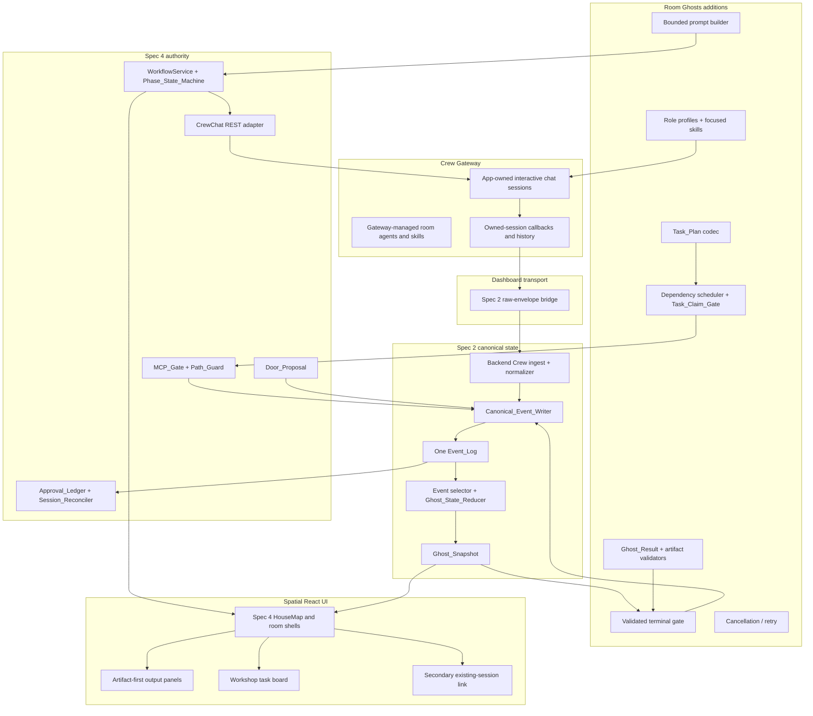
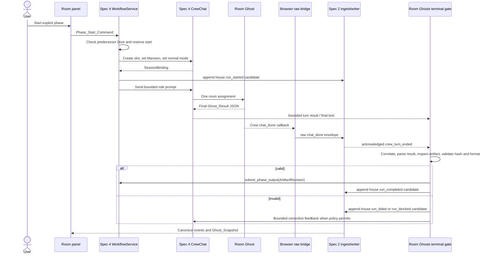
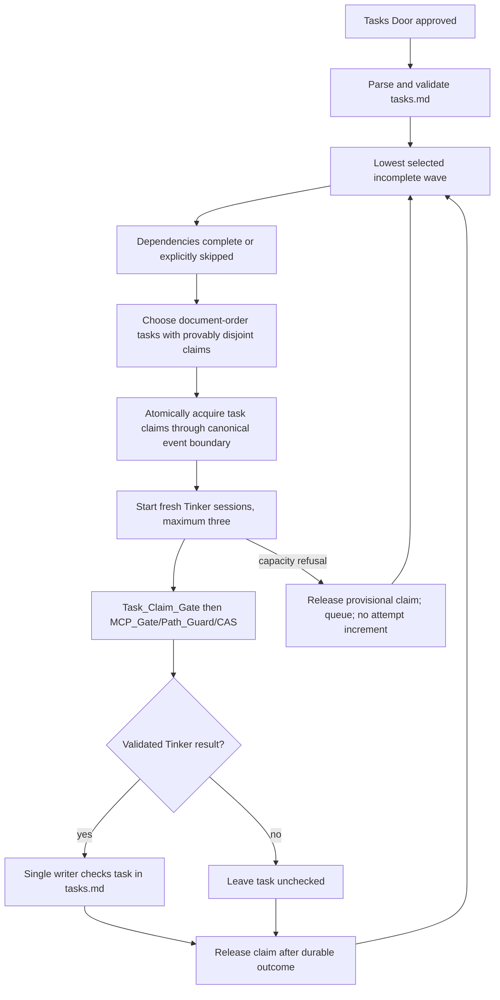

# Design Document

## Overview

Room Ghosts supplies role behavior, artifact contracts, task planning, task-claim scheduling, cancellation/retry controls, and artifact-first room panels on top of two completed prerequisites:

- Spec 2, `seance-log-and-ghost-state`, owns the canonical App_Event envelope, Canonical_Event_Writer, per-Mansion Sequence, one Event_Log, backend Crew normalization, event selection, Ghost_State_Reducer, Ghost_Snapshot, and replay semantics.
- Spec 4, `doors-and-guardrails`, owns Phase_State_Machine, Door_Proposal, Approval_Ledger, RoomPolicy, MCP_Gate, Path_Guard, guarded filesystem/command execution, CrewChat REST operations, Session_Reconciler, and first-wins domain decisions. It persists domain records only through Spec 2.

This feature does not add another event schema, log, writer, Ghost reducer, phase state machine, approval matcher, path guard, Crew normalizer, Crew WebSocket owner, chat client, or general MCP server. It specializes the gateway-managed Archivist, Draughtsman, Foreman, Tinker, and stretch Medium profiles and skills. It adds deterministic validation around model-authored output and extends Workshop scheduling with task-specific path claims and compare-and-swap writes.

Every runtime ghost uses Spec 4's app-owned-session sequence: create `/api/chat/slots`, set the Mansion project, set `/api/chat/mode` to `normal`, then send through `/api/chat`. The browser forwards raw owned-session Crew envelopes to Spec 2. Room Ghosts reacts only to acknowledged canonical events. Tool approvals use Spec 4 `(slot, mid)` reconciliation. `/api/spawn` and Kiro `/spec` are never used.

A canonical `crew_turn_ended` event is transport evidence, not successful work. The validated terminal gate correlates it with the matching Ghost_Result and expected artifact. Only Room Ghosts then appends a house-origin `run_completed`, `run_failed`, or supported `run_blocked` candidate through the Spec 2 writer.

The MVP includes the Archivist, Draughtsman, Foreman, up to three Tinkers, artifact validation, dependency and claim scheduling, cancellation/retry, and artifact-first room panels. The Medium and maximum-three-cycle Séance Room reviewer loop are stretch scope.

## Cross-spec ownership

| Concern | Owner | Room Ghosts responsibility |
|---|---|---|
| Canonical event envelope, IDs, Sequence, log, writer, integrity, replay order | Spec 2 | Build house-origin candidates and consume acknowledged events; never write storage. |
| Raw Crew normalization and reconnect catch-up | Spec 2 backend | React to canonical `crew_turn_ended`, tool, message, error, and approval facts; never map raw frames. |
| Ghost state | Spec 2 | Join Ghost_Snapshot into Room_Projection without an independent state store. |
| Phase, Door, approval, action, and path authority | Spec 4 | Invoke exact public commands and display their projections; never copy their folds. |
| App-owned Crew REST sessions and Session_Approval correlation | Spec 4 | Bind roles/runs, provide prompts, and request cancellation through verified extensions. |
| Artifact validation and domain terminal result | Room Ghosts, Spec 5 | Validate Ghost_Result and artifact before appending `run_completed` or failure. |
| Task-plan grammar, task claims, and dependency scheduling | Room Ghosts, Spec 5 | Narrow Tinker authority; never widen Spec 4 policy. |
| Final spatial presentation | House UI spec | Consume Room_Projection and existing exact command callbacks. |

Dependency order is `crew-app-foundation` → Spec 2 → Spec 4 → Spec 5. Room Ghosts implementation starts only when the Spec 2 writer/read/fold interfaces and Spec 4 workflow/approval/MCP/CrewChat interfaces are available. A conformance harness verifies those public interfaces but does not adapt, replace, or reconcile them.

### Research and verified inputs

Exact project documents read for this design:

- `.kiro/specs/crew-app-foundation/requirements.md`, `design.md`, and `tasks.md` for the signed backend, app-token client, live/replay SDK boundary, committed bundle, tests, and existing code seams.
- `.kiro/specs/seance-log-and-ghost-state/requirements.md` and `design.md` for the canonical App_Event/Event_Log/Ghost_Snapshot contracts.
- `.kiro/specs/doors-and-guardrails/requirements.md`, `design.md`, and `tasks.md` for phase, Door, Approval_Ledger, MCP_Gate, Path_Guard, app-owned session, and UI authority contracts.
- `.kiro/steering/tech.md`, `spikes/hh-spike/backend/server.py`, `spikes/hh-spike/agents/hh-scribe.json`, and `spikes/fixtures/s6-app-session-approval.jsonl` for verified Crew 0.12.1/0.12.2 request and event shapes.

Exact local documentation filenames used:

- `kiro-docs/crew__apps.md`, `crew__apps__manifest.md`, and `crew__apps__sdk.md` for gateway-managed resources, permission-scoped UI hooks, manifest resources, and API/event declarations.
- `kiro-docs/custom-agents__configuration-reference.md` and `custom-agents__creating.md` for V3 `tools`, `permissions.rules`, explicit resources, exact MCP selectors, and legacy `allowedTools` compatibility.
- `kiro-docs/steering.md`, `skills.md`, and `crew__capabilities__skills.md` for explicit custom-agent steering and skill resources.
- `kiro-docs/permissions.md`, `crew__security.md`, `crew__capabilities__mcp-tools.md`, and `mcp__security.md` for deny-overrides rules, interactive approvals, MCP trust, and auto-approval hazards.
- `kiro-docs/crew__chat__sessions.md` and `crew__chat__message-controls.md` for independent session state, stopping, partial output, and persistent history.
- `kiro-docs/crew__features__subagents.md` for capacity/backpressure concepts. Runtime ghosts do not use the subagent API.
- `kiro-docs/specs__feature-specs.md`, `specs__feature-specs__requirements-first.md`, and `specs__correctness.md` for Kiro-compatible artifacts, traceability, and property-test conventions.

When local docs and spikes differ, the verified spikes and foundation behavior win. In particular, the app backend uses raw aiohttp because `kirocrew-client` was not published, verifies `X-KiroCrew-Proxy`, and treats `approval_id` as reusable response data rather than approval identity.

## Architecture



### Cross-spec conformance gate

Task RG-C1 is an executable composition test over completed public interfaces. It must prove:

1. a phase start produces one acknowledged Spec 2 `run_started` App_Event and a Spec 4 working projection with the same Mansion, slot, ghost, and run identity;
2. Spec 4 Door, risky-action, path-denial, task-claim, and cancellation candidates all return through the one Spec 2 writer and replay from the one Event_Log;
3. approval authorization folds only acknowledged canonical records and consumes through Spec 2 compare-and-append;
4. browser-delivered raw Crew envelopes enter only Spec 2 ingest, and Spec 4/Room Ghosts consume only acknowledged canonical events;
5. `crew_turn_ended` leaves a run nonterminal until Room Ghosts validates Ghost_Result and artifact, after which exactly one domain terminal fact is appended; and
6. canonical blocked reasons needed by Room Ghosts are schema-valid.

Failure means the named prerequisite is unavailable or version-incompatible. Room Ghosts returns `contract_unavailable`; it does not implement an adapter, alternate writer, alternate reducer, or substitute normalizer.

### Phase run sequence



The terminal gate requires both the acknowledged `crew_turn_ended` record and matching bounded turn result. Arrival order does not matter. Duplicate `chat_done` delivery reuses the canonical Record_ID, and terminal settlement is idempotent by run identity. The Archivist, Draughtsman, and Foreman use the same app-owned session for user-requested revisions before Door approval. A retry after terminal failure or cancellation uses a fresh slot and higher Run_Sequence. Approving a valid Door never starts the next phase.

### Workshop scheduling sequence



A wave is a barrier. Wave `N` starts only after selected tasks in every lower wave are complete or explicitly skipped under spec 4 policy. The scheduler starts at most three Tinkers and never runs concurrent claims that may overlap. Unknown glob relationships count as overlap. Tinker writes require the active task claim and an expected file digest; claim authorization narrows spec 4 RoomPolicy and can never widen it.

## Components and Interfaces

### Specialized app resources

Spec 4 creates the gateway-managed MCP resource and baseline Archivist, Draughtsman, Foreman, and Tinker profiles. Room Ghosts completes their role prompts and skills and adds the disabled-by-default Medium profile/skill. The final resource catalog remains:

```text
app/agents/{archivist,draughtsman,foreman,tinker,medium}.json
app/skills/{ears-requirements,correctness-design,executable-tasks,scoped-implementation,bounded-review}/SKILL.md
app/mcp/server.py                         # owned by spec 4
app/mcp/room_tools.py                     # owned by spec 4, extended by Task_Claim_Gate
```

The final manifest has `resources: "gateway"`, `lifecycle: "gateway"`, the five agent paths, the five skill directories, the exact spec 4 MCP registration, `/api/version`, `/api/chat`, `/api/chat/*`, `/apps/haunted-house/api/*`, consumed event names, and `sessionApproval: true`. It has no spawn/global-approval path and no `autoApprove` field.

Every role profile:

- lists exact `@haunted-house-room-tools/<tool>` selectors established by spec 4 S9;
- uses V3 `permissions.rules`, denies unassigned MCP plus built-in filesystem/shell/web/subagent capability, and has empty `allowedTools`;
- sets `includeMcpJson: false` and `includePowers: false`;
- explicitly names Mansion steering and one room skill resource using the URI form proven by RG-S2;
- contains no authority-bearing Mansion root, room name, task claim, approval, or capability token in model-visible configuration;
- ends one assignment with exactly one Ghost_Result JSON object.

| Role | Existing spec 4 tools | Room Ghosts behavior and output |
|---|---|---|
| Archivist | list/read room file, write spec document, submit phase output | EARS/INCOSE requirements and glossary at active `requirements.md` |
| Draughtsman | list/read room file, write spec document, submit phase output | researched design, traceability, PBT assessment/properties at active `design.md` |
| Foreman | list/read room file, write spec document, submit phase output | executable checkboxes, requirement refs, Path_Claims, JSON waves at active `tasks.md` |
| Tinker | list/read, guarded room write, risky proposal/execution, submit result | exactly one Selected_Task within an active claim |
| Medium (stretch) | read tools and guarded test proposal only | structured review verdict; no file mutation |

Skills use valid Agent Skills frontmatter, deterministic checklists, artifact grammar, bounded repair behavior, and output examples. Skills never grant authority and contain no direct `/spec`, `/api/spawn`, built-in write, automatic approval, or unbounded review instruction.

### Core artifact contracts

`app/backend/haunted_house/core/ghost_result.py`

```python
class GhostStatus(StrEnum):
    READY = "ready"
    BLOCKED = "blocked"
    FAILED = "failed"

@dataclass(frozen=True)
class ArtifactRef:
    path: str
    sha256: str

@dataclass(frozen=True)
class GhostResult:
    schema_version: Literal[1]
    run_id: str
    status: GhostStatus
    summary: str
    artifacts: tuple[ArtifactRef, ...]
    task_id: str | None
    reason_code: str | None

def parse_ghost_result(text: str) -> GhostResult: ...
def print_ghost_result(value: GhostResult) -> str: ...
```

Parsing accepts exactly one JSON object and rejects prefixes/suffixes, duplicate or unknown keys, unknown status, traversal, noncanonical hashes, wrong run/task identity, control characters, and lengths beyond the contract. Printing uses UTF-8, sorted keys, and compact separators. The schema contains no transcript, environment, secret, app token, session capability, or arbitrary tool-output field.

`app/backend/haunted_house/core/task_plan.py`

```python
@dataclass(frozen=True)
class LeafTask:
    task_id: str
    title: str
    optional: bool
    complete: bool
    requirements: tuple[str, ...]
    writes: tuple[str, ...]
    document_index: int

@dataclass(frozen=True)
class TaskPlan:
    leaves: tuple[LeafTask, ...]
    waves: tuple[tuple[str, ...], ...]

def parse_task_plan(markdown: str) -> TaskPlan: ...
def print_task_plan(plan: TaskPlan) -> str: ...
def validate_task_plan(plan: TaskPlan, requirement_ids: frozenset[str]) -> tuple[Finding, ...]: ...
```

The grammar recognizes `- [ ] N.N`, `- [x] N.N`, optional `- [ ]* N.N`, `_Writes: ..._`, `_Requirements: ..._`, and the fenced JSON `## Task Dependency Graph`. Validation requires unique decimal IDs, every incomplete leaf exactly once, contiguous wave IDs from zero, requirement coverage, normalized Mansion-relative claims, and no possible same-wave claim overlap. Parse-print-parse preserves semantic order and metadata.

`app/backend/haunted_house/core/artifact_validation.py` provides pure validators:

- requirements: required headings, one EARS pattern per criterion, numbering, glossary definition before technical use, and no native `/spec` instruction;
- design: required sections, requirement coverage, property numbering/references, research citations, assumptions converted to named spikes;
- tasks: Task_Plan grammar, coverage, executable coding tasks, optional test markers, dependency graph, and every leaf represented once.

A `Finding` has stable `code`, `location`, and bounded safe `message`. Model-authored text never becomes an exception or API message without redaction and length limits.

### Prompt construction

`app/backend/haunted_house/core/prompts.py` renders phase, revision, Tinker, and Medium prompts from typed inputs. The prompt includes one run ID, one role, one objective, Mansion-relative paths, approved upstream artifact hashes, relevant requirements, the active task claim/revisions when applicable, exact allowed tool names, and the Ghost_Result schema.

The renderer rejects absolute or traversing paths, unknown IDs, controls, oversized feature briefs/feedback, duplicate task identities, more than one Selected_Task, and claims not accepted by Task_Plan validation. User/model text is delimited as data. No text can add a tool, permission, path, task, approval, or output field. The prompt explicitly says that `/spec`, `/api/spawn`, direct built-in mutations, unrelated tasks, and extra final prose are outside the assignment.

### Validated terminal gate

`app/backend/haunted_house/services/terminal_gate.py` is the only path from a room ghost's ended Crew turn to a successful room outcome:

```python
class TerminalGate(Protocol):
    async def settle_turn(
        self,
        binding: GhostRunBinding,
        turn_ended: AppEvent,
        final_text: str,
    ) -> TerminalOutcome: ...
```

The gate accepts only an acknowledged canonical `crew_turn_ended` whose Event_Scope matches the binding. It:

1. correlates the canonical transport fact and bounded CrewChat final text to one run;
2. parses one Ghost_Result;
3. checks run, role, task, path, and attempt identity;
4. reads each artifact through Spec 4's guarded-file interface;
5. checks current ArtifactRevision and digest;
6. runs the phase validator or task evidence validator;
7. submits the output to Spec 4 WorkflowService when valid;
8. appends one house-origin `run_completed` candidate through Spec 2 only after steps 1–7 succeed; and
9. otherwise appends one redacted `run_failed` or supported `run_blocked` candidate and leaves Door/task state unchanged.

The gate is idempotent by logical run-terminal identity. A duplicate `crew_turn_ended` or retry of settlement returns the existing terminal App_Event. It never accepts a raw `chat_done` envelope, and Spec 2 never emits a domain terminal candidate for that envelope.

### Workshop scheduler and task claims

`app/backend/haunted_house/core/workshop_scheduler.py`

```python
MAX_TINKERS = 3
MAX_ATTEMPTS = 3

@dataclass(frozen=True)
class WorkshopState:
    plan: TaskPlan
    selected: frozenset[str]
    outcomes: Mapping[str, TaskOutcome]
    active_claims: tuple[TaskClaim, ...]
    backpressure: Mapping[str, BackpressureState]

@dataclass(frozen=True)
class Dispatch:
    task_id: str
    paths: tuple[str, ...]

def claims_may_overlap(left: tuple[str, ...], right: tuple[str, ...]) -> bool: ...
def choose_dispatches(state: WorkshopState, available: int) -> tuple[Dispatch, ...]: ...
```

`choose_dispatches` considers only the lowest eligible wave, document order, user selection, completion state, attempts, dependencies, active claims, and available capacity clamped to `0..3`. It is pure and deterministic. Unknown path/glob relationships return may-overlap.

`Task_Claim_Gate` extends spec 4's room tool service. Trusted session context provides `(run_id, task_id, claim_id)`; model input cannot select a different claim. For every Tinker read/write/delete/command/git path, the gate first verifies the active claim and access kind, then calls spec 4 `MCP_Gate`, `Path_Guard`, and Approval_Ledger. An allow from the task claim cannot override a spec 4 denial. Every direct write includes an expected SHA-256; stale writes preserve current bytes.

Claim acquire/release facts are house-origin candidates appended through the Spec 2 Canonical_Event_Writer before session start or reuse. Claim acquisition uses compare-and-append against the current highest Sequence. Claim release occurs only after an acknowledged terminal outcome. A cancellation without confirmation retains the claim.

Backpressure uses delays `1, 2, 4, 8, 15` seconds, capped at 15. Crew capacity refusal does not create or increment a task attempt. Five uninterrupted refusal cycles without an active completion produce `capacity_unavailable` and require explicit Retry.

The task checkbox writer serializes updates through Spec 2 compare-and-append and Spec 4's guarded file replacement. It re-reads current `tasks.md`, confirms the expected digest, checks only the successful task, preserves unrelated bytes where possible, and appends outcome evidence through the Canonical_Event_Writer before releasing the claim. Concurrent completion order cannot lose a checkbox.

### Run, cancellation, and retry services

`GhostRunBinding` extends spec 4 `SessionBinding` with the spec 2 identity needed for Event_Scope:

```python
@dataclass(frozen=True)
class GhostRunBinding:
    run_id: str
    run_sequence: int
    mansion_id: str
    spec_name: str
    phase: str
    ghost_name: str
    slot: str
    attempt: int
    task_id: str | None
    claim_id: str | None
    upstream_hashes: Mapping[str, str]
```

`services/room_ghost_service.py` invokes Spec 4 WorkflowService for explicit starts and revisions, appends the matching `run_started` candidate through the Spec 2 writer, builds the role prompt, and hands the turn to Spec 4 CrewChat. It consumes Spec 2 acknowledged App_Events by Record_ID and joins Ghost_Snapshot with Spec 4 WorkflowProjection. It stores no independent ghost, Door, or event state.

`services/cancellation.py` uses the app-token-scoped owned-session cancellation operation discovered by RG-S3. Requesting cancellation submits a house-origin `ghost_progressed` candidate with progress kind `cancel_requested`. Confirmed cancellation submits `run_blocked` with the compatible `cancelled` reason, preserves prior acknowledged tool/approval events, leaves the task unchecked, and releases the claim. A 30-second unconfirmed cancellation uses `cancel_unconfirmed` and retains the claim.

Retry is explicit. A failed/cancelled run below three attempts creates a fresh slot, new run ID, greater Run_Sequence, and attempt+1. A capacity dispatch refusal is not an attempt. No automatic fourth attempt exists.

### Spec 2 and Spec 4 integration ports

Room Ghosts depends on public interfaces rather than storage or transport implementations:

```python
class CanonicalRunPort(Protocol):
    async def append_run_candidate(self, candidate: AppEventCandidate) -> AppEvent: ...
    async def compare_and_append_run_candidate(
        self, expected_sequence: int, candidate: AppEventCandidate
    ) -> AppEvent: ...
    async def read_after(self, mansion_id: str, sequence: int) -> CanonicalReadResult: ...
    async def ghost_snapshot(self, mansion_id: str, ghost_id: str) -> GhostSnapshot: ...

class GuardrailWorkflowPort(Protocol):
    async def start_phase(self, command: PhaseStartCommand) -> SessionBinding: ...
    async def submit_phase_output(self, command: SubmitOutputCommand) -> DoorProposal: ...
    async def workflow_projection(self, mansion_id: str) -> WorkflowProjection: ...
    async def decide_door(self, command: DoorDecisionCommand) -> WorkflowProjection: ...
    async def decide_risky_action(self, command: RiskyDecisionCommand) -> WorkflowProjection: ...

class GuardedRoomToolPort(Protocol):
    async def acquire_task_claim(self, binding: GhostRunBinding, paths: tuple[str, ...]) -> TaskClaim: ...
    async def inspect_artifact(self, binding: GhostRunBinding, path: str) -> ArtifactSnapshot: ...
    async def replace_claimed_file(self, claim: TaskClaim, path: str, expected_sha256: str, data: bytes) -> ArtifactSnapshot: ...
    async def release_task_claim(self, claim_id: str, terminal_record_id: str) -> None: ...
```

`CanonicalRunPort` is a narrow adapter over the Spec 2 Canonical_Event_Writer and fold. It cannot assign Sequence or write a file. Guardrail ports call the completed Spec 4 modules. Missing or incompatible interfaces return `contract_unavailable`; no fallback store, normalizer, reducer, approval matcher, or permissive tool exists.

### Backend API extensions

Spec 4 owns workflow, Door, risky-decision, and audit routes. Room Ghosts adds only role/task commands not already represented:

| Method and route | Purpose |
|---|---|
| `GET /api/mansions/{mansion}/specs/{spec}/room-ghosts` | Joined Ghost_Snapshot, WorkflowProjection, artifact, task, claim, and Session_Link metadata |
| `POST /api/mansions/{mansion}/specs/{spec}/feedback` | Send bounded pre-approval revision feedback to the current phase session |
| `POST /api/mansions/{mansion}/specs/{spec}/workshop/start` | Select validated tasks and start scheduling after the tasks Door is open |
| `POST /api/room-ghosts/runs/{run_id}/cancel` | Request verified owned-session cancellation |
| `POST /api/room-ghosts/runs/{run_id}/retry` | Explicit fresh attempt under limits |

Phase starts and Door/Risky approval decisions continue through spec 4 routes. The backend never adds a second approval endpoint. Every route remains behind foundation proxy verification and validates enum values, names, IDs, sizes, expected projection versions, and body keys. Accepted asynchronous commands return 202. Invalid input returns 400, unknown resources 404, stale/illegal state 409, and unavailable compatibility contracts 503.

### Room UI

Room Ghosts extends, rather than replaces, spec 4's `HouseMap`, Study, Drafting Room, Workshop, `DoorPanel`, and `WaitingPanel`. New shared pieces are:

```text
app/ui/src/components/ArtifactView.tsx
app/ui/src/components/GhostOutputSummary.tsx
app/ui/src/components/SessionLink.tsx
app/ui/src/components/RunRecoveryControls.tsx
app/ui/src/rooms/workshop/WorkshopTaskBoard.tsx
app/ui/src/rooms/seance-room/SeanceRoomPanel.tsx   # stretch
app/ui/src/core/room-projection.ts
app/ui/src/adapters/room-ghosts-api.ts
```

`RoomProjection` joins spec 2 Ghost_Snapshot with spec 4 WorkflowProjection and Room Ghosts artifact/task state. A version or integrity mismatch disables mutating controls and requests a fresh snapshot. The UI does not infer approval or success.

- The artifact/task board is first. It shows rendered Markdown or safe text, deterministic findings, current artifact digest, task waves/claims, and output summary.
- Ghost/door state follows with text and a distinct icon. The allowed write scope is visible.
- Existing spec 4 approval panels remain the sole decision controls.
- Cancel and Retry are explicit and state-gated.
- Session_Link is a secondary action after artifact/status content. It opens the existing slot through the exact RG-S4 SDK/route contract; it never creates a new chat.
- No room panel contains a primary inline composer.
- Existing spec 4 `useNotify`, `useNavBadge`, live region, keyboard map, focus restoration, reduced motion, and Still house rules remain authoritative. Room Ghosts supplies events/state to those components rather than implementing another notification coalescer.
- Replay uses spec 2 Event_Log plus the reconciled spec 4 projection adapter and the same room components. Mutations and Session_Link navigation are disabled in static replay.

## Data Models

### Ghost result

```python
@dataclass(frozen=True)
class ArtifactRef:
    path: str
    sha256: str

@dataclass(frozen=True)
class GhostResult:
    schema_version: Literal[1]
    run_id: str
    status: Literal["ready", "blocked", "failed"]
    summary: str
    artifacts: tuple[ArtifactRef, ...]
    task_id: str | None
    reason_code: str | None
```

Summary is 1-1000 characters after trimming. Artifact paths are normalized Mansion-relative POSIX paths. Digests are 64 lowercase hexadecimal characters. A ready phase result has exactly its allowed Phase_Artifact. A ready Tinker result contains only in-claim artifacts and completion evidence. Blocked/failed results carry a stable reason and cannot open a Door or check a task.

### Task plan, claims, and outcomes

```python
@dataclass(frozen=True)
class LeafTask:
    task_id: str
    title: str
    optional: bool
    complete: bool
    requirements: tuple[str, ...]
    writes: tuple[str, ...]
    document_index: int

@dataclass(frozen=True)
class TaskPlan:
    leaves: tuple[LeafTask, ...]
    waves: tuple[tuple[str, ...], ...]

@dataclass(frozen=True)
class TaskClaim:
    claim_id: str
    run_id: str
    task_id: str
    paths: tuple[str, ...]
    acquired_record_id: str

@dataclass(frozen=True)
class TaskOutcome:
    status: Literal["queued", "active", "complete", "failed", "cancelled", "blocked", "skipped"]
    attempt: int
    run_id: str | None
    evidence: tuple[ArtifactRef, ...]
    reason_code: str | None
```

A task is complete only after validated evidence and a successful serialized checkbox write. Failed, cancelled, blocked, or malformed results remain unchecked. Skip requires an explicit spec 4 decision and satisfies a wave barrier only when the reconciled policy allows it.

### Backpressure

```python
@dataclass(frozen=True)
class BackpressureState:
    task_id: str
    dispatch_failures: int
    next_delay_seconds: int
    last_reason: Literal["crew_capacity", "local_capacity", "claim_busy"]
```

Delays are 1, 2, 4, 8, and 15 seconds, then remain 15. Five uninterrupted Crew refusals produce `capacity_unavailable`. Local cap and claim contention do not increment the Crew-refusal count.

### Joined room projection

```typescript
interface RoomProjection {
  projectionVersion: number
  integrity: 'valid' | 'uncertain' | 'corrupt'
  room: 'study' | 'drafting_room' | 'workshop' | 'seance_room'
  ghost: GhostSnapshot
  workflow: PhaseView
  artifact: ArtifactView | null
  tasks: readonly TaskView[]
  activeRuns: readonly RunView[]
  sessionLink: string | null
  findings: readonly FindingView[]
}
```

The adapter validates both source projections. `integrity !== 'valid'` disables phase, Door, risky approval, cancellation, retry, and Workshop start controls. Display remains available from the valid prefix.

### Review verdict (stretch)

```python
@dataclass(frozen=True)
class ReviewFinding:
    finding_id: str
    requirement_ids: tuple[str, ...]
    paths: tuple[str, ...]
    summary: str

@dataclass(frozen=True)
class ReviewVerdict:
    status: Literal["pass", "changes_requested", "blocked"]
    cycle: int
    findings: tuple[ReviewFinding, ...]
```

Each changes-requested finding becomes one explicit repair-task proposal. The normal Workshop scheduler runs only user-approved repair tasks. The third non-pass cycle blocks review; there is no fourth automatic cycle.

## Correctness Properties

*A property is a characteristic or behavior that should hold true across all valid executions of a system-essentially, a formal statement about what the system should do. Properties serve as the bridge between human-readable specifications and machine-verifiable correctness guarantees.*

Redundancy review removed properties already owned by adjacent specs: Crew-frame normalization and base live/replay fold convergence belong to spec 2; phase ordering, Door first-wins, `(slot, mid)` approval correlation, path confinement, compare-and-swap spec writes, three-session cap, UI approval non-inference, and notification coalescing belong to spec 4. Room Ghosts tests those as integration contracts instead of restating their property tests. The remaining properties cover only role specialization, model-output contracts, task-specific authority, scheduling, validated terminal semantics, recovery, and stretch review behavior added by this feature.

### Property 1: Unsafe role-profile mutations are rejected

*For any* valid specialized role profile, adding a broad tool/MCP wildcard, removing the role skill or steering resource, enabling inherited MCP or Powers, adding a non-empty compatibility grant, removing a required deny rule, or adding `autoApprove` causes Room Ghosts profile validation to fail; the unchanged profile passes.

**Validates: Requirements 2.1, 2.2, 2.3, 2.4, 2.5, 2.6, 2.7, 2.8**

### Property 2: Ghost_Result serialization round trip

*For any* valid Ghost_Result, printing and then parsing produces an equivalent value, and the printed representation is one canonical UTF-8 JSON object with sorted keys and no forbidden field.

**Validates: Requirements 13.1, 13.3, 13.4**

### Property 3: Task_Plan serialization round trip

*For any* valid TaskPlan, printing and then parsing produces an equivalent ordered model of task IDs, checkbox states, optional markers, requirement references, Path_Claims, and waves, and the printed document uses the Kiro-compatible Task_Plan_Grammar.

**Validates: Requirements 7.2, 7.3, 7.4, 13.5, 13.6, 13.7**

### Property 4: Invalid task graphs and conflicting waves are rejected

*For any* valid task plan, deleting an incomplete leaf from the graph, duplicating an assignment, substituting a missing/non-leaf ID, making waves noncontiguous, placing possibly overlapping claims in one wave, or removing all coverage for a requirement produces a finding that identifies the violated task, wave, claim, or requirement.

**Validates: Requirements 7.4, 7.5, 7.6, 7.7, 13.8**

### Property 5: Rendered prompts cannot widen a run

*For any* valid feature brief, feedback, upstream artifacts, and one Selected_Task, the rendered prompt contains exactly the supplied run, role, task, requirement, claim, revision, and allowed-tool identities; contains no second task or out-of-claim path; and contains no `/spec` or `/api/spawn` invocation.

**Validates: Requirements 3.4, 3.7, 9.1**

### Property 6: Completion requires a canonical turn end and valid matching artifact

*For any* phase or task run, the terminal gate appends successful completion if and only if it has an acknowledged `crew_turn_ended` App_Event for the current Event_Scope, Ghost_Result is schema-valid and identifies the run/task, status is `ready`, artifacts are permitted and match current hashes, phase/task validation passes, and Spec 4 accepts output submission; every failed check leaves the Door sealed or task unchecked and appends no `run_completed` App_Event.

**Validates: Requirements 5.5, 5.6, 6.5, 6.6, 7.8, 7.9, 9.6, 9.7, 10.9, 10.10, 10.11, 13.2**

### Property 7: Scheduler dispatches only safe ready work

*For any* valid WorkshopState and available capacity, every dispatch belongs to the lowest eligible wave, is selected/incomplete, has every lower-wave dependency complete or explicitly permitted as skipped, respects the three-Tinker cap, and is pairwise disjoint from active and newly selected claims; no completed task or dependent of a non-successful task is chosen.

**Validates: Requirements 8.1, 8.2, 8.3, 8.4, 8.8, 12.7**

### Property 8: Backpressure preserves task identity and attempt

*For any* ready task and any capacity-refusal sequence, backpressure keeps the same task queued, leaves attempt unchanged, and yields delays `1, 2, 4, 8, 15, 15...`; successful capacity release resumes document order, while five uninterrupted Crew refusals produce `capacity_unavailable` rather than an unbounded retry.

**Validates: Requirements 8.6, 8.7**

### Property 9: A task claim can only narrow Tinker authority

*For any* Tinker RoomPolicy, active File_Ownership_Claim, requested path, and access kind, Task_Claim_Gate permits forwarding to spec 4 only when the trusted run/task/claim identities match and the path is inside the claim; the final result is allowed only when spec 4 MCP_Gate and Path_Guard also allow it.

**Validates: Requirements 8.2, 8.4, 8.8, 9.2, 9.3, 9.5**

### Property 10: Parallel task completion is confluent

*For any* valid plan and set of distinct successful task completions, applying completions through the single task-plan writer in any order produces the same checked-task set, preserves unrelated content/metadata, and releases each completed claim exactly once after a durable outcome.

**Validates: Requirements 8.5, 9.8**

### Property 11: Canonical room integration has one validated terminal fact

*For any* valid room-run history with duplicate raw delivery and canonical redelivery, Spec 2 assigns one logical `crew_turn_ended` fact, Room Ghosts consumes each acknowledged Record_ID at most once, no successful terminal event exists before artifact validation, and at most one `run_completed` App_Event exists for the logical run; live incremental and Event_Log replay joins produce equivalent room outcome and artifact readiness.

**Validates: Requirements 10.1, 10.2, 10.3, 10.4, 10.5, 10.6, 10.7, 10.8, 10.9, 10.10, 10.11, 10.12**

### Property 12: Cancellation and retry stay bounded

*For any* Ghost_Run history with zero to three attempts, confirmed cancellation preserves prior events and releases the claim once, unconfirmed cancellation retains the claim and blocks the run, a permitted explicit retry creates one fresh slot/Run_Sequence and increments attempt exactly once, and no automatic fourth attempt is created.

**Validates: Requirements 12.1, 12.2, 12.3, 12.5, 12.6, 12.8**

### Property 13: The review loop terminates within three cycles

*For any* stretch review verdict sequence, `pass` terminates without a successor cycle, each `changes_requested` below cycle three creates one validated repair-task proposal per finding, and a third non-pass produces `blocked` with no fourth automatic review.

**Validates: Requirements 14.3, 14.4, 14.5, 14.6**

## Error Handling

| Condition | Behavior |
|---|---|
| Required Spec 2 or Spec 4 public interface is absent or incompatible | Return `contract_unavailable`; start no room ghost; create no compatibility adapter or fallback store |
| A raw Crew envelope reaches Room Ghosts | Reject the call path; route the envelope through Spec 2 ingest and consume only its canonical acknowledgment |
| `crew_turn_ended` has no matching result or validated artifact | Keep the run nonterminal until bounded reconciliation or append a supported failure/block outcome |
| Canonical schema rejects a required reason/progress value | Keep the associated feature blocked until Spec 2 adds a backward-compatible schema value |
| Steering/skill URI form does not load in an installed app agent | Apply RG-S2's verified explicit URI or bounded immutable prompt injection; never assume inherited context |
| Mansion/spec/run input is invalid | Return 400/404 before spec 4 WorkflowService or Crew call |
| Predecessor Door is sealed or projection version is stale | Use spec 4's 409 response and unchanged projection |
| App-owned slot setup fails | Use spec 4 `phase_start_failed`; no later setup/send call executes |
| Permission lacks `mid` or correlation is ambiguous | Use spec 4 ignored/blocked reconciliation; authorize no action |
| Ghost_Result is malformed/mismatched | Persist safe failure/block through spec 2; keep Door/task unchanged |
| Artifact path/hash/revision is stale or out of scope | Preserve current bytes; return deterministic finding; keep task/phase incomplete |
| Task graph/claim is invalid | Reject Workshop start and name the offending task/wave/claim |
| Claim acquisition races | Keep task queued; start no Tinker until canonical acquisition succeeds |
| Crew refuses capacity | Release provisional claim; bounded backoff; no attempt increment |
| Five uninterrupted Crew capacity refusals | Block as `capacity_unavailable`; require explicit Retry |
| Cancellation lacks confirmation after 30 seconds | Block as `cancel_unconfirmed`; retain claim |
| Backend restarts during active work | Rebuild from canonical Event_Log and reconcile app-owned sessions; repeat no uncertain side effect |
| Existing-session navigation contract is unavailable | Disable Session_Link with `contract_unavailable`; never open a replacement/new chat |
| Medium reaches three non-pass cycles | Block review and require user decision |

All API, event, validation, and tool errors use existing spec 2/spec 4 redaction. They contain stable codes and bounded safe detail, never raw Gateway bodies, app tokens, proxy secrets, session capabilities, full prompts, document contents in event payloads, or unbounded model output.

## Testing Strategy

Room Ghosts contains pure codecs, validators, scheduling, path-claim narrowing, and lifecycle logic, so property-based testing applies to those additions. It does not duplicate property tests for spec 2 normalizers/reducers or spec 4 workflow/approval/path/UI mechanisms. Cross-spec behavior uses executable contract and integration tests.

### Property tests

- Use Hypothesis in `app/backend/tests/property/` for Properties 1 through 13. Property 11 calls completed in-memory Spec 2 and Spec 4 public interfaces after RG-C1; it performs no real filesystem or Gateway I/O.
- Run at least 100 examples per property. Use one property-based test per numbered property.
- Add this exact comment to each test: `Feature: room-ghosts, Property N: <property title>`.
- Use reference models for profile mutation, task-graph set equality, scheduler readiness/capacity, claim intersection, checkbox confluence, terminal gating, and retry/review bounds.

### Unit and contract tests

- Profiles and skills: parse all role JSON/frontmatter, resolve references, verify exact tools/resources/rules, recursively reject `autoApprove`, and scan role instructions for prohibited native spec/spawn/direct-write behavior.
- Prompts: golden and boundary examples with Unicode, Markdown fences, prompt-looking input, controls, absolute/traversing paths, oversized feedback, duplicate tasks, and unknown requirement IDs.
- Artifact validators: all EARS forms; ambiguous criteria; undefined terms; missing design sections; malformed property refs; Kiro task checkbox/optional/path-claim/graph errors; malformed Ghost_Result keys/status/hash/identity.
- Terminal gate: fake accepted/rejected spec 4 output and spec 2 candidate ports; assert no completion before validation and no Door/task mutation on error.
- UI: DOM tests for artifact-first order, state text/icon, visible authority, no composer, existing spec 4 approval controls, cancel/retry, secondary Session_Link, focus restoration, reduced motion, and replay read-only actions.

### Cross-spec conformance tests

- Build one composition harness using the completed Spec 2 App_Event/writer/read/folds and Spec 4 phase/approval/path interfaces. Prove the six cross-spec conformance invariants under startup, duplicate delivery, restart, phase completion, invalid artifact, risky approval, and task claim.
- Assert no Room Ghosts path opens an Event_Log, assigns canonical writer fields, maps a raw Crew envelope, constructs an independent Ghost_State/Door/approval/path model, or writes an alternate durable state file.
- Feed raw S6 fixture observations through Spec 2 ingest once, then use acknowledged canonical events for every Spec 4 and Room Ghosts assertion.
- Use shared scrubbed vectors for acknowledged events, Ghost_Snapshot, WorkflowProjection, and joined RoomProjection.
- Verify Spec 4 `(slot, mid)` first-wins behavior through its existing public tests rather than a second matcher.

### Gateway and MCP integration tests

- Reuse spec 4's fake Gateway and real MCP subprocess harness. Add role prompts/results, terminal interception, app-resolvable approvals, cancellation, Session_Link, capacity refusal, and three-Tinker task scenarios.
- Replay `spikes/fixtures/s6-app-session-approval.jsonl` only through Spec 2's canonical raw-ingest path; every downstream assertion consumes acknowledged App_Events.
- Run RG-S2 against installed profiles to confirm steering/skill resources and exact tool visibility.
- Run RG-S3 to establish cancellation request/confirmation. Run RG-S4 to establish existing-slot navigation. Run RG-S5 to classify capacity signals.
- An opt-in live Crew test uses a disposable Mansion, creates one harmless role session, approves one safe MCP write through the app, verifies one denied bypass, validates the artifact, and observes the canonical terminal state. Fixtures are scrubbed before write.

### Test commands

- Python: `scripts/test-py.sh -q app/backend/tests`
- UI: `npm --prefix app/ui test -- --run`
- Type checking: `npm --prefix app/ui run typecheck`
- Full suite: `scripts/test-all.sh`
- Existing manifest, bundle-import, secret, fixture-home-path, stale-bundle, and `.kiro` checks remain required.

## Requirement Traceability

| Requirement | Primary owner and addition | Verification |
|---|---|---|
| 1 | Spec 4 manifest/MCP base; specialized role resources | Profile/skill/manifest contract tests |
| 2 | Specialized Agent_Profile validator | Property 1; live RG-S2 denial probe |
| 3 | Spec 4 CrewChat/WorkflowService; GhostRunBinding/prompt | Property 5; app-owned session integration |
| 4 | Spec 4 Session_Reconciler and WaitingPanel | Existing spec 4 properties plus room-panel integration |
| 5 | Archivist skill, requirements validator, terminal gate | Property 6; golden Study run |
| 6 | Draughtsman skill, design validator, terminal gate | Property 6; golden Drafting run |
| 7 | Foreman skill and Task_Plan codec | Properties 3-4; golden planning run |
| 8 | Workshop scheduler/backpressure | Properties 7-8; fake capacity integration |
| 9 | Task_Claim_Gate, spec 4 MCP_Gate/Path_Guard | Properties 6, 9-10; real MCP contract tests |
| 10 | Spec 2 writer/ingest conformance, terminal gate, joined projection | Property 11; cross-spec live/replay test |
| 11 | Spec 4 house controls plus output panels/task board/Session_Link | DOM and accessibility tests |
| 12 | Cancellation/retry service | Property 12; RG-S3 integration |
| 13 | Ghost_Result and Task_Plan codecs | Properties 2-4; malformed input tests |
| 14 | Medium skill, review cycle, repair proposals | Property 13; stretch integration |
| 15 | Contract and live harnesses | Test collection and opt-in live checks |

## Decisions and Spike-Gated Assumptions

| Spike | Question | Pass condition | Failure behavior |
|---|---|---|---|
| RG-C1: prerequisite conformance | Do the completed Spec 2 and Spec 4 public interfaces match the ownership table? | All six conformance invariants pass without an adapter or alternate store | Block room runs with `contract_unavailable`; fix the owning prerequisite spec rather than adding compatibility code |
| RG-S2: app resource loading | What explicit `file://` and `skill://` URIs load Mansion steering and the installed role skill for gateway-managed app agents? | Each disposable role sees only expected markers and exact tools | Use the verified explicit form or bounded immutable injection; never depend on implicit inheritance |
| RG-S3: owned-session cancellation | What app-token request and event confirm cancellation of an owned active turn? | Harmless waiting turn cancels; completed tool events remain; confirmation identity is unambiguous | Keep Cancel disabled with `contract_unavailable` |
| RG-S4: existing-session navigation | What SDK operation or stable dashboard route opens an existing slot? | Room action opens the same slot identity without creating a chat | Keep Session_Link disabled; never substitute a new chat |
| RG-S5: app-owned capacity | Which Gateway statuses/events mean retryable pressure versus terminal failure? | Bounded harmless turns produce scrubbed classified contracts | Retry only known signals; classify unknown refusal as blocked |

RG-C1 is a hard prerequisite conformance check, not a design spike or implementation task. Spec 4 S9 remains the hard prerequisite for trusted MCP session identity, and Spec 4 S10 controls whether command/git tools are available. Room Ghosts adds no weaker fallback.
