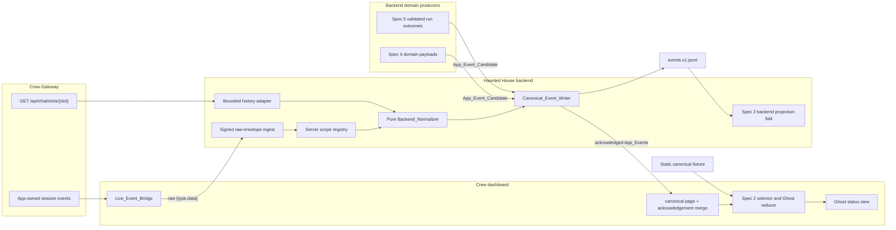

# Design Document

## Overview

This feature makes one backend-written canonical Event_Log the source of truth for Haunted House activity. The browser uses Crew's `useAppEvents` hook only as a low-latency transport. For each subscribed callback it sends `{type, data}` to the signed backend ingest route without interpreting the payload. The backend validates the registered session scope, normalizes the Crew envelope, redacts it, assigns deterministic identifiers and the next per-Mansion Sequence, appends one canonical JSON line, flushes it, and returns the acknowledged App_Event. The browser updates live state only from those acknowledgments and from canonical pages read after reconnect.

House-originated facts use the same Canonical_Event_Writer directly. In particular, `doors-and-guardrails` submits workflow, Door, approval, action, and guardrail records as `domain_event_recorded` candidates. The domain owns those payloads and folds; this feature owns their envelope, persistence, Sequence, optional tamper evidence, selection, and replay order.

A Crew `chat_done` envelope becomes only `crew_turn_ended`. It is transport evidence with no terminal Ghost_State effect. `room-ghosts` later correlates that acknowledged fact with a Ghost_Result and expected artifact, validates both, and appends `run_completed`, `run_failed`, or a supported `run_blocked` candidate. No path in this feature infers success from `chat_done`.

The design extends the implemented `crew-app-foundation` seams. `server.py` already applies `X-KiroCrew-Proxy` middleware to `/api/`, `GatewayClient` already centralizes app-token REST calls, and `app/ui/src/adapters/sdk.ts` is already the only UI importer of `@kirocrew/app-sdk`. The current code contains no event store or normalizer, so this design introduces one of each without migration between competing stores.

All requirements are MVP. A direct backend subscription to Crew's WebSocket is a future optimization spike. If implemented later, it must replace browser delivery and feed the same backend normalizer and writer.

## Cross-spec ownership

| Concern | Owner | Consumers and rule |
|---|---|---|
| Canonical App_Event envelope and validation | Spec 2, `seance-log-and-ghost-state` | Every feature persists this envelope and no other. |
| Event_ID, Record_ID, Sequence, optional `prev_hash`/`hash` | Spec 2 Canonical_Event_Writer | Producers supply stable candidate identity only; they never assign writer fields. |
| Single append-only Event_Log | Spec 2 Log_Store through the writer | Spec 4 and Spec 5 have no log or direct file writer. |
| Crew envelope normalization | Spec 2 backend normalizer | Browser forwards raw envelopes; Specs 4 and 5 consume acknowledged events. |
| Ghost selection, state, and replay semantics | Spec 2 selector/reducer | Live and replay implementations share vectors and rules. |
| Workflow, Door, approval, action, and guardrail payload semantics | Spec 4, `doors-and-guardrails` | Spec 4 validates and folds its domain payloads, then appends through Spec 2. |
| Artifact validation and successful terminal decision | Spec 5, `room-ghosts` | Only Spec 5 converts `crew_turn_ended` into `run_completed` or validation failure. |
| Final spatial composition | `house-ui-and-accessibility` | Consumes acknowledged projections and never normalizes Crew data. |

Dependency order is `crew-app-foundation` → Spec 2 → Spec 4 → Spec 5. Spec 2's interfaces must exist before Spec 4 can implement compare-and-append authorization. Spec 4's authority interfaces must exist before Spec 5 can start room ghosts or validate outputs.

## Research findings and constraints

- `.kiro/steering/tech.md` and `spikes/fixtures/s6-app-session-approval.jsonl` verify app-owned-session frames for `chat_message`, `chat_message_update`, `chat_status`, `chat_segment`, `chat_chunk`, `chat_done`, `tool_call`, `tool_result`, `shared_crew.decision`, and `approval_resolved`.
- Permission identity is `mid`. `approval_id` repeats across turns and is response data only.
- Most Crew frames have no timestamp. Writer Sequence records accepted observation order; deterministic source identity and source sequence retain upstream ordering evidence where present.
- `useAppEvents` is host-supplied and currently declared locally as a callback receiving `data`. Static subscriptions know the event type, so the Live_Event_Bridge can reconstruct the raw `{type, data}` envelope without changing `data`.
- Browser delivery can duplicate or omit frames across reconnects. Exact Record_ID deduplication and backend session-history reconciliation address those cases.
- The backend can obtain an app token through the implemented `GatewayClient`. A direct app-token WebSocket is verified as possible by S6, but using it here would add lifecycle and reconnect work that is unnecessary for MVP. It remains a replacement optimization, not a second owner.
- The product requires one append-only log and replay from that log alone. The canonical log path is `.haunted-house/seance/events.v1.jsonl`.

### Required event-shape spikes

1. **S2-A1, callback envelope:** Verify every subscribed event reaches `useAppEvents` with the callback data shape expected by the raw bridge and that unsubscription stops delivery. Fallback: block that event subscription; do not move normalization into the browser.
2. **S2-A2, failure and result fields:** Capture bounded scrubbed `chat_error` and final/non-final `tool_result` shapes. Fallback: preserve only stable identifiers and safe category values.
3. **S2-A3, reconnect indication:** Determine whether the SDK exposes a stable reconnect signal. Fallback: catch up on mount, visibility return, detected source gap, and bounded polling while runs are active.
4. **S2-A4, history completeness:** Confirm bounded fields returned by `GET /api/chat/slots/{slot}` after restart. Fallback: recover only facts the history proves and report `history_partial`.

## Architecture



### Commit and publication flow

1. A backend domain producer registers an Event_Scope by appending `run_started` through the writer. The acknowledged record updates the server scope registry.
2. The Live_Event_Bridge subscribes to exact supported Crew event names. It packages the known type with callback data and posts the raw envelope.
3. The ingest route accepts only envelopes whose slot maps to a server-registered active scope. Browser-supplied scope fields are ignored or rejected.
4. The pure Backend_Normalizer maps each accepted envelope to zero or more candidates. `chat_done` always maps to `crew_turn_ended`; it never creates a terminal run candidate.
5. The writer validates the full batch, deeply redacts it, resolves causal EventRefs, calculates Event_ID and Record_ID, and checks exact duplicates under the per-Mansion lock.
6. Each new physical record receives the next Sequence. The production writer also calculates `prev_hash` and `hash`. It appends canonical bytes, flushes, and calls `fsync` before acknowledgment.
7. The browser merges only acknowledged App_Events. Reconnect starts with `GET .../events?after_sequence=<last>` and publishes current state only after catch-up.
8. Live and replay folds select one variant per Event_ID, order selected records by persisted Sequence, and apply the same state rules. A Ghost_Transition is derived from consecutive snapshots and is not persisted as another event.

The physical log remains append-only. Sequence is physical accepted order. Event selection may omit exact duplicates and losing variants from a projection, but it never rewrites the log. Domain folds use the selected records in Sequence order.

## Components and Interfaces

### Canonical event model

Python owns validation, normalization, writer transforms, and backend projection. TypeScript owns browser parsing and the UI/replay projection implementation. Both implement this spec's rules and consume shared scrubbed vectors; no other spec defines an event model.

```ts
export type EventType =
  | 'run_started' | 'ghost_progressed'
  | 'message_recorded' | 'message_updated'
  | 'response_segment_started' | 'response_chunk_recorded'
  | 'crew_turn_ended' | 'crew_error_observed'
  | 'run_completed' | 'run_blocked' | 'run_failed'
  | 'tool_started' | 'tool_updated' | 'tool_finished'
  | 'approval_requested' | 'approval_decided' | 'decision_recorded'
  | 'domain_event_recorded' | 'source_event_observed'

export interface EventScope {
  mansion_id: string
  ghost_id: string
  session_slot: string
  run_id: string
  run_sequence: number
}

export interface EventSource {
  origin: 'crew' | 'house'
  source_type: string
  identity_parts: readonly string[]
  revision: number
  generation: string
  source_sequence: number
}

export interface AppEventCandidate {
  schema_version: 1
  event_type: EventType
  scope: EventScope
  source: EventSource
  caused_by: readonly EventRef[]
  occurred_at_ms: number | null
  payload: JsonValue
}

export interface AppEvent extends AppEventCandidate {
  event_id: `e1:${string}`
  record_id: `r1:${string}`
  sequence: number
  persisted_at_ms: number
  caused_by: readonly `e1:${string}`[]
  prev_hash?: `h1:${string}`
  hash?: `h1:${string}`
}
```

`domain_event_recorded` uses:

```ts
interface DomainEventPayload {
  domain: string
  kind: string
  entity_id: string
  data: JsonValue
}
```

Spec 2 validates bounds and JSON compatibility. The named domain validates its `kind` and `data` before submission and again while folding. The outer schema never changes for a new domain kind.

Limits are: Mansion names match `^[a-z0-9]+(-[a-z0-9]+)*$` and are at most 40 characters; identifiers are 1–160 UTF-8 bytes; `identity_parts` contains 1–8 values of at most 512 bytes before redaction; at most 32 causal references; payload encoding is at most 256 KiB; ingest batches contain at most 100 envelopes and one request is at most 1 MiB.

### Identity, Sequence, and tamper evidence

Event_ID canonical bytes are:

```json
[1,"<event_type>",{"mansion_id":"...","ghost_id":"...","session_slot":"...","run_id":"...","run_sequence":0},{"origin":"crew","source_type":"chat_chunk","identity_parts":["..."]}]
```

Event_ID is `e1:` plus lowercase SHA-256 of those redacted bytes. Record_ID is `r1:` plus lowercase SHA-256 of the complete redacted candidate after causal references become Event_ID values. Record_ID excludes `sequence`, `persisted_at_ms`, `record_id`, `prev_hash`, and `hash`, so a retry can be identified before writer metadata exists.

The first appended record has Sequence 1. Every later new record receives predecessor Sequence + 1 under the per-Mansion lock. An exact Record_ID returns the stored record and consumes no Sequence. `compare_and_append(expected_sequence, candidates)` compares against the highest physical Sequence while holding the same lock used for append. This gives Spec 4 optimistic concurrency without giving it a store.

The schema permits `prev_hash` and `hash` as an optional pair for compatibility with externally supplied fixtures. The production writer enables tamper evidence when it creates a new log and then includes the pair on every record in that log. `prev_hash` is `h1:` plus 64 zeroes for genesis or the preceding physical record's `hash`. `hash` covers the complete redacted canonical record except `hash` itself and includes Sequence and `prev_hash`. A log may not switch between linked and unlinked records after its first record.

### Backend normalizer

`app/backend/haunted_house/core/crew_event_normalizer.py` is pure:

```python
@dataclass(frozen=True)
class CrewEnvelope:
    type: str
    data: JSONValue

@dataclass(frozen=True)
class NormalizationContext:
    scope_by_slot: Mapping[str, EventScope]
    approval_mid_by_decision: Mapping[str, str]

@dataclass(frozen=True)
class NormalizeResult:
    candidates: tuple[AppEventCandidate, ...]
    reconcile_slots: tuple[str, ...]
    diagnostic: NormalizeDiagnostic | None

def normalize_crew_envelope(
    envelope: CrewEnvelope,
    context: NormalizationContext,
) -> NormalizeResult: ...
```

| Crew envelope | Canonical candidate | State effect |
|---|---|---|
| `chat_message` | `message_recorded` | none |
| `chat_message_update` | `message_updated` | none |
| `chat_status` | `ghost_progressed` | working evidence only |
| `chat_segment` | `response_segment_started` | none |
| `chat_chunk` | `response_chunk_recorded` | none |
| any `chat_done` | `crew_turn_ended` | none |
| `chat_error` | `crew_error_observed` | none |
| initial `tool_call` | `tool_started` | opens tool |
| updating `tool_call` | `tool_updated` | none |
| `tool_result` | `tool_finished` | closes tool only when final |
| `shared_crew.decision` | `decision_recorded`, plus matched approval fact | matched approval only |
| `approval_resolved` | matched `approval_decided` | clears matched approval |
| other `chat_*` | `source_event_observed` | none |

`crew_turn_ended` preserves bounded redacted transport fields such as generation, `continuing`, and `needs_input`. It deliberately does not carry a claimed domain outcome. `crew_error_observed` preserves a fixed safe category. Room Ghosts decides whether either observation settles a run.

An unmatched decision can produce `decision_recorded` and request history reconciliation, but it cannot invent an approval `mid`. Unsupported dashboard noise is not subscribed. Unknown `chat_*` values remain auditable and state-neutral.

### Canonical Event Writer

`app/backend/haunted_house/core/seance_event.py` contains pure candidate/event validation, canonical JSON, identity calculation, redaction-independent transforms, parser logic, and hash verification. `deep_redact.py` extends the foundation string redactor across JSON trees.

The external seam is small:

```python
class CanonicalEventWriter(Protocol):
    async def append_candidates(
        self, mansion_id: str, candidates: Sequence[object]
    ) -> AppendResult: ...

    async def compare_and_append(
        self, mansion_id: str, expected_sequence: int, candidates: Sequence[object]
    ) -> AppendResult: ...

    async def read_after(
        self, mansion_id: str, after_sequence: int, limit: int
    ) -> CanonicalReadResult: ...
```

`AppendResult` contains acknowledged App_Events, duplicate Record_ID values, highest Sequence, and safe diagnostics. `CanonicalReadResult` contains physical records after the requested Sequence, highest Sequence, integrity status, valid-prefix boundary, and safe diagnostics.

Only `app/backend/haunted_house/adapters/seance_log_store.py` opens the log file. The adapter resolves a pre-existing Mansion under the configured root, rejects symlink escape, uses an inter-process lock because the MCP resource may call through a separate process, scans and verifies the physical tail, appends with `O_APPEND`, flushes, and `fsync`s. Blocking work runs outside the event loop. No other module receives a file handle or log path.

The writer is the only implementation permitted to assign Sequence and hash fields. Backend services call it in process. A separate MCP process reaches a capability-bound backend operation selected by Spec 4's S9 result; it never opens the Event_Log directly.

### Deep redaction

`deep_redact(value, known_secrets)` recursively processes keys, values, and arrays. It replaces known secrets in raw and mixed percent-encoded forms, credential-key values, repository credential patterns, and platform Home_Path prefixes. Unsafe key collisions receive deterministic placeholders. The result preserves JSON types and member counts and is idempotent.

Redaction runs before Event_ID, Record_ID, hash, Sequence serialization, response construction, or diagnostics. A residual scan fails the complete candidate batch. Diagnostics contain category and candidate index only.

### Event selection and Ghost state

Spec 2 owns equivalent pure folds in Python and TypeScript. Shared vectors and parity tests are normative when language behavior differs.

Selection rules:

1. collapse exact Record_ID duplicates;
2. group variants by Event_ID;
3. select the maximum `(source.revision, semantic_completeness, record_id)`;
4. sort selected events by `(sequence, event_id)`;
5. diagnose missing or forward causal references without changing Sequence order.

The Ghost_State_Reducer groups by `(mansion_id, ghost_id)`, selects the greatest `(run_sequence, run_id)` containing `run_started`, and applies set-based facts for that Run:

1. `run_failed` selects `failed`;
2. otherwise `run_blocked` selects `blocked`;
3. otherwise `run_completed` selects `done`;
4. otherwise an unresolved approval selects `waiting`;
5. otherwise `run_started` selects `working`;
6. no selected Run selects `idle`.

`crew_turn_ended`, `crew_error_observed`, `domain_event_recorded`, messages, chunks, decisions, and unknown source observations have no direct terminal effect. Pending approvals are requested `mid` values minus decided `mid` values. Open tools are started tool IDs minus final finished tool IDs. Arrays are unique and sorted.

A Ghost_Transition is derived by comparing snapshots before and after an acknowledged canonical record. Its identity is the causing canonical Event_ID plus ghost identity and destination state. It supports UI deduplication but is not written back to the log, avoiding recursive derived events and browser-authored audit state.

### Live bridge and reconnect

`app/ui/src/adapters/seance-live.ts` owns subscriptions and transport only:

```ts
interface CrewEnvelope { type: string; data: unknown }
interface SeanceLiveState {
  highestSequence: number
  snapshots: ReadonlyMap<string, GhostSnapshot>
  catchingUp: boolean
  diagnostic: EventDiagnostic | null
}
```

The adapter loads canonical pages on mount, registers static `useAppEvents` subscriptions, and POSTs raw envelopes to `/seance/ingest`. It cannot import a Crew normalizer. It merges returned records by Record_ID and recomputes the Spec 2 fold. Failed requests enter a bounded retry queue but do not affect snapshots.

Reconnect or visibility recovery first reads records after `highestSequence`. If a source gap needs Crew history, the UI requests backend reconciliation. The backend history adapter allows only registered slots, extracts bounded Crew facts, and sends them through the same Backend_Normalizer and Canonical_Event_Writer. Catch-up ends only after the resulting canonical records are read.

A direct backend WebSocket implementation is not an MVP task. A future spike must prove authentication, filtering, reconnect, and shutdown. Enabling it disables browser forwarding for that deployment and changes no normalizer, writer, or schema.

### Server routes

All routes inherit foundation proxy verification:

| Method and path | Contract |
|---|---|
| `POST /api/mansions/{id}/seance/ingest` | `{envelopes: CrewEnvelope[]}`; validates registered slots, normalizes, persists, returns canonical events. |
| `GET /api/mansions/{id}/seance/events?after_sequence=&limit=` | Returns canonical physical records after Sequence, highest Sequence, valid-prefix/integrity data, and diagnostics. |
| `POST /api/mansions/{id}/seance/reconcile` | Requests bounded history recovery for registered slots; recovered facts use the same normalizer/writer. |

The generic domain writer is an internal application interface, not a browser endpoint. Spec 4 workflow routes and the capability-bound MCP adapter call it. Invalid batch members reject the affected batch before append. Missing Mansion log directories return 404. Stale compare-and-append returns a typed conflict to internal callers. There is no update, delete, truncate, repair, or renumber route.

### Replay

`fixtures/replay/demo.jsonl` becomes a scrubbed canonical Event_Log. The replay adapter fetches only that file, parses and verifies it, selects canonical events, and applies the same TypeScript reducer. It never consumes raw `{t, frame}` fixtures after migration. Presentation timing may use occurrence time, but state and order use canonical Sequence.

## Data Models

### Canonical records

```python
@dataclass(frozen=True)
class AppEvent:
    schema_version: Literal[1]
    event_id: str
    record_id: str
    sequence: int
    event_type: str
    scope: EventScope
    source: EventSource
    caused_by: tuple[str, ...]
    occurred_at_ms: int | None
    persisted_at_ms: int
    payload: JSONValue
    prev_hash: str | None
    hash: str | None
```

### Ghost snapshot

```ts
interface GhostSnapshot {
  mansion_id: string
  ghost_id: string
  run_id: string | null
  run_sequence: number | null
  state: 'idle' | 'working' | 'waiting' | 'blocked' | 'failed' | 'done'
  pending_approvals: readonly string[]
  open_tools: readonly string[]
  latest_event_id: string | null
  latest_sequence: number
  reason: string | null
}
```

Supported `run_blocked` reason values include `locked_door`, `missing_input`, `stalled`, `history_partial`, `cancelled`, `cancel_unconfirmed`, `capacity_unavailable`, `claim_conflict`, `contract_unavailable`, and `confinement_unavailable`. Producers own when those facts are valid; Spec 2 owns their schema and reducer effect.

### Diagnostics

```ts
type DiagnosticCode =
  | 'invalid_envelope' | 'unknown_session' | 'invalid_candidate'
  | 'invalid_record' | 'unsupported_schema' | 'duplicate_sequence'
  | 'missing_sequence' | 'hash_mismatch' | 'hash_link_broken'
  | 'mixed_integrity_mode' | 'missing_predecessor' | 'conflicting_variant'
  | 'approval_unmatched' | 'history_partial' | 'persistence_failed'
```

Diagnostics contain bounded identifiers and categories only. They never contain request headers, raw Crew payloads, model output, document content, Known_Secrets, app tokens, or Home_Paths.

## Correctness Properties

*A property is a universal behavior verified over generated inputs. Each property below has one primary property-based test; integration-only timing and I/O claims use focused tests.*

### Property 1: Canonical schema validation matches the schema model

For all generated JSON values, validation accepts a value if and only if it satisfies the v1 App_Event or App_Event_Candidate field, scope, event-type, identifier, Sequence, optional hash-pair, finite-number, and JSON payload rules, and returns a typed error rather than raising for every rejected value.

**Validates: Requirements 1.1, 1.2, 1.3, 1.4, 1.5, 1.6, 1.7**

### Property 2: Event and record identifiers exclude writer metadata

For all valid redacted candidates, changing delivery time, Sequence, persistence time, or tamper-evidence fields leaves Event_ID and Record_ID unchanged, while changing an included identity field changes the applicable identifier except for a cryptographic collision.

**Validates: Requirements 1.8, 1.9, 5.1**

### Property 3: Crew normalization is deterministic and transport-terminal facts remain nonterminal

For all valid registered Supported_Crew_Envelopes, repeated backend normalization returns equal candidates with the mapped Event_Type and stable source identity; every `chat_done` maps only to `crew_turn_ended`, every `chat_error` maps only to `crew_error_observed`, and neither mapping emits `run_completed`, `run_blocked`, or `run_failed`.

**Validates: Requirements 2.2, 2.3, 2.4, 2.5, 2.6, 2.7, 2.8, 2.9, 2.10, 2.11, 2.12, 2.13, 2.14**

### Property 4: Invalid Crew envelopes produce no affected candidate

For all Crew envelopes with an unknown slot, missing required source identifier, unmatched required approval alias, non-finite value, or non-JSON value, normalization returns the corresponding typed result and no candidate for the invalid fact.

**Validates: Requirements 2.15, 11.1, 11.2**

### Property 5: Equivalent Crew approval sources share one identity

For all permission `mid` values and equivalent outcomes represented by supported Crew source forms, normalization assigns equivalent stable candidate identity and persistence produces the same Event_ID regardless of source delivery order.

**Validates: Requirements 2.12, 2.13**

### Property 6: Deep redaction is safe, structure-preserving, and idempotent

For all bounded JSON-compatible values and Known_Secret lists, redaction removes raw and encoded secrets, credential values, and Home_Paths; preserves JSON types and collection cardinality; and satisfies `redact(redact(value)) = redact(value)`.

**Validates: Requirements 4.1, 4.2, 4.3, 4.4, 4.5, 4.6**

### Property 7: The writer is monotonic, idempotent, and tamper-evident

For all finite valid candidate sequences, the writer assigns contiguous increasing Sequence values to new Record_ID values, assigns none to exact retries, preserves every acknowledged byte prefix, returns conflict for stale compare-and-append, and, when integrity fields are enabled, produces a chain accepted by the independent reference verifier.

**Validates: Requirements 3.1, 3.6, 3.7, 3.8, 5.3, 5.5, 5.6, 5.7, 5.8**

### Property 8: Selection and reduction converge under duplicates and permutations

For all finite canonical App_Event collections, duplicating records, permuting in-memory delivery, adding lower-ranked variants, and delaying lower Run_Sequence events produces the same selected Event_ID-to-Record_ID map, Sequence order, diagnostics set, and Ghost_Snapshots as the reference model.

**Validates: Requirements 5.2, 5.4, 5.9, 5.10**

### Property 9: Six-state reduction agrees with the reference fact model

For all finite valid multi-Mansion, multi-ghost canonical histories, Ghost_State_Reducer equals the reference set model for selected Run, terminal precedence, pending approvals, open tools, latest event, and reason; `crew_turn_ended` and `crew_error_observed` alone remain nonterminal; foreign scopes and input values remain unchanged.

**Validates: Requirements 6.1, 6.2, 6.3, 6.4, 6.5, 6.6, 6.7, 6.8, 6.9, 6.10, 6.11, 6.12, 6.13**

### Property 10: Canonical serialization and integrity parsing are stable

For all valid canonical App_Events and generated single-line corruptions, serialization and parsing round-trip to identical bytes; parser recovery reports exact lines for independent malformed records; and Sequence or hash corruption returns exactly the unchanged valid prefix ending before the first integrity failure.

**Validates: Requirements 7.1, 7.2, 7.3, 7.4, 7.5, 7.6**

### Property 11: Live and replay folding agree

For all finite valid multi-ghost Event_Logs, applying acknowledged pages incrementally or parsing the complete log in replay produces equal selected events, Ghost_Snapshots, and derived Ghost_Transitions without external state.

**Validates: Requirements 8.1, 8.2, 8.3, 8.4, 8.5, 8.6, 10.2, 10.7**

### Property 12: Session routing and redelivery preserve scope and Sequence

For all registered scope maps and Crew envelope sequences, each accepted envelope is associated with at most one equal slot scope, unknown slots append nothing, and any exact redelivery returns the prior Record_ID and Sequence without changing the log.

**Validates: Requirements 11.1, 11.2, 11.3**

## Error Handling

| Situation | Required behavior |
|---|---|
| Unknown or malformed Crew envelope | Return safe typed diagnostic; append no affected fact. |
| Unregistered slot | Reject or ignore without append; never trust browser-supplied scope. |
| `chat_done` | Persist `crew_turn_ended`; keep the run nonterminal pending Room Ghosts validation. |
| Shared decision without `mid` | Persist only safe decision evidence when identifiable and request history reconciliation. |
| Exact Record_ID duplicate | Return the existing App_Event and Sequence; write nothing. |
| Same Event_ID, different Record_ID | Append the redacted variant and let deterministic selection choose; diagnose conflict. |
| Stale compare-and-append | Return conflict and current highest Sequence; write nothing. |
| Redaction residual | Reject the complete affected batch before opening the log. |
| Missing Mansion log directory | Return 404; Spec 2 never creates a Mansion. |
| Append or fsync failure | Return `persistence_failed`; acknowledge no new event. |
| Sequence/hash integrity failure | Return and fold only the valid prefix; never repair automatically. |
| Reconnect | Read after highest acknowledged Sequence before publishing current status. |
| History is partial | Persist only proved facts, return `history_partial`, and preserve prior replayable state. |
| UI ingest failure | Keep bounded retry state and prior snapshots; apply no raw envelope locally. |
| Replay fixture failure | Show a diagnostic and make no Gateway or Backend fallback call. |

## Testing Strategy

### Property tests

- Python Hypothesis owns Properties 1–7, 10, and 12 against pure core plus modeled writer state.
- TypeScript fast-check owns Properties 8, 9, and 11 against the canonical selector/reducer used by the UI and replay.
- Every primary test runs at least 200 generated cases and includes `Feature: seance-log-and-ghost-state, Property N: <title>`.
- Shared scrubbed vectors cover canonical bytes, Event_ID, Record_ID, Sequence, optional hash fields, normalization outputs, variant ranking, and Python/TypeScript projection parity without duplicating a numbered property.

### Integration and example tests

- Aiohttp tests cover signed raw ingest, registered-slot validation, batch limits, canonical acknowledgments, read-after pagination, reconciliation, missing Mansion behavior, and unsigned rejection.
- Filesystem tests cover inter-process append locking, append-before-ack, fsync failures, exact duplicate retries, stale compare-and-append, immutable prefixes, symlink escape, partial trailing lines, and first-corruption valid-prefix behavior.
- SDK adapter tests prove the browser sends exact `{type, data}`, contains no normalizer mapping, catches up before current state, deduplicates acknowledgments, and cleans up subscriptions.
- Terminal examples prove every `chat_done` variant remains `crew_turn_ended` and cannot select done, blocked, or failed without a later house-origin terminal event.
- Structural tests reject another Event_Log path, direct log writer, top-level event schema, Crew mapping table, or persisted derived Ghost_Transition outside Spec 2.
- Replay tests trap WebSocket, XMLHttpRequest, EventSource, and every fetch except `./fixture.jsonl`.

### Requirements traceability

| Requirements | Design elements | Primary verification |
|---|---|---|
| 1 | Canonical event model, domain payload envelope | Properties 1–2; structural scan |
| 2 | Backend normalizer, raw browser bridge | Properties 3–5; adapter examples |
| 3 | Canonical writer and sole Log_Store | Property 7; store integration |
| 4 | Deep redaction and residual scan | Property 6; persisted-byte tests |
| 5 | Sequence, compare-and-append, selector, hashes | Properties 7–8 |
| 6 | Spec 2 Ghost reducer | Property 9 |
| 7 | Serializer, parser, integrity prefix | Property 10 |
| 8 | Shared live/replay fold | Property 11 |
| 9 | Signed ingest/read routes and writer interface | Route and writer integration |
| 10 | Live bridge and minimal status view | Adapter and DOM tests |
| 11 | Scope registry, catch-up, history adapter | Property 12; reconnect integration |
| 12 | Cross-spec boundaries and dependency order | Structural and cross-spec contract tests |

## Design Decisions

1. **Backend persistence is authoritative.** Browser subscription reduces latency but produces no trusted state until the backend returns canonical records.
2. **One writer owns all physical metadata.** Event producers cannot choose Sequence, persistence time, or hash links. Compare-and-append gives domains atomicity without exposing the Log_Store.
3. **One canonical envelope supports domain payloads.** Spec 4 can evolve approval and action kinds without creating a competing event schema.
4. **Sequence is replay order.** Source generation and causal links remain evidence and diagnostics; they do not rewrite accepted history.
5. **Event_ID and Record_ID have different jobs.** Event_ID groups one logical fact. Record_ID makes exact delivery retries idempotent and preserves conflicting variants for audit.
6. **Tamper fields are schema-optional and writer-owned.** The parser can read unlinked fixtures, while production-created logs consistently use the pair. There is no separate hash ledger.
7. **Transport completion is not domain completion.** `chat_done` proves a turn ended. Room Ghosts proves whether the expected work succeeded.
8. **Derived state is not re-persisted.** Ghost_Transition is deterministic output from canonical facts, which avoids browser-authored state records and recursive logs.
9. **Direct backend WebSocket is deferred.** If later proven useful, it replaces the browser transport and preserves the same normalizer and writer.
10. **No hidden fallback.** Failed persistence leaves UI state unchanged; failed replay never consults live Crew state.
