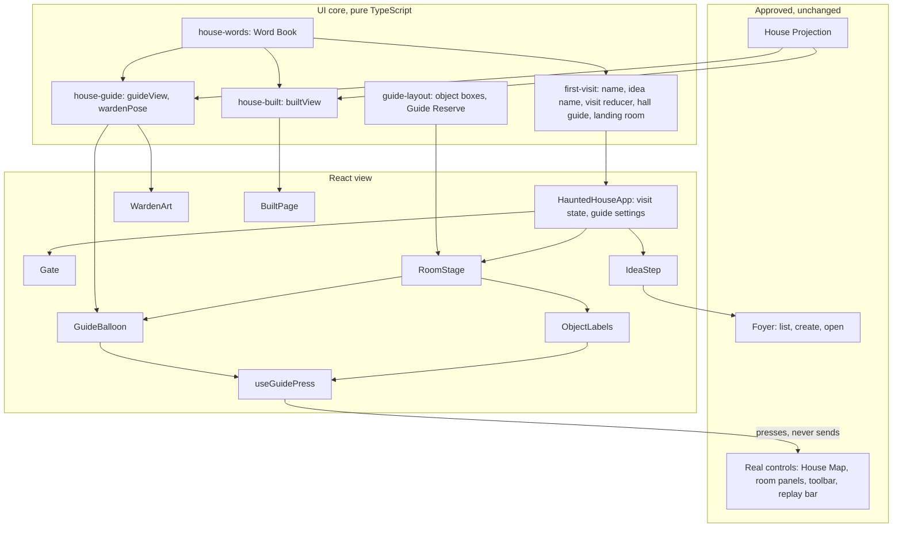

# Design Document

## Overview

Warden Guide and First Visit is a presentation layer over the walk-in room view. It adds one guide character, one fixed way for him to speak, and a first visit that takes a newcomer from the front gate to approved work with one decision per screen.

Three ideas carry the design:

1. **The guide is a pure reading of the house.** `core/house-guide.ts` turns the House Projection, the room on show, the open surface and three settings into a Guide View: a status line, a fixed question, a short list of options, and the Warden's pose. It holds no state and decides nothing.
2. **Every option is a press plan, not an action.** An option names the existing control it presses. The component layer finds that control and presses it. If the control is missing or off, nothing happens and the balloon repeats the reason the room already gives. Authority therefore stays where the earlier specs put it.
3. **Words come from one book.** `core/house-words.ts` holds each term once: the plain word, Kiro's word, and two sentences. The guide writes with the plain words and can show Kiro's beside them, so what a newcomer learns here is what they will meet in Kiro.

Facts marked **verified** come from checked-in code, approved specs or steering, read on Nov 17. Facts marked **assumption** need a spike before the dependent task.

### Research findings

- UI settings are page state and nothing else. `components/MansionShell.tsx` keeps Still House, sound, side view and the map sheet in `useState`; no file under `app/ui/src` reads `localStorage`, `sessionStorage` or `indexedDB`, and design decision 7 of `house-ui-and-accessibility` records that settings are not persisted (**verified**). "Stored the same way as existing UI preferences" therefore means: held for the visit, gone on reload.
- Because nothing is persisted, "returning visitor" cannot be remembered. It can be read: a live page whose mansion list is not empty when it loads has been used before (**verified**: `GET /apps/haunted-house/api/mansions`, `core/foyer-reducer.ts`).
- The current guide is `guideText` and `guideFor` in `core/house-guide.ts`, rendered by `components/RoomStage.tsx` with four fixed options. Painted spots already forward pointer presses to the House Map through `pressMapControl` and `data-opener-key` (**verified**).
- The controls a guided step must reach already exist, but only while their surface is mounted (**verified**):

  | Action | Existing control | File |
  |---|---|---|
  | Open a room, ghost or door surface | House Map control, `data-opener-key` | `components/RoomHotspots.tsx` |
  | Start a phase | Start button; offered for phase status `ready`, `failed`, `revision_required` | `rooms/house/RoomPanel.tsx`, `startView` in `core/house-view.ts` |
  | Approve or reject a door or a risky action | `DecisionButtons` inside `article[data-proposal]` | `rooms/house/DoorPanel.tsx`, `RiskyActionPanel.tsx` |
  | Ask for a revision | Toggle, one field, one send button | `rooms/house/RevisionRequest.tsx` |
  | Start Workshop tasks | Task checkboxes, then `[data-control="start-workshop"]`; nothing is ticked by default | `rooms/workshop/WorkshopTaskBoard.tsx`, `use-task-selection.ts` |
  | Retry a failed run | Retry button, `[data-control="retry"]` | `components/RunRecoveryControls.tsx` |
  | Play the recording | `[data-action]` buttons | `rooms/attic/ReplayBar.tsx`, `ReplayControls.tsx` |
  | What needs you, Still House, sound, side view | Toolbar controls | `components/HouseToolbar.tsx` |

- The upstream wording for a waiting door contains a Kiro word ("The requirements door needs your decision."); the wording for a risky action and a Crew tool prompt does not ("Tinker 2 asks to run a command.") (**verified**: `needsYou` in `core/house-view.ts`). The guide writes its own door sentence and quotes the other two.
- The door and risky-action panels show the exact subject of a decision (document path, revision and digest, or the full action) above their buttons, and the Needs You shortcut deliberately puts focus one Tab before the first button (**verified**: `DoorPanel.tsx`, `RiskyActionPanel.tsx`, `needsYouFocus`). The guide keeps both rules.
- Mansion API: `create(name, brief?)` and `open(name)`; names match `^[a-z0-9]+(-[a-z0-9]+)*$`, at most 40 characters; a brief is at most 2,000 code points; `MansionDescriptor.displayPath` is home-relative (`~/…`) (**verified**: `core/mansion-api.ts`).
- The replay stand-in answers list, create and open from memory and already lists the recorded mansion; `REPLAY_LANDING` names it (**verified**: `adapters/sdk-shim/mansions.ts`, `landing.ts`). A replay page would count as "returning" by the list rule, so the Gate rule names the Replay Build explicitly.
- The guide block today overlays the bottom-right 34 percent of the room and covers part of the right-wall door's press area (x 89 to 97.5 percent, y 28 to 81 percent) (**verified**: `house-stage-styles.ts`, `RoomStage.tsx`). That is the "covers content" failure this design removes.
- Contracts that bound the design (**verified**): `scripts-tests/house-ui-upstream-contract.test.ts` checks a list of pure core modules; `scripts-tests/check-house-ui-contract.test.ts` allows one text field inside a Mansion (the bounded revision request), requires every loop to last two seconds or more, and forbids third-party names; `scripts/check-assets.py` scans `app/ui/src`, `app/ui/replay` and `app/ui/dist`.
- Tests written for the Caretaker: `components/house-stage.test.tsx`, `components/MansionShell.test.tsx`, `house-keyboard.test.tsx`, `house-live-replay.test.tsx` (**verified**). They are rewritten for the Warden; every other suite stays as it is.
- `fast-check` 4.10 and `axe-core` 4.14 are already development dependencies; no package is added (**verified**: `app/ui/package.json`).
- The working tree holds the room-first stage as 38 uncommitted files. This feature builds on it, so it is committed first (**verified**: `git status`).

### Spike-gated assumptions

- **WG-S1, Kiro folder link (optional).** Whether the installed Kiro registers a link that opens a folder is unknown. Until a probe proves one, the Built Page shows the folder and three plain steps and offers no link. Failing or skipping this spike blocks nothing.
- **WG-S2, rendered layout.** jsdom does not lay anything out. A headless Comet run at 1280, 900 and 320 CSS pixels must measure that the Warden is at least twice the height of a ghost, that the balloon and the Warden touch no working object, label, open sheet or map sheet, and that nothing scrolls sideways. The numbers are kept in `spikes/fixtures/warden-guide-layout.json`. Requirements 1.6 and 5.6 to 5.8 are not claimed without it.
- **Live walk.** A full walk with real ghosts spends Kiro or Claude credits and is an owner step (task 13). The automated walk uses the existing stubbed gateway.

## Architecture



### Ownership and seams

| Concern | Owner | Rule |
|---|---|---|
| What the guide says and offers | `core/house-guide.ts` | A pure function. No React, DOM, SDK, clock or storage. |
| Terms | `core/house-words.ts` | The only place a plain word, a Kiro word or an explanation is written. |
| Where things are on the stage | `core/guide-layout.ts` | The one table of press areas and the Guide Reserve. The style sheet reads the same numbers. |
| The first visit | `core/first-visit.ts` | A pure reducer and pure helpers. The page holds its state. |
| Pressing | `components/use-guide-press.ts` | Finds an existing control and presses it. Imports no adapter and builds no command. |
| Decisions, starts, revisions | The upstream room modules | Unchanged. The guide reaches them only through their own buttons. |
| Creating and opening a mansion | The Foyer controller (`use-foyer.ts`) | Unchanged routes; the Idea Step calls `create`, then `open`. |
| Announcements | The existing live regions | The guide adds none. A changed setting is said through the one region the page already has. |

### Rendering flow

1. The page checks the backend as before. Unreachable: the status panel and Retry, no Gate.
2. The Foyer loads the mansion list. The visit reducer then decides: Gate (an empty list, or the Replay Build) or Foyer Hall (a live page with mansions).
3. Gate: one name field, one Knock. Knocking moves to the Foyer Hall and sets focus on the Warden's first line.
4. Foyer Hall: a first-time visitor on a live page gets the Idea Step; a returning visitor gets the mansion list with "Go back into …" first; the Replay Build gets the recording's invitation.
5. "Build this" calls the existing create, then the existing open. An opened mansion shows its Landing Room.
6. In a room, `guideView` is computed on every render from the projection. The balloon shows it; the Warden takes its pose.
7. Pressing an option runs its press plan. Pressing a painted object or its label runs the same kind of plan.
8. A changed projection changes the balloon in place. Nothing is announced, toasted or played.

## Components and Interfaces

### Word Book

`app/ui/src/core/house-words.ts`.

```typescript
type TermId =
  | 'plan' | 'requirements' | 'design' | 'tasks' | 'build'
  | 'ghost' | 'approve' | 'reject' | 'revise' | 'steering' | 'wall'

interface Term {
  readonly id: TermId
  readonly plain: string
  readonly kiro: string
  /** Exactly two sentences. */
  readonly about: readonly [string, string]
  /** The Kiro file of the term, when it has one. */
  readonly file: string | null
}

type WordMode = 'plain' | 'with-kiro'

/** "what it must do", or "what it must do (requirements)". */
function word(id: TermId, mode: WordMode): string
function term(id: TermId): Term
const TERMS: readonly Term[]
```

| Term | Plain word | Kiro's word | File | What is this? |
|---|---|---|---|---|
| plan | plan | spec | | A spec is Kiro's name for the written plan of one feature. It is three files: requirements, design and tasks. |
| requirements | what it must do | requirements | `requirements.md` | Requirements say what the software must do, one testable statement at a time. Kiro keeps them in requirements.md. |
| design | how it will work | design | `design.md` | The design says how the software will be built to meet the requirements. Kiro keeps it in design.md. |
| tasks | to-do list | tasks | `tasks.md` | Tasks are the ordered to-do list that turns the design into code. Kiro keeps them in tasks.md and ticks each one off. |
| build | the build | implementation | | Implementation is the work of carrying out the tasks. Each finished task leaves code in the project folder. |
| ghost | ghost | agent | | An agent is an AI worker with one job and its own limits. Each ghost in this house is one Kiro agent. |
| approve | open the door | approve | | Approving says a document is good enough to build on. Nothing moves to the next step until you approve. |
| reject | keep the door shut | reject | | To reject a document says it is not good enough yet. The door stays shut until a new version is approved. |
| revise | ask for a change | revision request | | A revision request is one note that asks the ghost who wrote a document to change it. It writes a new version, and the door stays shut meanwhile. |
| steering | house rules | steering | | Steering is the standing guidance every agent reads before it works. It keeps the work in line with how the project is run. |
| wall | wall | path limit | | A path limit is the list of folders an agent may read and write. An attempt to go outside it is refused. |

The first eight rows that the owner listed are required; `build`, `reject` and `revise` are added because the walk cannot be described without them. Guide copy is written as templates with term slots (`'{ghost} writes {requirements} here.'`), never with the words typed in. A unit test ties each Kiro word to the upstream table that owns it (`PHASE_NAMES`, the decision button names, the revision label), so the book cannot drift from the real controls.

### Guide View

`app/ui/src/core/house-guide.ts`, extended. `guideText`'s order of precedence is kept exactly.

```typescript
type StatusKind = 'locked' | 'catch' | 'door-waiting' | 'failed' | 'blocked' | 'working' | 'startable' | 'door-open' | 'built' | 'room'
type WardenPose = 'watching' | 'pointing' | 'offering-key' | 'holding' | 'stepped-back'
type OptionKind = 'go' | 'look' | 'start' | 'decide' | 'ask' | 'play' | 'setting' | 'leave'

/** One press of one existing control. */
type PressStep =
  | { readonly kind: 'map'; readonly target: HouseSurfaceTarget; readonly focus: 'heading' | { readonly proposal: string } | { readonly section: 'built' } }
  | { readonly kind: 'control'; readonly key: string }            // [data-guide-control="<key>"] in the open surface
  | { readonly kind: 'fill'; readonly key: string; readonly text: string }
  | { readonly kind: 'focus'; readonly key: string }              // puts focus in the field marked with the key
  | { readonly kind: 'every'; readonly keyPrefix: string }        // every enabled, unticked control whose key starts so
  | { readonly kind: 'shell'; readonly action: 'map' | 'reveal' | 'kiro-words' | 'needs-you' | 'close' | 'exit' }
  | { readonly kind: 'task'; readonly task: GuideTask | null }    // sets or clears the task in hand; page state only

interface GuideOption {
  readonly id: string
  readonly kind: OptionKind
  /** Verb first. At most 60 code points. */
  readonly label: string
  /** What pressing does. At most 120 code points. */
  readonly consequence: string
  /** The term whose Kiro word is shown beside the label when Kiro's words are on. */
  readonly term: TermId | null
  readonly steps: readonly PressStep[]
}

interface GuideContext {
  readonly roomId: RoomId
  /** The surface on top, or null in the bare room. */
  readonly surface: HouseSurfaceTarget | null
  /**
   * The task in hand, set when the visitor chose "Ask for a change" and cleared
   * when the form closes. It lets the balloon offer ready-made texts instead of
   * leaving the visitor at an empty field. Page state; it is no workflow state.
   */
  readonly task: { readonly kind: 'revise'; readonly phase: 'requirements' | 'design' | 'tasks'; readonly filled: boolean } | null
  readonly quiet: boolean
  readonly words: WordMode
  /** Whether the labels of the working objects are on show, and whether the map lies over the room: they only turn two setting labels around. */
  readonly reveal: boolean
  readonly mapOpen: boolean
  /** False on a page that cannot leave the Mansion. */
  readonly canLeave: boolean
}

interface GuideView {
  readonly status: string
  readonly statusKind: StatusKind
  /** Terms named in the status line; each gets a "What is this?". */
  readonly terms: readonly TermId[]
  /** Why some things are not offered: the room's own sentence (a recording, an unconfirmed state), or null. Upstream text, not guide copy. */
  readonly note: string | null
  readonly question: 'What do you want to do?'
  /** At most four. */
  readonly options: readonly GuideOption[]
  /** Every option of this view, the four above included. */
  readonly everything: readonly GuideOption[]
  readonly pose: WardenPose
  readonly poseLabel: string
  readonly previous: { readonly roomId: RoomId; readonly name: string } | null
  readonly next: { readonly roomId: RoomId; readonly name: string } | null
}

function guideView(projection: HouseProjection, context: GuideContext): GuideView | null
function wardenPose(room: RoomPresentation, projection: HouseProjection, quiet: boolean): { pose: WardenPose; label: string }
function landingRoom(projection: HouseProjection): RoomId
```

**Status line and pose, first match wins** (`{…}` is a Word Book slot; plain words shown):

| Order | Situation | Status line | Pose | Pose label |
|---|---|---|---|---|
| 0 | Quiet Mode | (balloon put away) | stepped back | The Warden has stepped back. |
| 1 | Room locked | The room's own locked text | watching | The Warden is watching. |
| 2 | First waiting item is a risky action | "Tinker 2 is held. Tinker 2 asks to run a command. Nothing runs until you decide." | holding | The Warden is holding Tinker 2. |
| 2 | First waiting item is a Crew tool prompt | The upstream sentence ("… Answer it in Crew.") | holding | The Warden is holding a ghost. |
| 2 | First waiting item is a door | "The Archivist has finished what it must do. The door waits for you." | offering a key | The Warden holds out a key. |
| 3 | A ghost failed | "The Archivist failed. <safe reason>" plus "It can be tried again." when its own run can be retried ("A failed run can be tried again." when the retry is another ghost's) | pointing when a retry is offered, else watching | The Warden points to your next step. |
| 4 | A ghost is blocked | "The Draughtsman is held. <safe reason>" | holding | The Warden is holding the Draughtsman. |
| 5 | A ghost is working | "The Archivist is writing. This door stays shut until you open it." (the door is named only while a door of the room is still shut) | watching | The Warden is watching. |
| 6 | The phase can be started (for the build, also while it is under way: it is started piece by piece) | "This is the Study. The Archivist writes what it must do here. Nothing is written yet." | pointing | The Warden points to your next step. |
| 7 | The room's doors are open | "This door is open. The Drafting Room is next." or, with every door open, "The house is built. Every door is open." | pointing | The Warden points to your next step. |
| 8 | Otherwise | What the room is for (`ROOM_GUIDE_TEXT`, rewritten with term slots) | watching | The Warden is watching. |

**Options by situation.** The first four listed are the Primary Options; the rest appear under "Something else…".

| Where | Situation | Primary options, in order | Steps |
|---|---|---|---|
| Room, no surface | Phase can be started | "Have the Archivist write what it must do"; "Look around the Study" | `map` room, then `control start:<phase>`; `map` room |
| Room, no surface | Ghost working | "Watch the Archivist work"; "See the whole house" | `map` room; `shell map` |
| Room, no surface | Door waiting | "Read what it must do"; "Ask for a change"; "Go to the door" | `map` room; `map` room, then `control revise:<phase>`; `map` door, focus on the proposal |
| Door surface open | Proposal pending, decisions on | "Open the door"; "Ask for a change"; "Read it again" | `control approve:<proposal>`; `map` room, then `control revise:<phase>`; `map` room |
| Revision form open | | "Ask for a shorter version" and two more ready-made changes; "Write my own" | `fill revise-text:<phase>`, then `task` (filled); `focus revise-text:<phase>` |
| Revision form filled | | "Send this change"; "Choose a different change"; "Write my own" | `control revise-send:<phase>`, then `task` (cleared) |
| Room, no surface | Risky action waiting | "See exactly what it asked" | `map` room, focus on the proposal |
| Room surface open | Risky proposal shown | "Allow it once"; "Refuse it" | `control approve:<proposal>`; `control reject:<proposal>` |
| Room, no surface | Ghost blocked | "See why the Draughtsman is held" | `map` ghost |
| Room, no surface | Run failed, retry offered | "Try the Archivist again"; "See what went wrong" | `map` room, then `control retry:<run>`; `map` ghost |
| Workshop | Tasks approved, work can start | "Build everything that is ready"; "Choose what to build myself" | `map` room, `every task:`, then `control start-workshop`; `map` room |
| Room, no surface | Door open, later room exists | "Go to the Drafting Room"; "Read what it must do again" | `map` next room; `map` room |
| Attic | | "Watch how this house was built"; "Step through it myself" | `map` attic, then `control attic:toggle`; `map` attic |
| Any room | Every door open | "See what was made" comes first | `map` foyer, focus on the built section |
| Replay Build | Any | Start, decide and ask options are left out; "Play or pause the recording" and "Play it from the start" are added | `control replay:toggle`, `control replay:restart` on the replay bar |

Always under "Something else…": go to each visible room, look around this room, see the whole house or put the map away, go to what needs you (when something does), show or hide Kiro's words, show or hide what can be pressed, what these words mean (the Word Book), keep the door shut (at a pending door), and leave for the Foyer Hall. "Step back" is its own control beside it.

Approved verbs: Allow, Ask, Build, Call, Choose, Close, Go, Have, Hide, Keep, Knock, Leave, Look, Open, Pause, Play, Put, Read, Refuse, See, Send, Show, Step, Try, Watch, Write.

Banned phrases (copy contract): "oops", "uh-oh", "yay", "hooray", "awesome", "magic", "let's", "simply", "just", "don't worry", "friend", "buddy", "little". No exclamation mark and no emoji anywhere in guide copy.

Ready-made change requests, per document, held beside the guide copy:

| Document | Ready-made texts |
|---|---|
| requirements | "Ask for a shorter version": "Make it shorter. Keep only what the first version needs." · "Ask for an example in each one": "Add one example to each requirement." · "Ask for simpler words": "Use simpler words." |
| design | "Ask for fewer parts": "Make it simpler, with fewer parts." · "Ask for one sentence on each part": "Explain each part in one sentence." · "Ask how each point is tested": "Say how each requirement is tested." |
| tasks | "Ask for smaller steps": "Split the large steps into smaller ones." · "Ask for the most important first": "Put the most important step first." · "Ask to drop what can wait": "Remove anything the first version does not need." |

### Pressing

`app/ui/src/components/use-guide-press.ts` runs a press plan.

- A `map` step is today's `pressMapControl`: it clicks the House Map control with that `data-opener-key` and passes the focus target the shell already supports (`needsYouFocus`).
- A `control` step clicks `[data-guide-control="<key>"]` inside the open surface. These attributes are added to the existing buttons and change nothing about them:

  | Key | Control |
  |---|---|
  | `start:<phase>` | Phase start button |
  | `approve:<proposal>`, `reject:<proposal>` | `DecisionButtons` of a door or risky proposal |
  | `revise:<phase>`, `revise-text:<phase>`, `revise-send:<phase>` | Revision toggle, field, send button |
  | `task:<taskId>` | Task checkbox |
  | `start-workshop` | Task board start (today's `data-control`) |
  | `retry:<run>` | Retry button |
  | `replay:toggle`, `replay:restart` | Replay bar buttons |
  | `attic:toggle`, `attic:next` | The Attic's own playback buttons |

- A `fill` step types into the one real field through the browser's own input event, so the field's limit, counter and validation apply as if typed.
- An `every` step ticks each enabled, unticked checkbox whose key starts with the prefix.
- **One press per commit.** The runner issues the next step from an effect after React has committed the previous one, so each control sees current state. Each step checks its own control at the moment it is pressed, and a plan that has not finished after a dozen renders is dropped. A plan stops at the first step whose control is missing or carries `aria-disabled="true"`; the balloon then shows the room's diagnostic, or the text the control's `aria-describedby` points to, and the one live region says it once because the visitor asked.
- **Decisions are never one stray Enter away.** A `decide` option exists only in a view whose surface already shows that decision. When a press plan opens such a surface, focus goes to the proposal heading; when the option list changes under the visitor's focus, focus moves to the status line. A repeated Enter therefore cannot land on a button that decides.

### Stage layout

`app/ui/src/core/guide-layout.ts` holds the press areas now written inline in `RoomStage.tsx`, the ghost slots, and the Guide Reserve, all in percent of the room scene.

```typescript
interface Box { readonly left: number; readonly top: number; readonly width: number; readonly height: number }

const GHOST_WIDTH = 9                              // percent of the scene width
const GHOST_ASPECT = 170 / 160                     // height over width
const WARDEN_ASPECT = 300 / 200                    // his drawing is 200 by 300
/** Twice a ghost's height, whatever the window: 12.75 percent of the scene width. */
const WARDEN_WIDTH = (2 * GHOST_WIDTH * GHOST_ASPECT) / WARDEN_ASPECT
const GUIDE_RESERVE: Box = { left: 84, top: 82, width: 16, height: 18 }

/** `backDoor`: the room has a door in its back wall, so the ghosts' band ends before it. */
function ghostBox(index: number, count: number, state: PresentationGhostState, backDoor?: boolean): Box
/** In reading order. `label` is what the object wears; `name` starts with the label and says what a press does. */
function workingObjects(room: RoomPresentation, view: Pick<GuideView, 'previous' | 'next'>, words: WordMode, needsYou: number):
  readonly { key: string; kind: string; box: Box; label: string; name: string; steps: readonly PressStep[] }[]
```

There are three layouts, and in none of them does the balloon lie over the room.

- **Narrow, below 900 CSS pixels of window width:** the room, then the labels (as a plain list when they are on), then the room's name plate, then the balloon, the guide's settings and the Warden, one after another in the page.
- **Stacked:** the same order, with an apron under the room. The balloon and the guide's settings lie in the apron; the Warden stands at its right end with his feet on its lower edge. He is taller than a short apron, so his head and shoulders may rise into the room, and only inside the Guide Reserve.
- **Side:** the room takes the height of the window and the balloon stands in a column beside it, under the room's name plate. Under the room is one strip with the guide's settings. The Warden stands in the room's own corner, in front of the right end of the desk, his head at the top of the Guide Reserve and his feet on the strip. The balloon rises from where he stands; the two columns do not push each other, so a tall balloon grows down past the strip and never opens a gap under the room.

Which of the two wide layouts is used is not a fixed breakpoint. The room and the guide should fit one window, and the room should be as large as that allows: on a tall window that is the stacked layout, on a short one the side layout, and where the line falls depends on how wide the house is on the host's page and on how much the page has above the room (the host's own chrome, the page title, a recording's bar). `stageFit` in `core/guide-layout.ts` works it out from those numbers:

```ts
type StageLayout = 'narrow' | 'stacked' | 'side'
interface StageWindow { windowWidth: number; windowHeight: number; houseWidth: number; sceneTop: number; rem: number }
/** The layout, the room's width and the width of the balloon's column. */
function stageFit(stage: StageWindow): { layout: StageLayout; sceneWidth: number; guideWidth: number }
```

It takes the side layout in a house of at least 56 rem when the room that fits beside a 20 rem balloon is at least as wide as the room that fits above a 22 rem apron. Beside the room, width the room cannot use goes to the balloon, up to 26 rem, which makes the balloon shorter.

`components/use-stage-metrics.ts` measures what the style sheet cannot know and hands it over as two custom properties on the shell: `--hh-scene-top`, how far down the page the room starts, and `--hh-toolbar-h`, how tall the toolbar over the room has wrapped. It returns the layout for the shell's `data-layout`. It measures when the house or the window changes size (one `ResizeObserver`, one `resize` listener), never on a timer and never on scroll. Where the page cannot measure, the sheet's defaults stand and the layout is stacked. The style sheet sizes the room with the same lengths as `stageFit`, so the two agree.

The balloon has two parts: what is true now (the status line, "What is this?", the question) stays in view, and what can be done (the choices, "Something else…" with its list and the Word Book) lies under it. In the two wide layouts the balloon is at most as tall as the window has room for, and its second part scrolls inside it; in the narrow layout it is as tall as its words.

The Guide Reserve is the bottom-right corner in front of the desk, where the scene holds decoration only. The right-wall door ends at 81 percent of the scene height, the ledger and the bell lie left of 56 percent of its width, and every ghost slot ends above 80 percent, so none of them reaches the reserve. In a room with a door in its back wall the ghosts' band ends before that door.

The room is sized as one length (`--hh-scene-w`), from which the Warden (12.75 percent of it wide, so twice a ghost's height), the open room sheet and the map sheet take their sizes. The art is vector and scales.

The open room sheet and the map sheet share the room's grid row and lie over the left of the room: they start under the toolbar, however many rows its tags have wrapped onto, end inside the room, and are 60 and 80 percent of the room wide from 3 percent in, so both end before the Guide Reserve begins at 84 percent. Neither reaches the name plate, the balloon or the Warden.

### The Warden

`WardenArt` replaces `CaretakerArt` in `components/room-paint.tsx`.

```typescript
interface WardenArtProps { readonly pose: WardenPose; readonly held?: SpectreRole | null }
```

- One silhouette, five poses: a hood with two lantern eyes and no face, a long robe that ends in mist, a ring of heavy keys at the belt, a chain that trails from one cuff. Watching: hands folded on the key ring. Pointing: one arm out toward the room. Offering a key: one key held out on the open hand. Holding: the chain taut around a small ghost shape at his side. Stepped back: turned three quarters away, hood lowered, smaller and dimmed.
- Flat shapes from the scene palette, through the `hh-p-*` fill and `hh-ps-*` line classes. One wrapper, `aria-hidden="true"`, `focusable="false"`. No `<image>`, `<use>` to another document, script, animation element or raster data.
- No loop and no transition. The lantern eyes are a steady fill, and a pose changes between one look and the next, under every motion setting. The Caretaker's hover loop, his stand and his text are removed.
- The pose label is a line of real text under the figure. In the stepped-back pose the same block holds the "Call the Warden" button.
- The character is original and must not resemble a known mascot or film ghost. A static scan cannot judge that, so the owner's originality review in `docs/assets-checklist.md` gains one line for the Warden.

### Balloon

`components/GuideBalloon.tsx` renders a Guide View and nothing else.

- Status line: a paragraph with `tabIndex={-1}`, so focus can be put on it. Each term in `terms` is followed by a small "What is this?" button (`aria-expanded`) that shows the two sentences in place.
- Question, then the Primary Options as a list of buttons. The Consequence Line is the button's visible second line and its `aria-describedby`. With Kiro's words on, the term's Kiro word follows the label in brackets.
- "Something else…" is a disclosure (`aria-expanded`) that opens the full list and the Word Book in place. It is not a dialog.
- "Step back" puts the balloon away.
- Every option carries `data-guide-option`, so the acceptance test can prove a walk used only these.

### Reveal

`components/ObjectLabels.tsx` renders the `workingObjects` of the room. With Reveal Mode off it renders nothing; the painted spots stay pointer shortcuts hidden from assistive technology, as today. With it on, each object gets a button at its box: visible text ("Archivist: working", "Requirements door: waiting", "To the Foyer", "Open this room's sheet", "What needs you"), an accessible name that adds what pressing does, and the same press plan as the object. The list is in reading order (left to right, top to bottom). The `?` key toggles it unless the event target is an input, a textarea or editable content. Escape closes, in order: the top surface, the map sheet, Reveal Mode, and only then leaves the Mansion.

### The guide's settings

The apron holds a group named "Guide settings", outside the balloon, with three tags: "House map" (shown where the map is a put-away sheet), "Show Kiro's words" and "Show me what I can press". Each exposes `aria-pressed` and says its state in words, as the toolbar's tags do. They stay when the Warden has stepped back, which is what keeps every setting reachable in Quiet Mode. The toolbar itself is unchanged.

### First visit

`app/ui/src/core/first-visit.ts`.

```typescript
interface VisitState {
  readonly place: 'loading' | 'gate' | 'hall' | 'mansion'
  readonly visitorName: string
  /** True once the visitor came in through the Gate in this visit. */
  readonly firstTime: boolean
  /** Whether the hall is asking what to build. */
  readonly idea: boolean
  readonly replay: boolean
  /** Where the visitor stood when a mansion opened, and so where leaving it returns them. */
  readonly cameFrom: 'gate' | 'hall'
}
type VisitEvent =
  | { type: 'list_loaded'; mansionCount: number }
  | { type: 'knocked'; name: string }
  | { type: 'stepped_outside' }
  | { type: 'idea_opened' } | { type: 'idea_closed' }
  | { type: 'mansion_opened' } | { type: 'mansion_left' }

function visitReducer(state: VisitState, event: VisitEvent): VisitState
/** One line, at most 40 code points, no control or formatting character; a joiner between two letters is kept. Idempotent. */
function visitorName(raw: string): string
function greeting(name: string): string            // "Come in, Ada." or "Come in."
/** A valid, unused Mansion name for an idea. `preferred` is the name of the example the idea started from. */
function mansionNameFromIdea(idea: string, taken: ReadonlySet<string>, preferred?: string | null): string
const EXAMPLE_IDEAS: readonly { readonly name: string; readonly title: string; readonly brief: string }[]
function hallGuide(state: VisitState, mansions: readonly { name: string; status: string }[], selected: string | null, invited: string | null): HallGuideView
```

- `list_loaded` decides the first place: the Gate when the list is empty or the page is the Replay Build, else the Foyer Hall. `knocked` moves the Gate to the hall and sets the name. `stepped_outside` acts in the hall only: it returns to the Gate and clears the name. Only `mansion_opened` reaches `mansion`, and `mansion_left` returns the visitor to where they stood when it opened (an open asked for in the hall can land after the visitor stepped outside). The reducer starts no request.
- `mansionNameFromIdea` reads the idea word by word (a hyphen inside a word is kept, so "to-do" stays one word), drops what opens a request ("I want to build a") and the articles, and stops at the first connecting word once it has two words ("that", "to", "for"), or at 24 characters. Accented letters lose their marks; a few Latin letters that do not come apart are spelled out. An idea with nothing nameable becomes `my-house`. A name that is taken gets `-2`, `-3`, … and never passes 40 characters. An example keeps its own name while that is free, also after its words are edited.
- Example ideas are small on purpose, so a ghost can finish them in one sitting: a word counter, a to-do list and a unit converter, each "a command-line tool … in one file of Python with its tests". Each carries its own name.
- The Gate (`components/Gate.tsx`) reuses the front-door painting as the exterior. The knocker is painted; the press target is a real "Knock" button, which the painted knocker forwards to for pointer users. The name field is labelled "Who is knocking?" and may be left empty.
- The Idea Step (`rooms/foyer/IdeaStep.tsx`, `use-idea-step.ts`) shows the three ideas as buttons that fill one textarea, the derived name ("Project folder: word-counter"), the existing brief counter and errors (`use-mansion-brief.ts`), and "Build this". It calls the Foyer controller's `create(name, brief)` and, on success, `open(name)`; it imports no API of its own. The existing mansion list and create form stay in the hall, under the guided step for a first-time visitor and above it for a returning one.
- In the Replay Build the hall shows the invitation in `landing.ts` with "Watch demo-mansion get built" first; that is the existing open action.
- The page keeps one polite live region before a mansion is open (the summary line) and one inside it (the house's announcer), as today. The Gate adds none.

### Built Page

`app/ui/src/core/house-built.ts` and `rooms/foyer/BuiltPage.tsx`, shown inside the existing Foyer panel of an open mansion (`ActiveMansionFoyerPanel.tsx`).

```typescript
interface BuiltInput {
  readonly documents: readonly { readonly phase: 'requirements' | 'design' | 'tasks'; readonly path: string }[]
  readonly tasks: readonly { readonly taskId: string; readonly title: string; readonly complete: boolean; readonly writes: readonly string[] }[]
  /** Home-relative, as the backend reported it. */
  readonly folder: string
}
interface BuiltView {
  readonly built: boolean
  readonly rows: readonly { readonly term: TermId; readonly plain: string; readonly kiro: string; readonly path: string }[]
  readonly tasks: readonly { readonly taskId: string; readonly title: string; readonly files: readonly string[] }[]
  readonly folder: string
  /** Set in a recording: the folder was on the computer that made it. */
  readonly folderNote: string | null
  /** How to open the folder in Kiro. Empty in a recording. */
  readonly steps: readonly string[]
}
function builtView(projection: HouseProjection, input: BuiltInput): BuiltView   // live or replay is read from the projection
```

`House.tsx` fills `BuiltInput` from values it already holds: the joined room documents (`documentPath`), the Workshop task board rows (`complete`, `writes`) and `mansion.displayPath`. A row appears only for a phase whose door is `open`. The steps are fixed copy: open Kiro; choose File, then Open Folder; pick this folder; the plan is under Specs. In the Replay Build the folder line reads that the folder is not on this computer. A verified link (WG-S1) may be added beside the steps; a guessed one is never shown.

### Steering and document changes

- `.kiro/steering/theme-and-accessibility.md`, Tone: "Menacing, never harmful. The house is old and watchful: candlelight, dust, creaky doors, tall still figures. The menace is aimed at ghosts that stray, never at the person using the house. No gore, no jump scares, no flashing, no screams." Copy gains: "Adult and exact. No baby talk."
- `.kiro/steering/product.md`: one row under the metaphor, "Warden: the guide. The guardrails made visible. A drawing, not an agent; it has no authority."
- `house-ui-and-accessibility/requirements.md`: dated change notes on 1.1 (the Gate precedes the Foyer on a first visit) and on Requirement 5 (tone), in the form already used there.
- `docs/assets-checklist.md`: the tone line and one originality line for the Warden.

### Requirements traceability

| Requirement | Design elements |
|---|---|
| 1 | `WardenArt`, scene palette classes, stage layout constants, motion gates, originality review |
| 2 | `wardenPose`, the status and pose table, no timer in the guide |
| 3 | `guideView`, the option table, approved verbs, banned phrases, bounded lengths, `GuideBalloon` |
| 4 | Press plans, `use-guide-press`, `data-guide-control`, decision focus rule, one press per commit |
| 5 | In-place updates, no host effect from the guide, the three layouts and `stageFit`, Guide Reserve, one live region |
| 6 | Quiet setting, stepped-back pose, "Call the Warden", the settings group's "House map" |
| 7 | Word Book, term slots, `word`, "What is this?", the settings group's toggle, upstream word check |
| 8 | `workingObjects`, `ObjectLabels`, `?` key, Escape order |
| 9 | `visitReducer`, `visitorName`, `greeting`, `Gate` |
| 10 | `EXAMPLE_IDEAS`, `mansionNameFromIdea`, `IdeaStep`, the Foyer controller's `create` and `open`, `hallGuide` |
| 11 | `landingRoom`, the option table, ready-made change requests, `every` and `fill` steps |
| 12 | The catch rows of the status and option tables, quoted upstream wording |
| 13 | Attic option, `builtView`, `BuiltPage`, WG-S1 |
| 14 | Parity property, replay stand-in, purity list, test strategy, steering changes |

## Data Models

The interfaces above are the whole model. Three notes:

- **Guide settings** are `{ quiet: boolean; kiroWords: boolean; reveal: boolean }`, held by `HauntedHouseApp` with `useState` beside the visit state and passed down. They start `false` on every load and are written nowhere.
- **The visitor's name** exists only in `VisitState.visitorName`. It is rendered as text in the greeting and nowhere else: no request body, event, log line, toast, badge or storage call ever receives it.
- **Guide copy** is a set of template tables in `core/house-guide.ts` and `core/first-visit.ts`. A template may contain Word Book slots, a ghost name, a room name and a bounded upstream sentence. It never contains tool input, document content, a path or model text; the Built Page, which shows paths, is not guide copy.

## Correctness Properties

*A property is a characteristic or behavior that should hold true across all valid executions of a system-essentially, a formal statement about what the system should do. Properties serve as the bridge between human-readable specifications and machine-verifiable correctness guarantees.*

Pressing, focus, layout rendering and accessibility rules are example and integration concerns. Property-based testing applies to the pure guide, the Word Book, the first-visit helpers, the layout table and the built view. Each property below has exactly one fast-check test of at least 200 cases.

### Property 1: The balloon grammar is total and bounded

For all House Projections, visible rooms, open surfaces and guide settings, `guideView` returns a view whose status line is not empty and holds at most 240 code points; whose question is the fixed one; whose Primary Options number at most four and all appear in the full list; whose option ids are unique; and whose every option has a label of at most 60 code points that starts with an approved verb, a non-empty consequence of at most 120 code points, and at least one press step. No guide text contains an exclamation mark or a banned phrase.

**Validates: Requirements 3.1, 3.3, 3.4, 3.5, 3.6, 3.8, 3.9, 3.11**

### Property 2: The most pressing thing comes first, in words and in pose

For all rooms, the status kind equals the first match of the reference order (locked, waiting decision, failed ghost, blocked ghost, working ghost, startable phase, open door, room description), and the pose equals the pose of that kind: stepped back exactly when Quiet Mode is on; holding only when the first match is a catch, with a label that names the held ghost when it has a name; offering a key exactly when the first match is a waiting door; pointing only where the room's state is confirmed (in a room whose controls are off for doubt he watches); and exactly one of the five poses with a non-empty label in every case.

**Validates: Requirements 2.1, 2.2, 2.3, 2.4, 2.5, 2.6, 2.8, 3.2, 11.3, 12.1, 12.4, 12.5**

### Property 3: The guide never offers more than the house allows

For all House Projections and contexts, every press step names something the projection holds (a visible room, a ghost or door of that room, a pending waiting item of that room, a run the room offers to retry); an option of kind `start`, `decide` or `ask` appears only for a room whose mutation is enabled in live mode; an option of kind `decide` appears only when the open surface is the one that shows that decision; and no option of any kind differs between Quiet Mode on and off except that the view is put away.

**Validates: Requirements 4.2, 4.3, 4.6, 4.8, 6.5, 11.2, 11.4, 11.5, 11.9, 11.10, 11.11, 12.2, 12.3**

### Property 4: Live and replay say the same thing

For all upstream house inputs, building the House Projection in live mode and in replay mode and reading both with the same context gives the same status line, the same pose and the same pose label; and the replay options are the live options with every `start`, `decide` and `ask` option removed and the playback options added.

**Validates: Requirements 3.10, 14.1, 14.2**

### Property 5: Plain words by default, Kiro's words on request

For all terms, `word(id, 'plain')` is the plain word and `word(id, 'with-kiro')` is the plain word followed by the Kiro word in brackets; every term has exactly two sentences; and for all House Projections and contexts with Kiro's words off, no text the guide composes contains a Kiro word of the book as a whole word (the house's own sentences that the status line quotes are named by the view and are not the guide's), while with Kiro's words on each term the guide names carries its Kiro word.

**Validates: Requirements 7.1, 7.2, 7.3, 7.4, 7.5**

### Property 6: A visitor's name is bounded and inert

For all strings, `visitorName` returns one line of at most 40 code points with no control character, and normalising its result again changes nothing; `greeting` is exactly "Come in, <name>." around the normalised name when it is not empty and is the nameless greeting when it is.

**Validates: Requirements 9.4, 9.5, 9.6**

### Property 7: Every idea yields a new, valid mansion name

For all idea texts and all sets of existing names, `mansionNameFromIdea` returns a name that matches the Mansion name rule, is at most 40 characters, is not in the set, and is the same for the same inputs; an Example Idea keeps its own name when that name is free.

**Validates: Requirements 10.4**

### Property 8: The visit never moves without a press

For all finite sequences of visit events, the place is one of loading, gate, hall and mansion; the Gate is shown first exactly when the list is empty or the page is the Replay Build; a live page that loads with a mansion is never shown the Gate unless the visitor steps outside; the place is `mansion` only after a `mansion_opened` event; and the name is not empty only after a `knocked` event with a non-empty name and is empty again after stepping outside from the hall.

**Validates: Requirements 9.1, 9.3, 9.9, 9.10**

### Property 9: The landing room is where the work is

For all House Projections, `landingRoom` returns a visible room that is the room of the first Needs You item when one exists, otherwise the room of the earliest phase whose door is not open, otherwise the Attic.

**Validates: Requirements 10.8, 11.1**

### Property 10: The guide never covers a working object

For all rooms, door layouts, ghost counts from zero to four and ghost states, every working-object box lies inside the scene and does not intersect the Guide Reserve; and the Warden's width constant makes his height exactly twice a ghost's.

**Validates: Requirements 1.6, 5.6, 5.7, 8.4**

### Property 11: The built page lists exactly what was approved

For all House Projections and built inputs, `builtView` reports `built` exactly when every phase door is open; lists a document row exactly for each phase whose door is open and whose supplied path has that term's file name as its last segment, in phase order, with the Word Book's plain and Kiro words; lists a task only when it is complete; and in replay mode says the folder is not on this computer.

**Validates: Requirements 13.2, 13.3, 13.4, 13.8, 13.9**

### Property 12: The stage fits its window

For all windows, house widths, amounts of page above the room and rem sizes, `stageFit` is narrow exactly below 900 pixels of window width; takes the side layout only in a house of at least 56 rem, and exactly when the room that fits beside the balloon is at least as wide as the room that fits above it; never makes the room and the balloon's column wider than the house; ends the room and what stands under it inside the window unless the room is at its smallest size; and never gives a smaller room to a taller window.

**Validates: Requirements 5.6, 5.8**

## Error Handling

| Condition | Guide behavior | Authority behavior |
|---|---|---|
| A press step's control is not in the page | The plan stops; the balloon shows the room's diagnostic | Nothing is sent |
| The control carries `aria-disabled="true"` | The plan stops; the balloon shows the text the control is described by | The control's own guard already refuses |
| A command is on its way when an option is pressed | As above: the real button is off until the answer comes | No second command |
| The projection changes while a plan runs | The next step looks its control up afresh and stops if it is gone or off; the balloon re-reads the house | No press from stale data |
| The open surface closes under an option | Options are recomputed for the bare room; focus goes to the status line | No decision option remains |
| The room is locked, read-only, uncertain, corrupt or incompatible | No start, decide or ask option; the status line is the room's own text | Unchanged upstream gating |
| Replay Build | Playback options only; the fixed read-only sentence stays where it is today | No request of any kind |
| Create fails in the Idea Step | The idea text stays; the existing error copy is shown beside "Build this" | No open request is sent |
| Create succeeds and open fails | The mansion is in the list; the existing open error is shown; "Go back into …" is offered | Nothing is retried on its own |
| The derived name is taken between showing and creating | The backend answers `existing_compatible`; the step derives the next free name and asks again only on a new press | Create stays idempotent |
| The name field holds control characters or is very long | It is normalised to one bounded line | It is never sent anywhere |
| `?` is pressed in a text field | It is typed | Reveal Mode does not change |
| The mansion list fails to load | The Foyer's own error and Retry; no Gate | No guess about first or returning |
| The backend is unreachable | The foundation status panel; no Gate, no Warden | As today |
| Clipboard or link support is missing on the Built Page | The folder is plain selectable text and the steps remain | Nothing depends on it |
| WG-S2 cannot prove the layout | Requirements 1.6 and 5.6 to 5.8 stay unclaimed and the layout returns to design | No hidden overflow is accepted |

All guide text is fixed copy with bounded slots. A ghost's reason and the upstream waiting sentences are already bounded and redacted by their owners and are quoted unchanged.

## Testing Strategy

TypeScript, React 18, Vitest, Testing Library, fast-check and axe-core, as in the earlier specs. No package is added.

### Property-based tests

One test per property in `app/ui/src/core/*.property.test.ts`, at least 200 cases each, with the comment:

```text
Feature: warden-guide-and-first-visit, Property N: <property title>
```

| Property | Test file | Generated focus |
|---|---|---|
| 1 | `house-guide-grammar.property.test.ts` | Every room, door and ghost state, waiting kinds, open surfaces, settings, long and Unicode names |
| 2 | `house-guide-order.property.test.ts` | Rooms that match several rules at once; quiet on and off; a reference table written independently |
| 3 | `house-guide-authority.property.test.ts` | Integrity values, read-only, locked, replay, every surface, pending and resolved items |
| 4 | `house-guide-parity.property.test.ts` | The upstream arbitraries of `test/workflow-arbitraries.ts`, built twice |
| 5 | `house-words.property.test.ts` | All terms, both modes, generated projections scanned for Kiro words |
| 6 | `visitor-name.property.test.ts` | Arbitrary Unicode strings, control characters, line breaks, very long input |
| 7 | `idea-name.property.test.ts` | Arbitrary ideas, empty and symbol-only ideas, crowded name sets |
| 8 | `visit-flow.property.test.ts` | Event sequences of every length up to 40, live and replay |
| 9 | `landing-room.property.test.ts` | Projections with and without Needs You items, every door combination |
| 10 | `guide-layout.property.test.ts` | Every room, zero to four ghosts, every ghost state, one or two doors |
| 11 | `house-built.property.test.ts` | Every door combination, partial task lists, both modes |
| 12 | `stage-fit.property.test.ts` | Windows from a phone to a large display, houses narrower than their window, page chrome above the room, six rem sizes |

The tests use independent reference tables. They read no SDK, DOM, network, filesystem or clock.

### Unit and example tests

- `house-guide.test.ts`: one readable vector per row of the status and option tables; the start option is offered exactly when `startView` offers an enabled start (no command in flight); the banned-phrase and verb lists.
- `house-words.test.ts`: each Kiro word equals the upstream word (`PHASE_NAMES`, the Approve and Reject names, the revision label); each `file` matches the phase document name.
- `first-visit.test.ts`: the three example ideas are valid briefs and names; greeting vectors.
- `warden-art.test.tsx`: five distinct poses; hidden from assistive technology; no prohibited element; palette classes only; the style sheet gives the Warden no animation and gates the one pose transition; the width constant is the one in `guide-layout.ts`.
- `scripts-tests/house-ui-upstream-contract.test.ts`: the purity list gains `house-guide.ts`, `house-words.ts`, `guide-layout.ts`, `first-visit.ts` and `house-built.ts`.
- `scripts-tests/check-house-ui-contract.test.ts`: unchanged rules still hold (one text field inside a Mansion, no loop under two seconds, no third-party name); one new rule scans the guide's source for a Word Book word typed outside the book.

### DOM, keyboard and accessibility tests

- `guide-balloon.test.tsx`: order of the five parts; consequence lines as descriptions; "Something else…" and "What is this?" open in place; Kiro's words beside labels; "Step back" and "Call the Warden"; focus on the status line after the list changes.
- `guide-rhythm.test.tsx`: for each row of the option table, the option clicks the one existing control (the same element the map or panel test finds); a decision option is absent until its surface is open; focus lands on the proposal heading; a missing or disabled control leaves the house unchanged and shows the reason; a second Enter decides nothing.
- `object-labels.test.tsx`: off means no label in the accessibility tree or Tab order; on means one button per working object in reading order; `?` toggles outside text fields only; Escape order.
- `Gate.test.tsx`, `IdeaStep.test.tsx`: one decision each; empty name accepted; the name reaches no request; examples fill the field; create then open and nothing else; failures keep the text.
- `house-interruptions.test.tsx`, extended: a changing balloon leaves the live region as it was; the guide calls no toast, badge or sound; one live region at the Gate, in the hall and in a mansion; quiet mode changes no summary.
- `house-accessibility.axe.test.tsx`, extended: the Gate, the Idea Step, each pose, Quiet Mode, Reveal Mode, the Word Book list and the Built Page in light, dark and reduced-motion states, with zero violations.

### Acceptance and parity tests

- `first-visit-walk.test.tsx`: against the stubbed gateway, a first-time visitor goes from the Gate to an approved requirements door. Run once with pointer presses and once with the keyboard alone. Every element pressed carries `data-guide-option`.
- The same file checks Quiet Mode: for every option of the fixture matrix, the control it presses is found and operable with the balloon put away.
- `replay-guide.test.tsx`: the static replay shows the Gate, the Warden and the balloon; its status lines equal the live ones for the canonical fixture at each cursor; the existing transport traps prove no request is made.

### Tests that change

| File | Why | What stays |
|---|---|---|
| `components/house-stage.test.tsx`, `components/MansionShell.test.tsx`, `house-keyboard.test.tsx`, `house-live-replay.test.tsx` | They assert the Caretaker's four fixed options and wording | Every assertion about map controls, focus return, parity and authority |
| `App.foyer.test.tsx`, `App.states.test.tsx`, `replay-foyer.test.tsx`, `replay.test.tsx` | A page that loads on an empty list, or the replay page, now starts at the Gate | Their assertions, after one knock or a test-only start in the hall |

No other existing test is edited. `scripts/check-release.sh` must exit 0 before every commit.

## Design Decisions and Rationale

1. **Settings and the name live for the visit.** The owner asked for the name to be stored the way existing settings are. They are stored in page state, by an earlier recorded decision. Persisting anything would add a storage contract, and the replay tests forbid browser storage in several modules.
2. **"Returning" is read from the mansion list.** With nothing remembered, an existing mansion is the only honest evidence of an earlier visit. "Step outside" lets a returning visitor, or the owner recording a demo, see the first visit again without deleting anything.
3. **Entering a mansion stays a press.** A returning visitor lands in the hall with "Go back into …" first, not inside a room. Opening is an explicit action in `mansion-lifecycle`, and with several mansions the page cannot know which one needs the visitor without opening it. Once inside, the Landing Room rule puts them where the work is.
4. **The approval is the first option at the door, not in the room.** A decision covers one exact revision, and the panel shows that revision above its buttons. The room balloon therefore offers "Go to the door"; the door balloon offers "Open the door". The walk is still made of guide options only, and nobody approves a document they cannot see named.
5. **Options press; they do not send.** Forwarding to the existing button keeps one path for every command, one place where a control is turned off, and one name the visitor will find again in Quiet Mode.
6. **One press per commit.** Clicking a second control inside the handler of the first would run against stale React state. Sequencing through commits keeps a multi-step option exactly as safe as the visitor pressing each control in turn.
7. **The guide renames nothing.** Existing controls keep their words; roughly 1,700 tests and the accessible-name format of `house-ui-and-accessibility` depend on them. The guide translates, and "Show Kiro's words" shows the translation.
8. **The balloon leaves the painting.** Overlaying the corner hid part of the room's own door. The apron keeps the room at full width, gives the copy room for a consequence under every option, and makes "never covers content" a fact of layout that a property can check.
9. **No memory of earlier catches.** A first-time explanation would need history the House Projection does not carry and would break live and replay parity. Every catch reads the same, and the longer explanation is always one press away.
10. **The Warden never moves on his own.** No loop, no timer, no idle gesture. A still figure is more menacing than a busy one, and a guide that performs is the failure being designed against.
11. **In a recording he stands as he did then.** The pose is read from the house, not from what the page can do, so a recording shows the same pose as the live house it was made from. He points only where the room's state is confirmed; in a live room whose controls are off for doubt he watches, because there is no step to point at.
12. **The guide writes its own door sentence.** The upstream sentence names the phase in Kiro's word. Composing it from the Word Book keeps "no Kiro word unless asked" checkable.
13. **Small example ideas.** The first visit should end with working code in one sitting and on a small credit budget, so the three ideas are single-file command-line tools.
