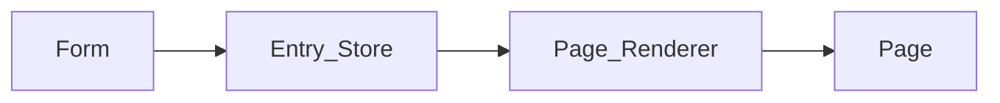

# Design Document

## Overview

The guest book is two small pure modules: an Entry_Store that validates and keeps entries, and a Page_Renderer that escapes and lists them.

## Architecture



The store never renders and the renderer never stores.

## Components and Interfaces

`src/guestbook/store.py` exposes `add(name, message, now)` and `entries()`.
`src/guestbook/render.py` exposes `render(entries)`.

## Data Models

```python
@dataclass(frozen=True)
class Entry:
    name: str
    message: str
    created_at: datetime
```

## Correctness Properties

### Property 1: Entries keep insertion order

*For any* sequence of valid submissions, `entries()` returns one Entry per submission in the order the submissions arrived.

**Validates: Requirements 1.1, 1.3**

### Property 2: Invalid submissions change nothing

*For any* store and any submission with a blank name or an oversized message, the store is unchanged and the submission is rejected.

**Validates: Requirements 1.2, 2.1–2.2**

### Property 3: Rendered text is always escaped

*For any* Entry, the rendered page contains the escaped name and message and no markup supplied by the visitor.

**Validates: Requirements 3.2**

## Error Handling

| Condition | Behavior |
|---|---|
| Blank name | Reject with `name_blank`; store unchanged |
| Message over 500 characters | Reject with `message_too_long`; store unchanged |

## Testing Strategy

Hypothesis property tests cover Properties 1 through 3 with at least 100 examples each. Unit tests cover the boundaries 1, 80, 81, 500, and 501.

## Requirement Traceability

| Requirement | Component | Verification |
|---|---|---|
| 1 | Entry_Store | Properties 1 and 2 |
| 2 | Entry_Store | Property 2; moderation unit tests |
| 3 | Page_Renderer | Property 3; golden page test |

## Decisions and Assumptions

- Verified: the standard library `html.escape` covers the five HTML metacharacters.
- Decision: entries live in memory for the MVP.
- Assumption: the host page can load without a framework. Spike S1 renders the page in a plain browser before the renderer task starts.
